# Gexis Player — User Manual

**Written for the release it ships with.** The screenshots use a demonstration library of
public-domain works: the album covers are paintings by Hokusai, Van Gogh,
Klimt, Kandinsky, Monet, Seurat, Marc, Rousseau, Hiroshige, Mucha, Gauguin
and others, the portraits are of the composers, and the lyrics are
Schiller's *Ode to Joy* (1785). The addresses shown are examples.

Gexis Player is a music player for the Raspberry Pi with a high-quality
DAC; it needs a Raspberry Pi 4 or newer, and the Pi 4 is the model it is
built and tested on. It plays your Lyrion (Logitech Media Server) library,
Spotify Connect, Bluetooth and Plexamp, one at a time, and switches to
whichever one you start. You control it
from its own touch screen (the *panel*), from any phone or computer on the
same network (the *phone page*), or from the apps you already use: a
Lyrion app, Spotify, or your phone's Bluetooth.

## Contents

1. [The panel at a glance](#1-the-panel-at-a-glance)
2. [Now Playing](#2-now-playing)
3. [The library](#3-the-library)
4. [Lyrion's own menus (Extended navigation)](#4-lyrions-own-menus-extended-navigation)
5. [When another source takes over](#5-when-another-source-takes-over)
6. [The idle screen and the visualiser](#6-the-idle-screen-and-the-visualiser)
7. [The phone page](#7-the-phone-page)
8. [Bar screens](#8-bar-screens)
9. [Settings](#9-settings)
10. [Updates](#10-updates)

---

## 1. The panel at a glance

The panel shows one of two places at a time:

- **Now Playing**: the track, its cover and the controls, whenever something
  plays.
- **The library**: your music, starting at **Home**.

The **mini strip** along the bottom of the library always shows what is
playing; tap it to go back to Now Playing. On Now Playing, the **Home**
button (bottom left) opens the library at Home, and the **Minimise**
chevron (top left) goes back to exactly where you were in the library.

*Home: the cards along the top, the newest albums underneath, and the mini
strip at the bottom. The row of cards scrolls sideways.*

**With the Lyrion client switched off** there is no library, and the
panel's home is the **waiting screen**: the clock, the date and the player's
name over the same picture as the idle screen, and each source waiting to be
played to pulsing at the foot - its mark, its name and its state, as under
the library. Start music from a phone
and the panel moves to Now Playing. Settings is the button in the top right
corner.

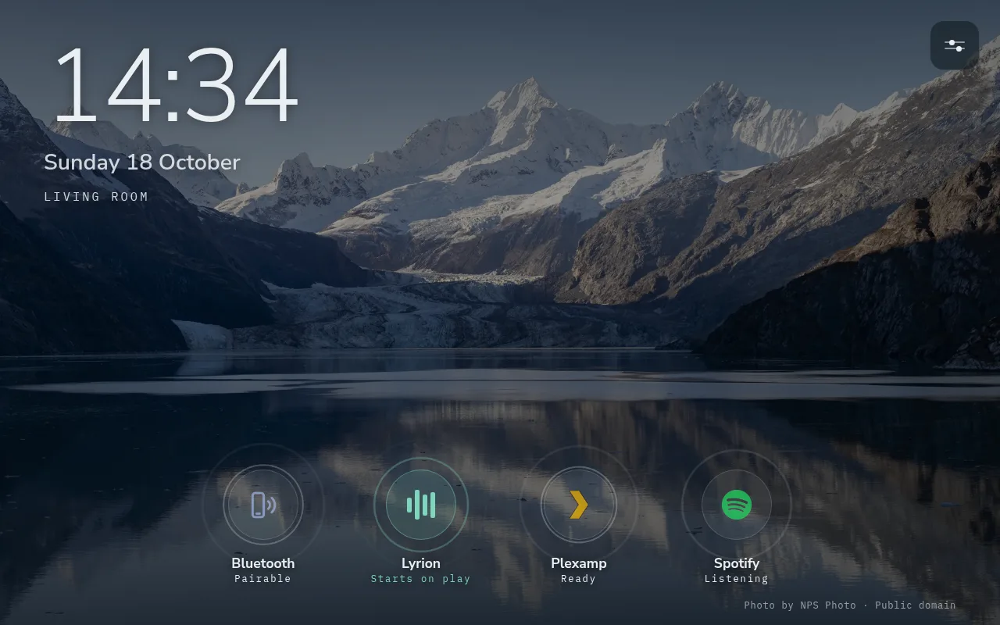

*The waiting screen, with the Lyrion client off: a public-domain wallpaper,
the four sources, and the picture's credit at the foot.*

Everything on the panel works by touch: tap to open, swipe to scroll. Lists
with many entries have a **letter rail** down the right-hand side; tap a
letter to jump there.

## 2. Now Playing

| Part | What it does |
| --- | --- |
| Cover | The album's art. With none from the source, the player looks one up. |
| Chevron (top left) | Minimise: back to the library where you left it. |
| Tabs | **Track**, **Lyrics**, **Artist**, **Release** (below). |
| Visualiser button (top right) | Shows the visualiser (section 6). |
| Progress bar | Elapsed and remaining time; tap to move through the track where the source allows it. |
| Home (bottom left) | The library, at Home. |
| Shuffle, previous, play/pause, next, repeat | As offered by the source playing. A source that cannot do something has that button greyed out. |
| Volume (bottom right) | Opens the volume drawer. |
| Queue (bottom right) | Lyrion's queue, with the number of tracks still to come. |

**Track** shows the title, artist, album and year, and, when the song has
synchronised lyrics, the current line and the next one. Tap the artist's
name to open their page in the library.

**Lyrics** shows the whole text, following the music when the lyrics are
synchronised.

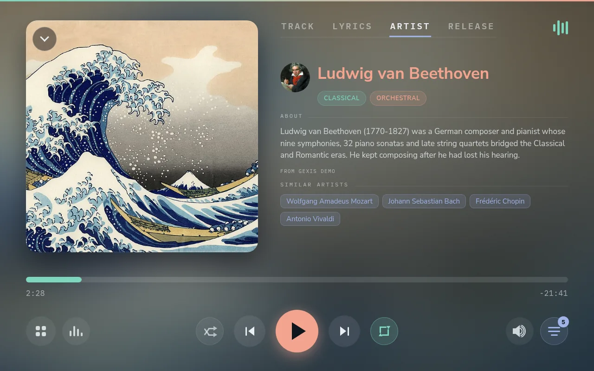

**Artist** shows a short biography, the artist's genres and similar artists.
Tap the artist's name for their page in the library, and a similar artist the
library has for theirs. On **Track** and **Release**, the album's title opens
the album's page.

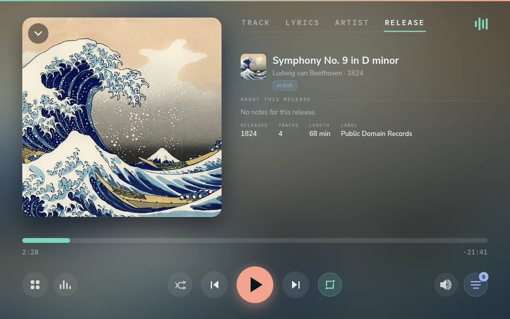

**Release** shows the album's year, number of tracks, length and label,
with a note about the release when one is available.

### The queue

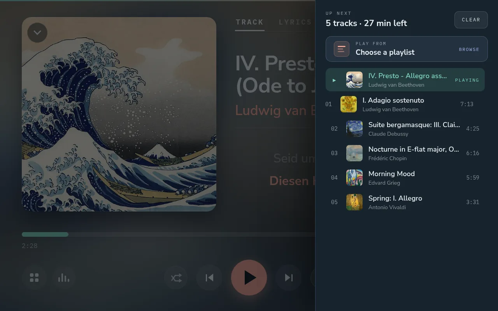

The queue lists what Lyrion will play next, with the time left. Tap a track
to play it; **Clear** empties the queue; **Play from** starts a playlist.

### The volume drawer

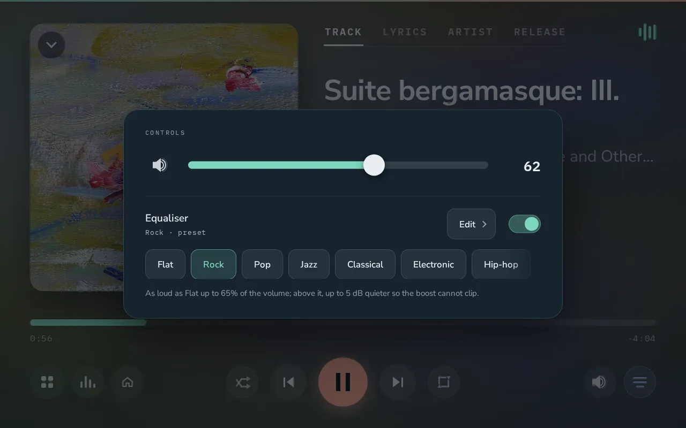

Drag the slider or tap along it. A drawer opened on the screen stays until
it is closed - a tap outside it - or the visualiser takes over or Home opens.
A change made elsewhere (a phone, a Lyrion app) can open the drawer too
(*Settings → Display → Show volume when changed elsewhere*); a drawer opened
that way closes by itself after *Volume drawer auto-hide*, stays open while
the phone's pointer rests on it, and ignores touches for a moment, so a tap
meant for what was under it does not set the level.

With **Volume** set to *Fixed*, the player always plays at full level
for an amplifier that sets the volume; the button then shows a padlock and
the drawer explains why. Mute still works there, where the output has a
volume control of its own (the HiFiBerry has; some USB DACs have none): the
drawer's speaker silences the output, the button shows the crossed speaker
while it is muted, and unmuting brings back the full level. *Maximum volume* and Spotify's *Starting volume* do
not apply in Fixed, and their rows are hidden. Changing the volume type
while music plays stops playback, and the sources reconnect on the new type,
so the level never jumps mid-track; the source that comes back starts no
louder than its *Starting volume*.

Under the volume sits the **equaliser**: the setting in use (*Rock ·
preset*), its switch, and the settings as a row of buttons to change to -
the presets, then your own. **Edit** opens the whole equaliser (see
[The equaliser](#the-equaliser)).

## 3. The library

The library is your Lyrion server's music. Home offers:

| Card | Opens |
| --- | --- |
| My Music | Lyrion's own library views (only with Extended navigation, section 4). |
| Browse | Three columns: artist, album, tracks. |
| Album Artists | Every album artist, with their portrait. |
| Playlists | Your Lyrion playlists. |
| Favourites | Your Lyrion favourites (Extended navigation). |
| New Music | The newest albums (also the row under the cards). |
| Radio | Lyrion's radio directory. |
| Apps | Lyrion's apps, such as streaming services (Extended navigation). |
| Settings | The player's settings (section 9). |

### Browse

Pick an artist, then an album, then a track. A tap on a row shows its
actions, and the row turns teal while they show:

- **Play** plays it now;
- **Add to queue** adds it to the end;
- **+** adds it to a playlist.

### Album Artists and the artist page

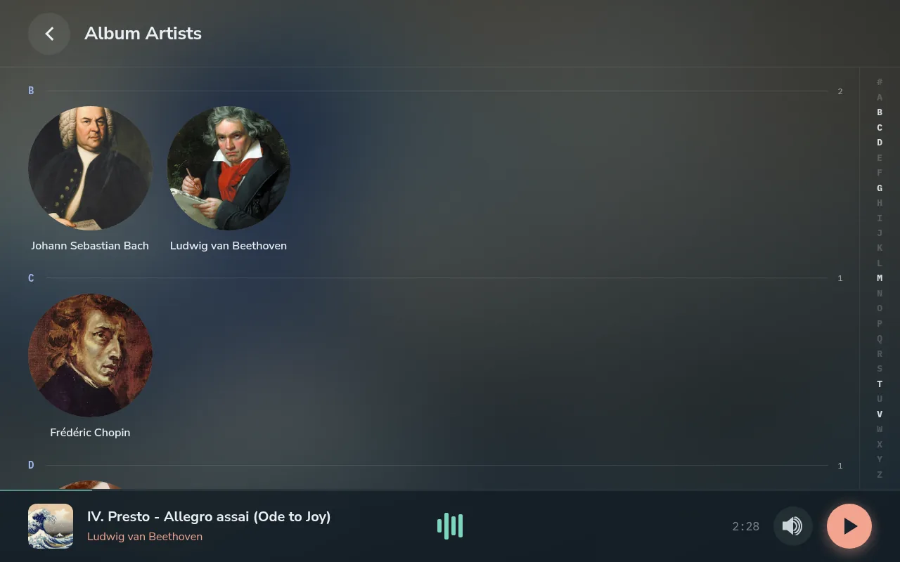

Artists are grouped by letter; tap a letter on the rail to jump.

An artist's page shows their portrait, genres and albums. It also has
**Play** and **Shuffle** for everything by them, a biography, their
*Popular* tracks and similar artists; a similar artist the library has opens
their page. A tap on a Popular track shows its actions, as anywhere else.

### Album page

**Play album** or **Add to queue**, and the tracks with their lengths. A
track by someone other than the album's artist - a guest on one song, every
track of a compilation - shows that artist under its title. Tap a track once
to show its actions, twice to play it.

### Playlists

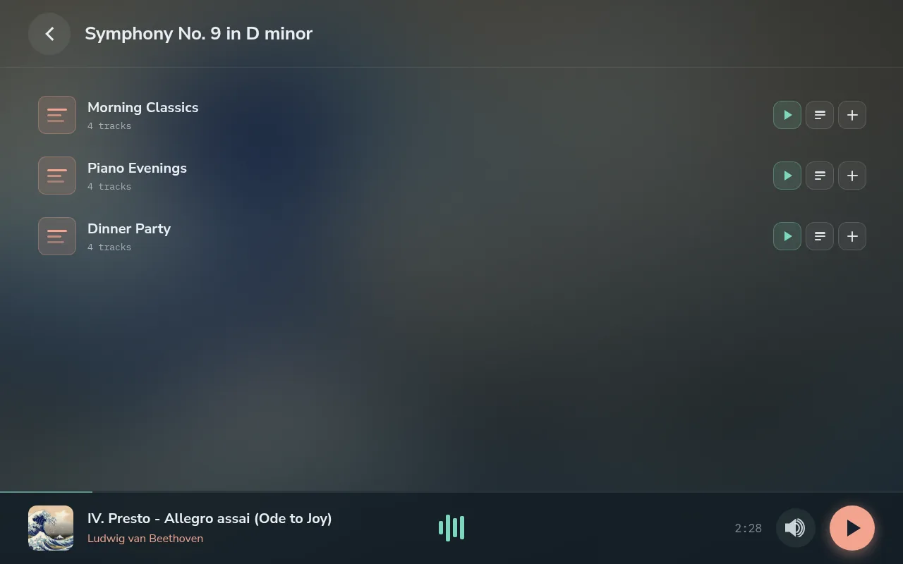

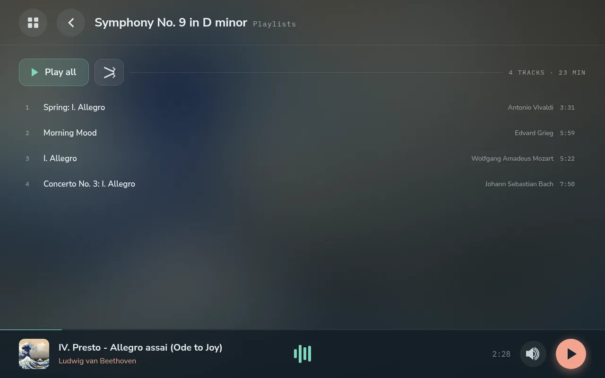

### Radio

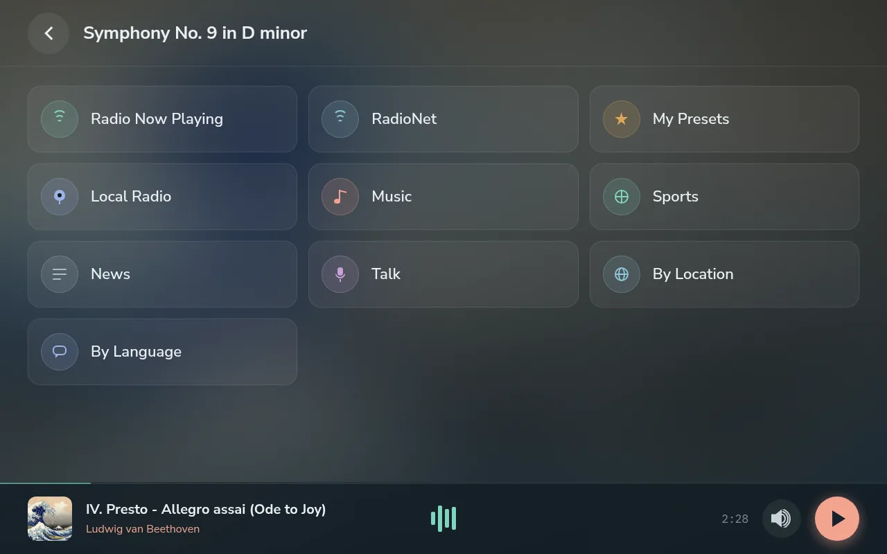

Lyrion's radio directory, by category. Tap a station once to show **Play**
and **Add**, twice to play it.

## 4. Lyrion's own menus (Extended navigation)

Choose **Extended** in **Settings → Sources → Lyrion Client → Navigation** and
Home gains **My Music**, **Favourites** and **Apps**: everything your Lyrion
server offers, including the apps it has installed.

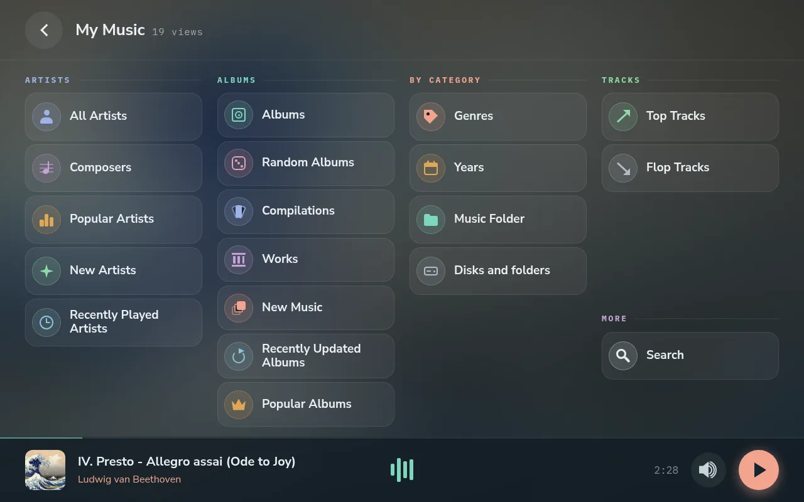

**My Music** groups Lyrion's library views:

| Group | Views |
| --- | --- |
| Artists | All Artists, Composers, Popular Artists, New Artists, Recently Played Artists |
| Albums | Albums, Random Albums, Compilations, Works, New Music, Recently Updated Albums, Popular Albums |
| By category | Genres, Years, Music Folder, Disks and folders |
| Tracks | Top Tracks, Flop Tracks |
| More | Search |

**Apps** lists the apps installed on your Lyrion server (streaming services,
internet radio and so on), each with its own logo and menus. A service's
first page can take a second or two to arrive; the panel says which service
it is waiting for. A service's playlist opens as a page of its tracks, each
with its artist under the title (a single artist's album shows titles only),
and its button says *Play playlist*.

**Search**: tap a search field and type on your phone (section 7); results
arrive as you type. A service's *Search* opens straight on its field, and
chosen from the phone's remote it brings up the phone's keyboard. My Music's Search looks for artists, albums, works,
songs and playlists at once.

A few things are left out on purpose:

- Lyrion's player settings, alarms and sync;
- album artists and playlists, which have their own cards on Home;
- entries that would change your streaming account (for example *Add to
  favourites*).

An album a service cannot stream in your region shows its tracks as *Not
available*.

## 5. When another source takes over

Only one source plays at a time. When you start Spotify, Bluetooth or
Plexamp from your phone, that source **takes over**: Lyrion pauses, a short
transition screen shows who took the player, and Now Playing shows the new
source. When that session ends, the player can give itself back to Lyrion
(*Settings → Handoff → Reclaim Lyrion when a session ends*, off by default), or
you can start Lyrion again from the panel.

Spotify starts at the **Starting volume** you set, however loud the Spotify
app was last time, so a takeover never starts at full volume.

## 6. The idle screen and the visualiser

After a while with nothing touched, the panel shows the **idle screen**: a
clock, the weather and a changing background picture. A touch brings back
what was there. *Settings → Display* sets when it appears and what it shows.
Between sunset and sunrise, the current weather shows the **moon** where it
would show the sun, lit as it is tonight where the player is; the forecast
days keep their sun.

The **visualiser** shows a VU meter or spectrum from a collection of skins,
drawn from the music as it plays. Open it with the visualiser button on Now
Playing or from the phone; touch the screen to close it. A spectrum's bars run from
the deep bass on the left (50 Hz) to the top of what recordings carry on the
right (16 kHz), the same at every sample rate. Each bar shows the music's own
level in its range, so a recording with little treble has short bars on the
right.

### A Home Assistant dashboard

The panel can show a **Home Assistant dashboard** - the room's lights,
blinds, scenes, whatever the dashboard holds - full screen, and everything on
it works by touch. The dashboard itself is made in Home Assistant; the player
only needs its address, set in *Settings → Display → Home Assistant
dashboard*.

- **To bring it up:** the dashboard button - in the pull-down controls on a
  bar, beside the visualiser button on Now Playing elsewhere, and on the phone
  page - or Home Assistant itself (an automation can call
  `POST /panel/dashboard/show` on the player). With *Dashboard instead of the
  idle screen* on, it comes up where the idle screen would during the times
  set.
- **While it is up**, the music goes on; a new track or the idle screen does
  not take the dashboard down. The volume drawer still shows over it, and
  display standby still turns the screen off.
- **The visualiser takes over from it**: opened from the phone, or coming on
  by itself after the visualiser's timeout while music plays, it takes the
  dashboard down and shows in its place.
- **To dismiss it:** the tab on the right edge of the screen, the phone's
  button, or `POST /panel/dashboard/hide`. A dashboard the schedule put up
  goes when its time ends, and the idle screen follows.

**What Home Assistant needs.** The player changes nothing in Home Assistant;
two things are set there, by whoever runs it:

1. **Allow it to be shown inside another page.** In Home Assistant 2026.10
   and later: *Settings → System → Network → HTTP server → More options*,
   turn off **Send X-Frame-Options**, then *Save and restart*. Keep that
   page open until Home Assistant is back: a change it does not see confirmed
   within five minutes is rolled back to the previous setting. (Before
   2026.10: `use_x_frame_options: false` under `http:` in
   `configuration.yaml`, then a restart; from 2026.10 that line is read once
   and then ignored.) Until this is done, the panel says so instead of
   showing the dashboard.
2. **Let the player in.** Either add the player's network to Home
   Assistant's *trusted networks* (`auth_providers` in `configuration.yaml`,
   with `allow_bypass_login: true`), so the dashboard opens without a login;
   or sign in once on the panel - Home Assistant then keeps the player signed
   in. To sign in, tap a field on the panel and type on a USB keyboard
   plugged into the player, or on the phone: while a field on the screen is
   chosen, the remote offers the phone's keyboard (tap *Typing on the
   player's screen* if it is not up). The phone types the characters the player's keyboard layout has (a US layout
   unless set otherwise); one it lacks is left out, and the phone says so.

Home Assistant's own header and side bar show unless the dashboard or the
user's profile in Home Assistant hides them. On a bar (1480 × 320), a
dashboard made for that shape reads best.

### The player in Home Assistant

Home Assistant can show each player as a media player and control it, with
the *Gexis Player* integration
([gexis-player-homeassistant](https://github.com/gcarstoiu/gexis-player-homeassistant)).
It is installed in Home Assistant by whoever runs it; the player changes
nothing there.

1. With HACS, add `https://github.com/gcarstoiu/gexis-player-homeassistant`
   under *Custom repositories* (type *Integration*), download *Gexis Player*
   and restart Home Assistant.
2. The player then shows under *Settings → Devices & services* as
   discovered: confirm it. One that does not show is added by its address -
   *Add integration → Gexis Player*, its name on the network (for example
   `livingroom.local`) and port 8090.

What Home Assistant gets:
- **A media player**: playing, paused or idle; title, artist, album, artwork
  and position; play, pause, next and previous when the source playing
  has them, shuffle and repeat where it has them - shown as on the player,
  greyed in the card while one cannot be used (Next on the last track);
  volume and mute, unless
  the output is fixed; the source playing (each source is taken over from
  its own app, as on the player).
- **On a player with a screen, four switches**: *Screen* (off is display
  standby), *Dashboard* (the dashboard above, up or down; unavailable until
  its address is set), *Visualiser* (unavailable when the output cannot feed
  the meters) and *Idle screen* (unavailable while the idle screen is
  switched off); **and three buttons**: *Home*, *Now
  playing* and *Lyrics*, which open them on the screen (the last two while a
  source is active).
- **On a player with a screen, a D-pad**: a remote, *D-pad*, whose commands
  `up`, `down`, `left`, `right`, `ok`, `back` and `home` move around the
  screen (*Moving around with a D-pad or a keyboard*, below).
- **A card for dashboards**: *Gexis Player*, in Home Assistant's card
  picker once the integration is installed - what plays with its artwork,
  the transport and the volume, a list to move to another player, and for
  the player's screen the quick actions - Home, Now playing, Lyrics, Meters,
  Room (the dashboard) and Idle, as on the phone, each left out where the
  phone leaves it out - and the D-pad. In the player's own
  look, or Home Assistant's (*look: home-assistant*); full, or compact with
  the D-pad folded away. It goes on a dashboard edited by hand (Home
  Assistant's new *Overview* takes favourite entities, not cards): *Settings
  → Dashboards → Add dashboard → New dashboard from scratch* if there is
  none, then on it the pencil, *+* in a section, the *By card* tab, and a
  search for *Gexis*.

It needs Home Assistant 2026.3 or later and a player on 1.5.0 or later (the
D-pad 1.6.0 or later); an older player is found and asked to update. With Home Assistant's own
*Lyrion Music Server* integration also set up, the player shows there too,
as Lyrion's player.

### Moving around with a D-pad or a keyboard

The screen can be used without touching it: with Home Assistant's *D-pad*
(above), or a USB keyboard plugged into the player.

- The **arrows** move a teal ring to the next control in that direction;
  **OK** (Enter) presses it, as a tap does; **Back** (Escape) closes what is
  open - a sheet, the volume, the tray - or goes back one step, and on Now
  Playing minimises it. On Home it does nothing.
- The ring shows at the first press, where it was last on that screen, or on
  the screen's main control (Play/Pause on Now Playing). A touch and the
  idle screen hide it. The phone's remote moves it too (section 7).
- On a slider, Left and Right change the value; Up and Down leave it.
- On a bar, Up from the top row brings the tray down.
- While the screen is dark, or the visualiser or the idle screen is up, the
  first press from Home Assistant only wakes the screen.
- Over the Home Assistant dashboard, the keys go to Home Assistant's own
  page; Back from Home Assistant's *D-pad* takes the dashboard down.
- Setup and updates are done from the phone.

## 7. The phone page

Open the player's address in a phone's browser, for example
**http://gexis.local:8090** (the name is your player's, chosen at setup).
Nothing needs installing; the phone and the player only need to be on the
same network.

The phone page is a **remote** for the player. At the top, the player's
name with what it is doing (*Playing · Lyrion*, *Paused · Spotify*,
*Idle*) and a switch between two pages, **Remote** and **Settings**. Tap
the name for every Gexis player on the network, each with what it is
doing, and choose one to open its remote in the same tab.

### The remote, with a screen

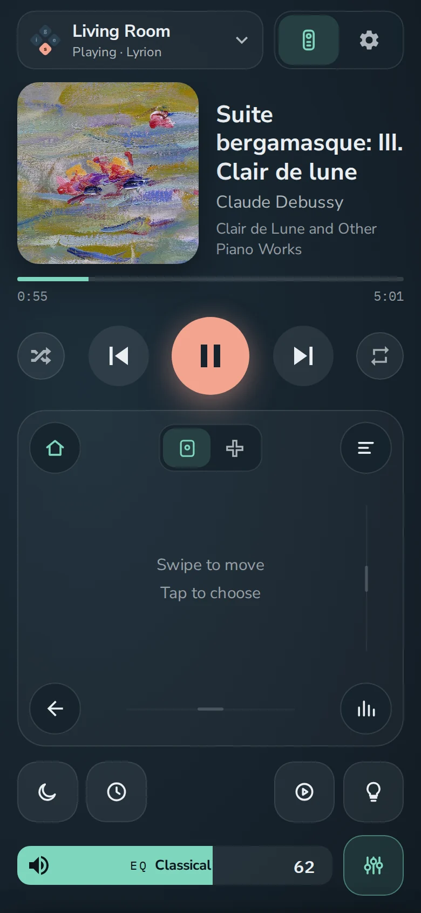

For a player with a screen, the remote has, from the top:

- **what is playing**: the cover, the track and the artist, beside them
  previous, play or pause and next, and under them how far into the track it
  is. Shuffle and repeat are on the player's own screen.
- **the touch area**, which drives the player's screen from across the room.
  Its corners are **Home**, **Lyrics**, **Back** and **Meters** (the
  visualiser); the one the screen shows is lit. The switch at its top
  chooses how:
  - **Trackpad**: a pointer on the player's screen, moved like a laptop's
    touchpad.

    | Gesture | Does |
    | --- | --- |
    | One finger | Moves the pointer on the screen. |
    | Tap | Presses what the pointer is on. |
    | Two fingers up or down, or sideways | Scroll what is under the pointer. |
    | One finger along the line at the right or the bottom | Scrolls with one finger. |
    | Pinch | Zooms the screen in or out around the pointer. |

    Whatever the pointer is over that can be pressed is outlined. The
    pointer hides after a few seconds of rest.
  - **D-pad**: the four arrows and OK, as buttons. A teal ring on the screen
    shows where you are, as with Home Assistant's D-pad.

  The phone remembers which of the two you used last.
- **quick actions**: **Standby** (the screen off until a touch, music
  starting or Standby again wakes it; the player keeps playing), **Idle
  screen** (while the idle screen is switched on), **Playing** (Now Playing,
  or back to the strip when it is up) and **Room** (the Home Assistant
  dashboard, once its address is set). While in standby the views are dimmed,
  and any of them, a corner or the touch area wakes the screen.
- **the volume**: tap or drag anywhere on the bar. The speaker at its left
  mutes and unmutes; the equaliser's setting is named in the middle. With
  *Fixed output* the bar is the panel's locked row: the level is set on the
  amplifier, and the speaker still mutes (where the output has a volume
  control of its own, as the HiFiBerry has).

Tap a text field on the screen (a search, for example), or press OK on one
with the D-pad, and the phone's own keyboard comes up: what you type appears
on the screen.

### The remote, without a screen

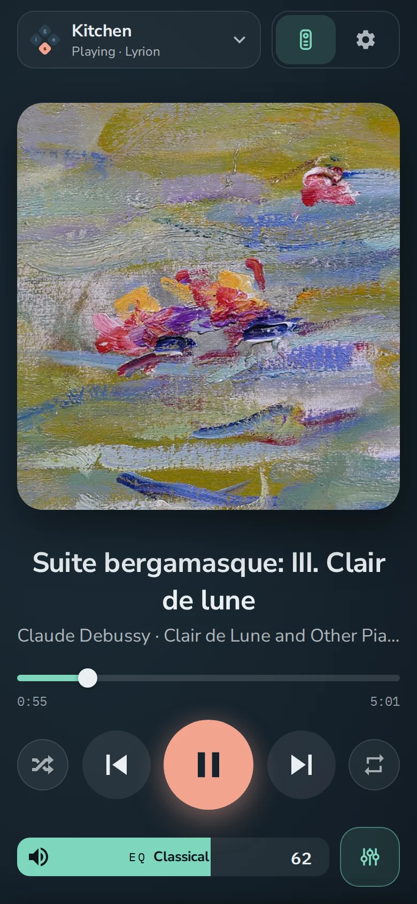

For a player without a screen there is nothing to drive, so the remote has
a large cover, the track, a bar to move through it (drag or tap; with Lyrion
and Spotify), larger controls and the volume.

### The equaliser

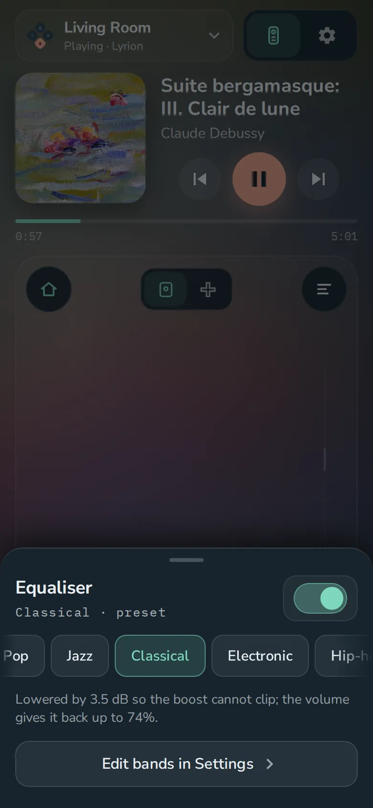

The button beside the volume opens the **equaliser**: its switch, the
settings as a row of buttons (the presets, then your own), and what it does
to the level. **Edit bands in Settings** opens the whole equaliser, where on
the phone each band is a row, a slider sideways from 0.

### Settings on the phone

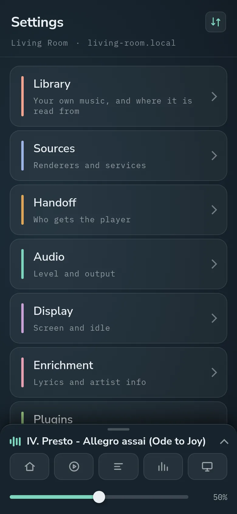

**Settings** has every setting, and the phone is the easier place to type a
name, a password or a key. *Settings → Display → Touchpad* has **Phone
touchpad** (off, the remote's touch area offers the D-pad alone, and no
typing), **Pointer speed** and **Pointer style** (Dot or Arrow).

## 8. Bar screens

On a wide, short *bar* screen (such as the tested 1280 × 400 and 1480 × 320) the same player is
laid out in strips: Now Playing on one line, and the library's lists run
sideways. A tray pulled down from the top holds Home, the volume and the
visualiser. On Now Playing, the **Minimise** button on the artwork points
right, to the mini strip it leaves you with, and sits where the library's
Back button does, at its size. With the Lyrion client off, the waiting
screen keeps the clock in a column on the left with the source tiles beside
it.

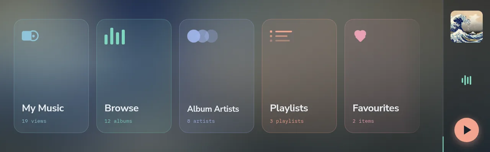

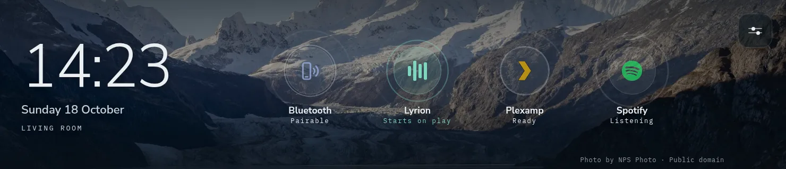

Pulled down from the top of any screen, the tray: Home, the visualiser,
the equaliser's button and the volume. It stays until it is closed - tap
below it, or push it back up - or the visualiser takes over or Home opens.
The equaliser's button names the setting in use; tapped, it opens a second
band under the first with the switch, the settings to change to and
**Edit**.

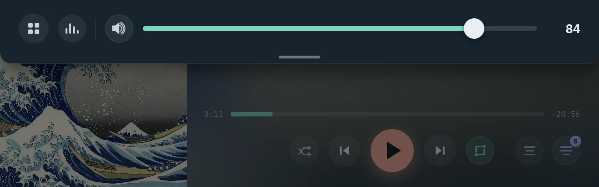

The library's lists run sideways, with a strip of letters to jump along
them.

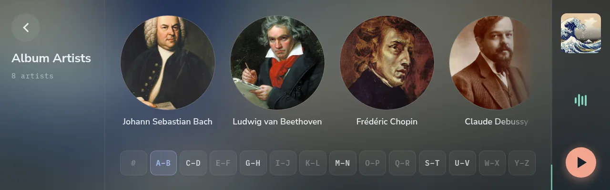

An artist's page and an album's: the picture on the left, what can be
played on the right.

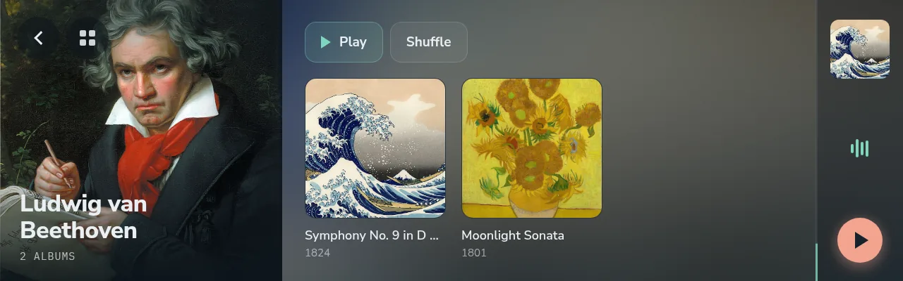

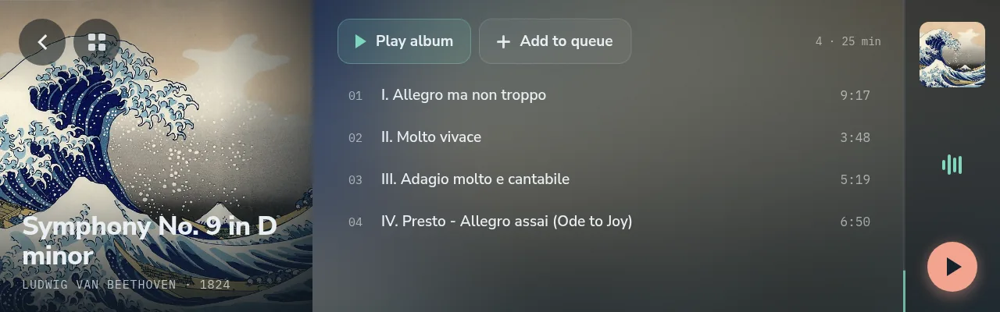

## 9. Settings

Settings is reached from the **Settings** card on Home, or on the phone
page. It is grouped into eight areas, listed down the left-hand side on the
panel.

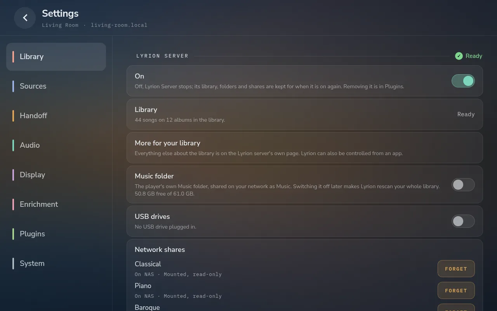

Tap a row to change it. A row that only applies in some cases (for example,
Spotify's *Starting volume* while Spotify is off) is hidden until it does.
Changes take effect at once unless the row says otherwise.

### Library — *Your own music, and where it is read from*

The **Lyrion Server** (a music server on the player itself) is switched
and set here. It reads only the music locations switched on, none at first:

| Setting | What it does |
|---|---|
| Lyrion Server: On | The server's own switch, also on the Plugins page. Off, it stops and its other rows are hidden; its library, folders and shares are kept for when it is on again. Its download, version and *Remove* are on the Plugins page only. |
| Lyrion Server: More for your library | Where everything else about the library is: a link to the server's own page, and to three apps that control it - Squeezer (Android), Lyrion (Android, F-Droid) and LyrPlay (iPhone). The links show on a phone, not on the panel. |
| Lyrion Server: Library | Read only: what the server is doing - starting, adding its add-ons, reading your music with a progress bar - and once ready, how many songs and albums it holds. The section's heading says the same in a word. |
| Lyrion Server: Music folder | The player's own Music folder, shared on the network as *Music*. Its note says how much room is free and how much there is in all. Below 4 GB free the Music share takes no new files, and the note says so, until more than 4.5 GB is free. |
| Lyrion Server: USB drives | Folders on USB drives plugged into the player. It cannot be switched on while no drive is plugged in, and says so; switched on already, it stays on. |
| Lyrion Server: USB folders | Shown with *USB drives* on. Each drive plugged in: tick it to add all of it, or open it and tick folders at any depth, then *Add*. A drive not chosen yet reads *Not added yet*; the folders of an unplugged drive are kept for 7 days. |
| Lyrion Server: Network shares | The shares added, each with its *Forget*. |
| Lyrion Server: Add share | Folders on a NAS or a computer (SMB or NFS): a scan lists the servers on the network, or add one by its address. Tick a share, or open an SMB share and tick folders at any depth, then *Add*. Shares already added are not listed again. |

Taking a location away later - a switch turned off, a USB folder removed, a
share forgotten - makes Lyrion clear its library and scan everything again,
which for a large library takes hours. A network share whose server does not
answer reads *Not mounted: the server did not answer*; the other shares are
still mounted.

### Sources — *Renderers and services*

| Setting | What it does |
| --- | --- |
| Lyrion Client: Enabled | Plays your Lyrion server's music. |
| Lyrion Client: Server | Which Lyrion server. Servers announce themselves on the network, each shown by its machine's name, else the library name set in Lyrion, else its address; typing an address is the fallback. Choosing another one restarts the player's software, so it is used at once. |
| Lyrion Client: Navigation | How you move around your library on the screen, one choice: **Simple** - the home tiles, albums, artists, playlists and radio; **Extended** - Lyrion's own menus as well: My Music, Favourites, Apps (section 4); **Off** - only what is playing and the sources, with no library to browse; Lyrion's apps on your phone still play to the player. |
| Spotify Connect: Enabled | The player appears as a Spotify Connect device. |
| Spotify Connect: Starting volume | The loudest Spotify starts at when it takes over. Hidden with Volume on *Fixed*. |
| Bluetooth: Enabled | The player accepts Bluetooth audio. |
| Bluetooth: Pairing | *Confirmation required* shows a six-digit code on the panel to accept; *PIN-free* pairs anything in range. |
| Bluetooth: Discoverable | Whether phones can find the player: *Always* (the default), *3 min after boot* or *Off*. With *Pairing* on *Confirmation required*, a new phone still has to be accepted on the screen. |
| Bluetooth: Trusted devices | Remembered devices; forget one here. |
| Bluetooth: Auto-trust on pair | Remembers a device once paired, so it reconnects by itself. |

Plugins add their own rows here once switched on: **Plexamp** (claim the
player into your Plex account).

### Handoff — *Who gets the player*

| Setting | What it does |
| --- | --- |
| Restore transport on return | What Lyrion does when it gets the player back: *Play only if playing* (it resumes only if it was playing when it was taken), *Always pause* or *Always play*. |
| Reclaim Lyrion when a session ends | Off by default. On, when Spotify, Bluetooth or Plexamp stops, Lyrion takes the player back; a phone that locks can end a Spotify session and switch the player to Lyrion without warning. |
| Show transition screen | The short animation when one source takes over from another. |
| Transition screen length | How long it stays up. |

### Audio — *Level and output*

| Setting | What it does |
| --- | --- |
| Output | Where the sound goes. If the chosen output is an HDMI port and its device disappears (a receiver switched off), the headphone jack plays until it is back, on its own volume rather than Fixed, and the row says so; the player returns to HDMI by itself. A USB DAC is shown by its maker, with a line saying what it reports it can take (for example *USB 2.0 · up to 768 kHz / 32-bit · native DSD*). An HDMI port shows what is on it - the screen by its model, a TV or receiver by its own name - and the sound it takes (for example *LG TV · up to 192 kHz / 24-bit*), or *takes no sound* for a display without any. Over HDMI the sound is not bit-perfect; HDMI has no volume control of its own, so its volume is Software or Fixed, and the visualiser moves only on Software. A USB-to-optical adapter is a USB sound card too: the one tested here (a Realtek *USB SPDIF Adapter*, into a DAC's optical input) is marked *Tested*, and since it has no volume control and feeds a device with its own, its volume starts at *Fixed* - the DAC or amplifier sets the level - unless *Software* is chosen. On a card that lacks a track's rate (that adapter takes 44.1, 48, 96 and 192 kHz, not 88.2 or 176.4), Lyrion's music is converted to the card's highest rate, 192 kHz, and Plexamp converts it itself; every rate the card takes still reaches it unchanged. A change of output while music plays stops playback; start it again when ready. |
| Sound card board | Most boards and every USB DAC are found by themselves. A board that is not (it does not show under Output) can be chosen here. *Tested* beside a board means played and measured by the project, or reported working by owners; a problem an owner reported shows as a line under it; other boards carry no mark. The same goes for *Output* and for the screens under *Attached screen*. |
| Volume | How the level is set. *Hardware* (default): by the sound card's own volume control, bit-perfect at every level. *Software*: by the player recalculating the sound, on any output; not bit-perfect below 100 %. *Fixed*: always full level, for an amplifier that sets the volume itself; it asks first. Any change of volume type stops playback while the sources reconnect on it. On a DAC that takes DSD natively (some USB DACs), *Fixed* also plays DSD files from Lyrion as DSD, unconverted, and the Fixed choice says so; otherwise DSD files are converted to PCM. A DSD file of more than two channels is always converted, and folded down to stereo. The visualiser stays still during DSD. On an output with no volume control of its own, such as HDMI, Hardware is greyed out and Software is used in its place. The level carries across between Hardware and Software. |
| Maximum volume | The loudest the player will go, on any input. At 80, 100 % on every control means that level. Hidden with Volume on *Fixed*. |
| Volume curve | How the slider's travel maps to loudness. *Cubic* (half travel is −15.5 dB) is the usual shape; *Linear* puts half travel at −30 dB. |
| Equaliser | Opens the equaliser, for the output in use; the row says what it uses (*Rock*, *Custom*) or *Off*. See below. |

#### The equaliser

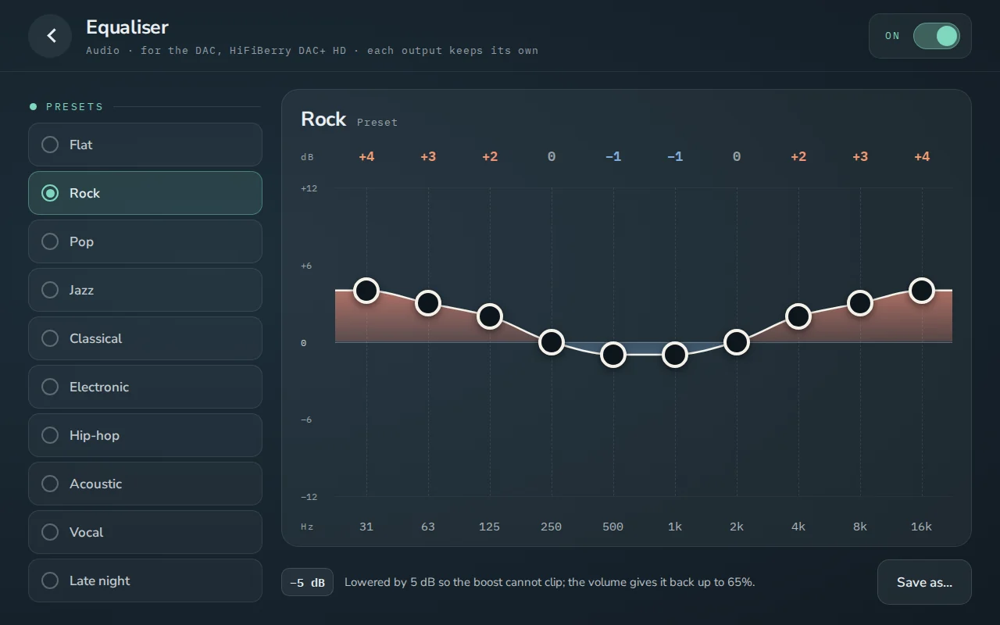

Ten bands, an octave apart from 31 Hz to 16 kHz, each from −12 to +12 dB.
**Each output keeps its own**: the DAC, HDMI and optical each remember
whether the equaliser is on and which setting it uses, and the page says
which output it is setting.

- **On or off**, at the top. Off, the sound is untouched, bit-perfect, as
  it always was. Switching it on or off reopens the output, so what is
  playing stops; start it again if it does not carry on.
- **A setting**: one of the presets - *Flat*, *Rock*, *Pop*, *Jazz*,
  *Classical*, *Electronic*, *Hip-hop*, *Acoustic*, *Vocal* and *Late
  night* (more bass and treble for listening quietly) - or one of your own.
  Choosing one is heard at once, and the bands move to it.
- **The bands**: drag one up or down; the change is heard as it moves.
  Moving a band of a preset or of one of your own makes it **Custom**
  (*From Rock · not saved*), until it is saved.
- **Save as…** keeps the bands as one of your own, under a name: up to ten,
  shared by every output. One of your own can be **renamed** or **deleted**;
  an output that uses a deleted one goes back to *Flat*. On the panel, type
  the name with a keyboard plugged into the player or from the phone's
  touchpad.
- **The note under the bands** says how far the music is lowered so that a
  boost cannot clip, and that the volume gives it back - *Lowered by 5 dB so
  the boost cannot clip; the volume gives it back up to 65%* - or that
  nothing is lowered when no band rises. Up to that volume a setting plays
  as loud as *Flat*; above it, a little quieter, up to the lowering at
  100 %, and the quick change says so. With *Volume* on *Fixed* there is no
  volume to give it back with: the music plays that much quieter, and the
  note says to turn the amplifier up to match.
- **DSD** plays untouched: while a DSD track plays natively, the equaliser
  stands aside, and it is back for the next PCM track.

Every source plays through it - Lyrion, Spotify, Bluetooth and Plexamp -
and the visualiser shows the music as it arrives, before the equaliser.

### Display — *Screen and idle*

| Setting | What it does |
| --- | --- |
| Personalise | Asks again, on your phone, how you listen, whether the phone's touchpad works the screen, and what the screen shows - the questions after first-time setup - starting from what the player has now. The player's screen shows a code to the page. |
| Attached screen | The display in use, by its name (a TV by the name it gives). **Change** picks the screen's model from the list, by maker; it sets the layout, Standard or Bar, and which visualiser skins are offered. A screen not in the list is shown as *Other screen* with its size. A DSI screen the Pi finds by itself - the Raspberry Pi Touch Display and those built to answer as one - is shown as *Raspberry Pi Touch Display or compatible* until its model is picked. Another DSI model needs a line in the Pi's boot settings, which choosing it writes: the player restarts and asks *Keep this screen?*, and goes back by itself if the screen stays dark. A four-lane DSI model is listed only on a Pi 5 or a Compute Module: a Pi 4's display connector carries two lanes. |
| Screen port | Which port the screen is on: *DSI*, the Pi's own display connector, when a DSI screen is connected, and the HDMI ports. A DSI screen is the screen unless an HDMI port is chosen here, which leaves the DSI screen black. The tile and its list show what is plugged into each port - the screen, another device by its name (a sound bar or receiver), *sound* when the sound goes to that port; a port with nothing connected is greyed. A change that alters the picture restarts the player and asks *Keep this screen?*. The port chosen stays the screen, even with a touch panel on the other port. **A TV can be the screen**: it runs at 1920 x 1080 (or the largest 16:9 size below it that it offers), and since it has no touch, *Keep this screen?* is answered on the phone page, as for any screen not in the list. A listed touch screen is answered on itself, and on the phone page too when the player cannot tell that its touch works. A touch panel left on the other port is switched off. A port that is not the screen shows black. If the TV crops the edges of the picture, set its picture size to *Just Scan* or *Original*. When the TV's port also carries the sound, display standby only blacks the picture, so the music goes on. On a board with one HDMI port, the row only says what is on it. |
| Text size | How large the writing on the player's screen is: 90 % to 130 %, 100 % as it comes. The screen changes at once; Home's tiles grow with larger text. Pictures, buttons and the layout keep their size, so long titles are cut short sooner at large sizes. A phone keeps its own size. |
| Screen rotation | For a screen mounted the other way up. |
| Screen brightness | How bright the screen's backlight is, 10 % to 100 % (100 % unless changed); applies at once. Only on a screen whose backlight the player can set: a DSI screen. |
| Headless | Turns the player's screen off; settings that only affect the screen are hidden while it is on, the screen in use, its ports and its rotation included. |
| Display standby: Scheduled standby, Standby times | With *Scheduled standby* on, the screen goes off during the standby times whenever nothing is playing (on a DSI screen, its backlight). Up to six times, each a start and an end - picked from a grid of hours and quarters - on the chosen days; one may run past midnight, counting for the day it starts. |
| Display standby: Back to standby after | A screen woken during a standby time goes dark again after this long with no touch and nothing playing (2 minutes unless changed; up to 30). |
| Home Assistant dashboard: Dashboard address | The address of the room's Home Assistant dashboard. Home Assistant has to allow it to be shown and let the player in - see [A Home Assistant dashboard](#a-home-assistant-dashboard). Empty, nothing of the dashboard shows. |
| Home Assistant dashboard: Dashboard button | The button that puts it up: in the bar's pull-down controls, beside the visualiser on Now Playing, and on the phone page. On unless changed, once an address is set. |
| Home Assistant dashboard: Dashboard instead of the idle screen, Dashboard times | At the times set - the same grid as the standby times - the dashboard comes up where the idle screen would. Off unless changed. |
| Touchpad: Phone touchpad, Pointer speed, Pointer style | The phone's touchpad (section 7). |
| Volume: Show volume when changed elsewhere | A phone's volume change opens the drawer; the panel's own changes do not. |
| Volume: Volume drawer auto-hide | How long the drawer stays when a change from elsewhere opened it. |
| Photo service and location: Pixabay API key, Location | Shared by both screens below. The key is for online wallpapers (Pixabay, free). The location is for the weather and for the wallpapers' seasons and holidays; until one is set, the country comes from the time zone. |
| Home screen: Home screen list, Items in the strip | With the Lyrion client on: what the row under Home's cards shows, and how many. |
| Home screen: Clock on the waiting screen | With the Lyrion client off: the time, date and name in the top left. |
| Home screen: Background and the rows after it | With the Lyrion client off: the waiting screen's own picture, set apart from the idle screen's, with the same rows as below (no artist pictures). |
| Idle screen | On or off. Off (the default on a new player), the panel stays on what it shows and the rows below are hidden. |
| Idle screen: Screen, Timeout | The built-in clock-and-weather screen, or an external page; and after how long, with nothing playing and nobody touching the panel. |
| Idle screen: Background | **Gexis wallpapers**, the player's own pictures; artist pictures from the library, which show the player's own while the Lyrion client is off; online wallpapers (Pixabay); pictures on the device; or black. |
| Idle screen: Wallpaper topics | With online wallpapers. *Space* (galaxies, nebulae, astronomy) and *Calm* search Pixabay's selected photos; the others are Pixabay's own categories. Choosing several mixes them. On a bar, panoramas are mixed in with the other photos. |
| Idle screen: Wallpaper styles, Follow the time of day | With Gexis wallpapers: the chosen styles (Calm, Colourful, Psychedelic), and the hour's pictures (dawn, day, dusk, night). |
| Idle screen: Seasons, Holidays | *Seasons*, with Gexis wallpapers: the season's pictures join the styles, by hemisphere. *Holidays*, with Gexis wallpapers or online wallpapers: on New Year, and on Christmas and Easter where they are public holidays, only those days' pictures show; Easter follows the Western or Orthodox date by country. |
| Idle screen: Background brightness, Change the picture every | How dark the picture is behind the text, and how often it changes. |
| Idle screen: Clock, Clock format, Weather, Forecast, Weather icons | What the idle screen shows over the picture; forecasts come from Open-Meteo. *Weather icons* draws them in one of seven styles: Solid, Duotone, Neon, Modern (frosted glass), Futuristic (a heads-up display), Photographic (the real Sun and Moon, from NASA photographs) and Atmospheric. |
| Idle screen: Weather icon motion | *Animated* or *Static*. Animated icons use about half of one of the Pi's four processor cores while the idle screen is up; Static uses almost none. |
| Visualiser: Timeout, Stop when nothing is playing | When the visualiser takes the screen while music plays, and when it gives it back. |
| Visualiser: Skin type, Rotate skin per track, Skin | Which skins it uses; tap a skin to preview it, then *Use this skin*. |
| Visualiser tweaks | How the bars and needles move, how far the needles follow the volume, how high they read (*Gain*), and whether turntables and tapes turn. Only what the chosen *Skin type* draws is listed: the spectrum's smoothing for skins with a spectrum, the needles' rows for skins with meters, the turntables' and tapes' animation for those (and Fanart, mostly turntables), and the record speed for turntables. *All* lists everything. |

### Enrichment — *Lyrics and artist info*

| Setting | What it does |
| --- | --- |
| Enrichment | Looks up what a source does not send: lyrics, biographies, covers, artist pictures. |
| Lyrics | Fetches lyrics, synchronised where available. |
| Look up missing artwork | Finds a cover for sources that send none (Bluetooth, radio). |
| ListenBrainz token | For the artist page's *Popular* list; a free token. |
| fanart.tv key, TheAudioDB key | Optional keys for artist pictures and album covers. |
| Confidence threshold | How sure the match must be (recommended 90 %). Below it, nothing is shown rather than something wrong. |
| Lyrion Client: Find portraits and covers | Looks up every album artist's portrait and every album's cover, keeps Lyrion's where none is found, and shows what the last run found. |

### Plugins — *What is installed beyond the player itself*

Optional parts, each with its own switch: the **visualiser skins** for this
screen's size, **Plexamp**, the **Lyrion Server** and the **Beszel**
monitoring agent, among others. A plugin that needs software from its maker
downloads it when switched on. Setup offers the same plugins, and the first
start shows each download arriving. A plugin file can also be uploaded here.
Each plugin's switch says its version (for example *Version 0.4.7*); the
software it downloads is named, with its own version, on the line below once
it is installed.
While Beszel is on, its heading in **System**, above the hub address, token
and key, says whether the agent has reached its hub: **Connected** in green,
**Connecting** in orange for its first minute, **Not connected** in red after
that. A Hub public key that is not one is refused when it is saved.

### System — *The player, its network, updates and maintenance*

Everything about the player itself, under seven headings.

**This player**

| Setting | What it does |
| --- | --- |
| Device name | One name for everything: the network address (*name*.local), the Lyrion player, the Spotify device and the Bluetooth name. A name is one line of text. |
| Time zone | Taken from the network; set it by hand only when that is wrong. |

**Network**

| Setting | What it does |
| --- | --- |
| Wi-Fi | The networks in range and the ones the player knows. The connected network shows its speed; tap it to see its signal (dBm and %), speed, band and channel, and the player's address, updated every few seconds. A closed lock marks a secured network that needs its password; an open lock, one whose password the player already has. Under the connected network's details, its address can be set by hand the same way as the cable's, and kept the same way. |
| Cable | Shown while a network cable is plugged in: *Connected · 1000 Mb/s · address*. Tap it to see the address, gateway and DNS, and to set the address by hand (*Manual*: the address with its prefix, the gateway, one or two DNS servers) or back to *Automatic*. After *Save*, open the player at its new address and tap *Keep* within 60 seconds; otherwise the old address comes back by itself. While the cable is in, the Wi-Fi is off and its networks stay saved; unplug the cable and the Wi-Fi connects again by itself. |

**Updates**

| Setting | What it does |
| --- | --- |
| Software update | What is installed, what is waiting, and *Check for updates* / *Update* (section 10). |
| Change logs | What changed in the last 10 releases. |
| Updates | *Automatic* installs a waiting release at night, never while playing. |
| Update channel | *Testing* gets each release first, *Stable* once it has been tried. Recommended: Stable. |

**Backup and reset**

| Setting | What it does |
| --- | --- |
| Back up now | Saves the settings, the library's pictures, the paired devices and the device's configuration into the Backups share. |
| Restore | Puts a backup from the Backups share back and restarts the device. On a phone or computer, *Download* beside a backup saves it there, and *Add a backup* puts one from there in the list (checked first; it is not restored until you choose it). A backup that is empty or damaged says so on its line and offers only *Forget*. A freshly flashed card can restore one during setup instead, straight from the phone: setup asks for this player's output (with its volume type) and screen, and its *Check it over* lets you change the name too. |
| Reset to factory settings | Puts the player back as on a freshly flashed card, then restarts into setup. Everything goes: every setting and the name, the settings and idle page chosen when the card was flashed, the Wi-Fi networks, paired devices and sign-ins, the skins and plugins, the Lyrion Server's library, the screen's browser data, and the backups kept on the player (the Backups share stays, empty). The music folder, its playlists and the Pictures share stay. Download a backup first under *Restore*. To confirm, hold *Hold to reset and restart* for 3 seconds, until its bar fills; letting go earlier cancels. The screen and every phone then say the player is resetting; a phone also says how to reach setup. The installed version stays. |

**Help**

| Setting | What it does |
| --- | --- |
| Problem report | On a phone or computer, three steps. What happened: in your own words, and how often. Preparing: the player gathers its logs, versions, hardware and settings, ticking each line of a checklist as it goes - including what it took out: addresses, names, networks, shares, keys and what you play. Send: *On GitHub* opens the report there filled in with what happened and the log's last errors (needs a GitHub account; the full file can be dragged onto it too), or *By e-mail* downloads the file to send to the address shown. Nothing leaves the player until you send it; read the file first. The prepared report stays on the player for an hour. On the screen it says where to open it instead. |
| Hardware feedback | On a phone or computer, three steps. The screen: a test pattern on the player's screen, with four circles to tap on a touch screen, which measures where the touches land, and two questions. The sound: a short test tone at 44.1, 96 and 192 kHz played at the current volume (not while a source holds the sound card, even paused: stop it first), and three questions. *Did the music sound right?* must be answered: GitHub needs it. Anything else: your own notes, if any, and what the player adds for you, to read before it goes. Without a screen, or with Headless on, it starts at the sound and has two steps. Then the same Send step as the problem report: *On GitHub* opens the feedback there, filled in with what the player reads of them (never a serial number or anything about you) - *Create* on GitHub sends it - or *By e-mail* downloads it as a text file to send to the address shown. The player keeps the last one: the row shows when it was made, with *Send again* and *Start over*, until the sound card or screen changes. It helps others see what works before buying. A week after a sound card or screen that is not Tested is first used, a line at the top of System offers it once; × puts it away for good. |
| Debug logs | Keeps the logs across restarts, for tracking down a problem. |
| API explorer | For building apps and home automation: shows the player's API at its address followed by `/api`, where every route is described and can be tried against this player - restart and reset included. Off by default. |

**About**

| Setting | What it does |
| --- | --- |
| Legal, Credits | The licences, and everyone whose work is in the player. |

**Power**

| Setting | What it does |
| --- | --- |
| Reboot | Restarts the device; playback stops. |

## 10. Updates

When a new release is waiting, **Settings → System → Software update** shows
it with its notes. A player several releases behind shows the notes of every
release it skips, newest first, each under its number and date. What it
shows is from the last check, which runs every night; **Update…** checks again
first, so it offers what the channel holds now, with its notes. **Update**
runs six steps, each ticked as it finishes:

1. download;
2. back up the settings;
3. stop playback;
4. install;
5. restart the player;
6. check that it answers.

The panel shows the steps full-screen and keeps them up, all ticked, until
you press **Done**.

The backup from step 2 is listed under *Restore* as *before an update*. The
player keeps the newest three of these and deletes older ones; a backup made
with *Back up now*, or copied into the Backups share, is never deleted.

*Check for updates* pressed while an update is being installed - the
automatic one at night included - shows that install's steps instead, with
*An update is being installed. Check for updates again once it has finished.*

On the player's own screen, *Update* (or *Continue*, when music is
playing) goes straight to the full-screen update view.

If something goes wrong during the install, the player puts the previous
release back by itself. If an update stops without finishing, the panel lets
go after about half a minute, and *Software update* shows what the updater
last reported. When the player starts again after a power cut during the
install, it finishes the install and restarts once more, or puts the
previous release back. An install found cut short later, by *Check for
updates* or the check at night, is finished once nothing is playing, and
the device restarts; while music plays, it waits.
