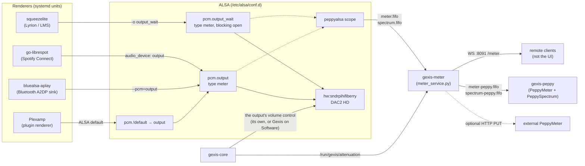
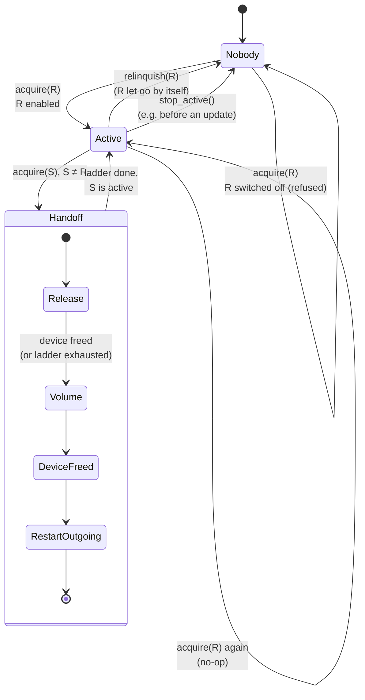
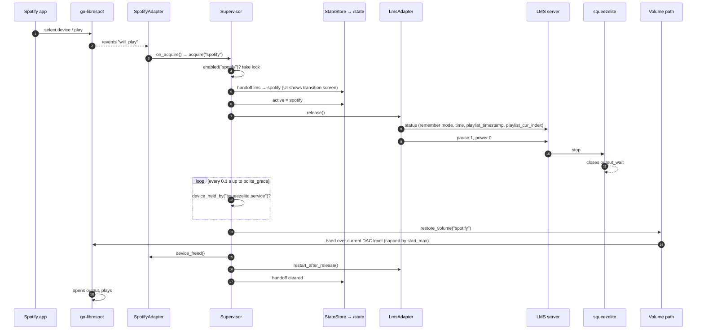
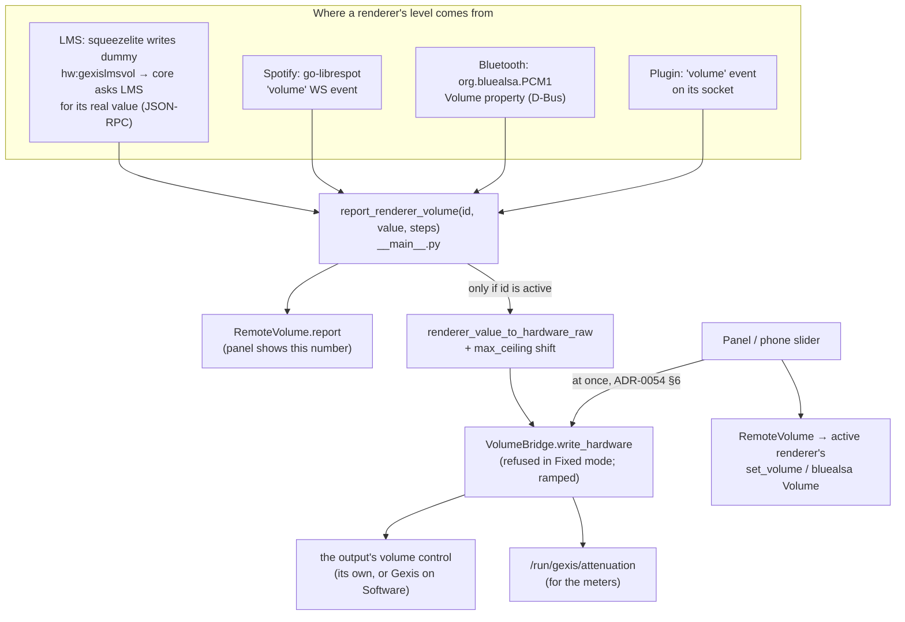
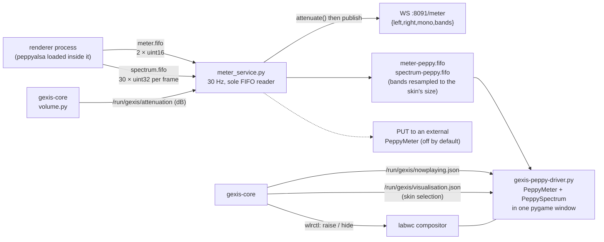

# The audio path

How sound gets from a renderer to the DAC, who decides which renderer may play,
how volume works, and how the meters and visualiser get their data.

The short version: **one renderer at a time writes to one logical ALSA device,
`output`; the core daemon decides who that is; volume is applied once, in the
output's own volume control on Hardware or in the software stage inside
`output` on Software; and a tap inside `output` feeds the visualiser.** There is no sound server and no mixing (ADR-0008).

## The audio graph



Every arrow into the DAC is a single, unconverted stream. The DAC advertises
S16_LE, S24_LE and S32_LE at 44.1–192 kHz; a format it does not take is
refused rather than converted, because nothing in the chain is a `plug`
(ADR-0009), with one deliberate exception for HDMI described under
[Choosing an output](#choosing-an-output).

## The logical device

`image/stage-gexis/00-alsa/files/output.conf` is installed as
`/etc/alsa/conf.d/output.conf` and defines everything a renderer touches:

| Name | What it is | Who uses it |
|---|---|---|
| `pcm.output` | `type meter` over `hw:sndrpihifiberry`, with the peppyalsa scope | go-librespot, bluealsa-aplay, and (through `default`) Plexamp |
| `pcm.output_wait` | The same chain, but the slave is opened with `nonblock 0` so a busy DAC makes the open *wait* instead of failing (ADR-0095) | squeezelite only |
| `gexis_softvol`, `gexis_softvol_wait` | **With Volume on Software (ADR-0124, ADR-0127):** `meter → copy → softvol → card`; on HDMI `meter → copy → softvol → plug → card` (the meter there since 2026-10-07, Finding 116; HDMI on Fixed is `plug → card` with no meter). One control for both, `Gexis Playback Volume` (`Gexis` to amixer), -90..0 dB in 0.25 dB steps; at 0 dB it passes every sample unchanged (Finding 115). Before any renderer starts, `gexis-softvol-restore.service` (ADR-0140) makes the control and writes the saved level, so a renderer resuming after a power cut never plays through it at the 0 dB ALSA makes it with; the core makes it again at start and sets the same level (`softvol_boot.start_level`), parks the card's own control at 0 dB only after that level reads back, and gives the card the level back when Hardware is chosen again. On every change of output the core closes its mixer handles and frees libasound's cached configuration (`volume.forget_mixers`): a running process otherwise keeps resolving `output` to the card it first saw | every renderer, through `output` / `output_wait` |
| `gexis_eq_out` | **With the equaliser on (ADR-0162):** what CamillaDSP plays to - the rest of the output's chain: `hw:` the card, `plug → card` on HDMI, `gexis_softvol → card` on Software. `pcm.output` and `pcm.output_wait` then end on the loopback, `hw:Loopback,0,0` (see [The equaliser](#the-equaliser)) | CamillaDSP |
| `ctl.output` | The DAC's control interface, so `amixer -D output` and the core reach the hardware mixer by name | gexis-core |
| `pcm_scope.peppyalsa` | Level and 30-band spectrum analysis, written to FIFOs in `/run/gexis` | loaded inside whichever renderer has the device open |

`zz-gexis-default.conf` adds `pcm.!default "output"` (ADR-0085). It exists
for software that builds its own device list and cannot be pointed at a
custom PCM name; Plexamp is the case that forced it.

**The card is always named, never numbered.** The HiFiBerry's index differs
between machines because the onboard audio devices come first; everything
uses `hw:sndrpihifiberry` or the `output` indirection. `core/src/gexis_core/alsa.py`
resolves the id to a number only at the moment it needs a `/dev/snd` path.

Why `output_wait` is squeezelite's alone: alsa-lib opens `hw` devices
non-blocking by default, so a renderer that opens while the previous one is
still releasing gets `EBUSY` at once. squeezelite then sleeps a fixed 5 s;
a blocking open removes that gap. Only one renderer is allowed to wait, so
two waiters can never deadlock each other (ADR-0095 as amended).

## The renderers

Renderers are upstream binaries, run as shipped; we configure them but do
not build or patch them (ADR-0093). Each is a systemd unit. The core talks to
each through that renderer's own control API, via an **adapter**
(`core/src/gexis_core/adapters/`).

| Renderer | Unit | Control channel (adapter) | Acquisition event | Release |
|---|---|---|---|---|
| Lyrion (LMS) | `squeezelite.service` | LMS JSON-RPC + CometD push (`adapters/lms.py`) | the player's LMS **power** going on (`power_on`) | record transport + position, `pause 1`, `power 0` |
| Spotify Connect | `go-librespot.service` | go-librespot local HTTP API + `/events` WebSocket on port 3678 (`adapters/spotify.py`) | `will_play`, `active` or `playing` events | `POST /player/pause`, short settle, `POST /player/stop` |
| Bluetooth | `bluealsa-aplay.service` (with `bluealsa` and BlueZ) | BlueZ over D-Bus (`adapters/bluetooth.py`) | `MediaTransport1` or `MediaPlayer1` appearing | `Device1.Disconnect()` |
| Plugin renderer (Plexamp) | the unit named in the plugin's manifest | JSON lines over a Unix socket (`adapters/plugin.py`, ADR-0084/0089) | the plugin sends `acquire` | the plugin is sent `release`, then the core kills the unit (ADR-0091) |

Notes per renderer:

- **squeezelite** runs `-o output_wait -O hw:gexislmsvol -V Master -C 1`.
  `-C 1` closes the device after one idle second. `-O/-V` point its mixer at
  a private dummy control rather than the DAC (see [Volume](#volume)).
  `squeezelite-mixer-check.sh` runs as `ExecStartPre` and refuses to start if
  that control is missing, because squeezelite would otherwise fall back to
  software volume silently (ADR-0018). The player name comes from
  `/etc/gexis/device-name.env` (ADR-0048).
  **It is our own build**, `gexis-squeezelite` (ADR-0145,
  `packaging/squeezelite/`): the commit Debian trixie packages, Debian's
  build options, and `squeezelite-downmix.patch`, which **folds a file of
  more than two channels down to stereo** in the decoder, before anything
  else sees it - the Squeezebox protocol carries two channels, and upstream
  played a 5.1 FLAC's front pair alone, refused a 5.1 WAV and kept two of a
  DSD file's channels (Finding 121). The fold-down is ffmpeg's default
  (ITU-R BS.775): left = front left + 0.707 centre + 0.707 each left
  surround, right likewise, a back centre 0.5 to both, LFE left out, every
  coefficient divided by the larger side's sum so that nothing can clip
  (5.1 plays 7.7 dB below its front channels' level). It is computed in
  double precision from every channel left-aligned to 32 bits (`downmix.c`).
  Channel orders: FLAC's specification; WAV's channel mask when the player
  reads the header itself, otherwise (the format given in Lyrion's `strm`)
  the default (SMPTE) order; AIFF the same as WAV, logged as assumed; DSF its
  channel type; DSDIFF its channel IDs.
  **DSD with more than two channels is converted to PCM** (dsd2pcm, every
  channel) and folded, even with `-D` - one-bit audio cannot be mixed. AAC
  is folded by FAAD2 itself (`downMatrix`, set upstream), 2.2-2.3 dB below
  our fold. Each folded track logs `downmix: N channels folded to stereo
  (<layout>)` at warning level, so it is in the journal. Stereo and mono take
  upstream's code path untouched: byte for byte the same output
  (`packaging/squeezelite/tests/`). **Opus** with more than two channels goes
  through opusfile's own `op_read_stereo` (George, 2026-10-13): upstream read
  every channel into a buffer sized for stereo and unpacked it as stereo,
  garbled. Not folded, until Phase 15 (`ph-mpd`): Ogg Vorbis (refused
  upstream: "too many channels") and ALAC (ffmpeg: "unsupported number of
  channels").
- **go-librespot** is configured (`go-librespot-config.yml`) with
  `audio_device: output`, `external_volume: true` (it never attenuates the
  stream itself) and `normalisation_disabled: true`, so Spotify reaches the
  DAC at full scale like the other renderers (ADR-0052 §6). Its API listens
  on a fixed port so the adapter can find it. The device name in that file is
  rewritten by `core/src/gexis_core/device_name.py`.
- **Bluetooth** is A2DP sink only (`bluealsa -S -p a2dp-sink`).
  `bluealsa-aplay --pcm=output --volume=none` keeps bluealsa in pass-through
  mode: no software volume, and no mixer for it to write. The core reads and
  writes the phone's level directly over bluealsa's D-Bus API
  (`bluealsa_volume.py`, ADR-0054 §1). Pairing is confirmed on the panel by
  the core's own BlueZ agent (ADR-0045).
- **Plexamp** is not in the image's renderer stage. The `gexis-plexamp`
  plugin package (ADR-0090) carries the bridge and the units; Plexamp itself
  is downloaded on the device by a pinned URL and checksum when it is switched
  on, because it may not be redistributed (ADR-0100). It reaches `output`
  through the ALSA default (ADR-0085). Because Plexamp holds the device for
  ~14 s after a stop and has no setting to shorten it, the core takes it off
  the device by killing its unit rather than waiting (ADR-0091); a new play
  queue counts as an acquisition (ADR-0092). It is claimed from Settings
  (ADR-0119).
- **Any renderer plugin** declares its capabilities in its `hello`
  (`docs/PLUGIN-CONTRACT.md`): acquisition events, release action, an
  optional release ladder, controls, and how its volume is handled.
  `capabilities_from()` in `adapters/plugin.py` refuses a declaration it
  cannot act on rather than defaulting it.

A source switched off in Settings has its unit **stopped and disabled**, not
just ignored, and the supervisor refuses an acquisition from it whatever
fires (ADR-0077; `renderer_enabled()` in `__main__.py`). LMS is also treated
as off when no server is configured.

The Lyrion *server* is a separate optional plugin that runs on the device
itself (ADR-0115); squeezelite does not care whether its server is local or
elsewhere on the network.

## Arbitration: who holds the device

`core/src/gexis_core/arbitration.py` is the `Supervisor`. It is pure policy:
it never touches ALSA or a renderer directly, only adapters and two injected
callables (`device_busy`, `restore_volume`). The model, from ADR-0010 as
changed by ADR-0027:

- **At most one renderer is active. "Nobody" is a normal state**, not an
  error, and it is where the device sits between sessions.
- **Acquisition is a deliberate act** (a phone selecting the device, a phone
  connecting, LMS being powered on), never "audio started". Notification
  sounds from a connected phone must not steal the device.
- **The newest acquisition wins.** Whoever held the device is released.
- **Not a stack, no history.** When a renderer lets go, nothing is restored
  and nothing resumes on its own.
- **A takeover acts through the outgoing renderer's control channel**, so the
  app on the phone shows the truth (disconnected, paused) rather than
  "playing" into silence.



### The release ladder

Releasing is escalated, and every rung **polls** whether the outgoing
renderer's own process still holds the PCM (every 0.1 s), rather than sleeping
the whole grace period:

1. **Polite**: `adapter.release()` through the renderer's API, then up to
   `polite_grace` (default 3 s).
2. **First signal**: `adapter.signal_stop(force=False)`, then `sigterm_grace`
   (3 s).
3. **Second signal**: `signal_stop(force=True)`, then `sigkill_grace` (2 s).

"Still holds the device" is `alsa.device_held_by(unit)`: is that unit's PID
among the holders of the card's playback node. Checking "is anyone holding
it" would be wrong, because by then the incoming renderer may legitimately
have opened it. The card checked is whichever output is configured, not
always the HiFiBerry (ADR-0055).

The LMS, Spotify and plugin adapters send **SIGKILL** on both signal rungs.
A SIGTERM'd squeezelite, go-librespot or Plexamp exits cleanly, and
`Restart=on-failure` does not count a clean exit as a failure, so it would
never come back. The Bluetooth adapter sends SIGTERM on the first signal rung
and SIGKILL on the second. A plugin may declare its own ladder (Plexamp declares
no polite grace, ADR-0091). Every call into a renderer's API while the
supervisor holds its lock is bounded at 2 s (`RENDERER_CALL_TIMEOUT_S`), so a
renderer that stops answering cannot stall later takeovers.

### A takeover, end to end

Spotify taking the device from a playing LMS:



Details worth knowing:

- **The handoff is published before the new active renderer**, so the panel
  covers the screen before the incoming artwork can flash. The transition
  screen shows on every takeover for at least `handoff_duration` (default
  1.5 s), longer if the takeover is still in flight (ADR-0094).
- **Release before volume.** The incoming renderer's level is applied only
  after the outgoing one has let go; otherwise the outgoing audio would
  briefly play at the new level. For the same reason a volume report from
  the incoming renderer while the outgoing one is still being released is
  not applied (`Supervisor.releasing_for`); its level is set once the
  release is done.
- **LMS pauses before powering off.** A playing player powered off comes back
  "playing" and squeezelite tries to open the device immediately; pausing
  first avoids that. When LMS later takes the device back, its
  `device_freed()` resumes playback and seeks back to the recorded position,
  but only if `playlist_timestamp` shows the queue was not changed meanwhile
  and `playlist_cur_index` shows it is still on the same track (ADR-0027).
  The `restore_transport` setting can override whether it resumes.
- **The pause and power-off complete even when LMS is slow.** The supervisor
  gives `release()` two seconds and moves on; the call itself is shielded, so
  the power-off still lands when LMS answers. If LMS could not be reached at
  all, the power-off is owed and sent when the connection is back, rather
  than a player still on being read as LMS taking the device again.
- **LMS takes the device back from an owed power-off** (George,
  2026-10-12). Any acquisition cancels the debt. While one is owed, a
  deliberate play counts as LMS acquiring: the connected player going to
  `play` from a pause or stop seen on it, since there is no power-on edge to
  say so (LMS carrying on to a squeezelite that reconnects after the ladder
  does not count). A shielded release that finds LMS has acquired since it
  began neither sends its power-off nor leaves one owed
  (`LmsAdapter._acquisitions`).
- **Echoes of our own release are harmless.** Releasing LMS makes LMS report
  "powered off"; that arrives as `relinquish("lms")`, which the supervisor
  ignores because LMS is no longer the active renderer.
- With `reclaim_lms` on, a session ending with nobody holding the device
  powers LMS back on (`_reclaim_lms()` in `__main__.py`).

## Volume

### Volume: Hardware, Software or Fixed

One setting, `output_mode` (ADR-0127; it merged ADR-0124's Software volume
toggle into ADR-0046's Output mode).

| Mode | What happens | Claim |
|---|---|---|
| **Hardware** (default; was *Variable*) | The output's own volume control sets the level, on the scale read for that card (ADR-0117): on the DAC2 HD, `DAC Playback Volume`, 240 steps of 0.5 dB. Samples reach the card unmodified. | Bit-perfect up to the DAC chip |
| **Software** | `meter → copy → softvol → card` (HDMI: `meter → copy → softvol → plug → card`; the `copy` so the meter reads the music before the cut, Finding 135); the card's own control parked at 0 dB. On an output with no control of its own, `Settings.restrict` greys Hardware and `Settings.value` answers Software, the next option (`volume_mode()` in `softvol_boot.py` for start-up, shared by the core and the boot step). | Bit-perfect at 100 % only (Finding 115) |
| **Fixed** | The output's control is set to its own 0 dB (240 on the DAC2 HD) and nothing may write it; the amplifier sets the level. Volume controls are hidden, with a padlock and a reason, not greyed (ADR-0046). | Nothing in the signal path is touched |

Switching to Fixed while playing waits until playback stops, because a jump to
full scale into an amplifier set for a quieter signal is the loudest mistake
the device can make (ADR-0018, ADR-0046; `_apply_output_mode()` in
`__main__.py`). An output with no volume control (HDMI) no longer forces Fixed: Software
takes Hardware's place there (ADR-0127). Between Hardware and Software the
chain changes, so the renderers restart with the level carried across. From
Fixed to Software the software stage starts at the level before Fixed, else
at the Starting volume, else at -30 dB (`level_after_fixed()`,
`SOFTWARE_LEVEL_FIRST_DB`); nothing is published in Fixed, and the card's own
control, which Fixed holds at full scale, is never read for it. In code, `volume.fixed_output()` gates `VolumeBridge.write_hardware()`,
the one function every write to the DAC goes through.

### One DAC, many sliders

Every renderer has its own volume slider in its own app, and all of them must
end up on one hardware control without fighting over it. The rules, from
ADR-0053 and ADR-0054:

1. **The renderer's own number is the truth.** The panel is a remote control
   for the active renderer: it shows that renderer's number and sends the
   panel's changes to that renderer. LMS at 25 shows 25 on the panel.
2. **One curve, ours.** The core maps a renderer's value onto the DAC with a
   single function, `renderer_value_to_hardware_raw(value, steps)` in
   `core/src/gexis_core/volume.py`. Default is cubic over a 60 dB span; zero is
   silence, which is the bottom of the control's own range
   (`hardware_silence()`), not raw 0: on the Pi's headphone jack, which runs
   -10239..400, raw 0 is 0 dB; the `travel_curve` setting can switch to linear-in-dB.
3. **Only the active renderer reaches the DAC.** Reports from inactive
   renderers are kept for display but never applied.
4. **A renderer's value is never sent back to it.** The panel's 101 positions
   cannot represent AVRCP's 128 values exactly, so echoing a renderer's own
   value back creates a ratchet. `RemoteVolume.report()` is inbound only.
5. **A first report above the level playing is answered, not followed**
   (`start_guard.py`). After a takeover that hands a starting volume
   (Spotify, a plugin declaring `volume_handed`), after a takeover by a phone
   that has not yet said its level, and for 30 s after a change of output
   restarts the renderers, a report louder than the level playing is answered
   by sending that level back through the renderer's own channel (its API, or
   the phone's AVRCP level). A phone's remembered level or a restarted
   go-librespot's 100 is not a hand on the slider. The level sent is ours, never
   the renderer's own value, so rule 4 holds.



Mechanics behind the picture:

- **Dummy controls.** squeezelite always writes *some* mixer when LMS changes
  its volume, whether or not it is the active renderer. So it is pointed at
  `hw:gexislmsvol`, a `snd-dummy` card with no audio path
  (`gexis-dummy-mixers-modprobe.conf`). A change there is only a signal: the
  `DummyMixerBridge` sees it, waits for the control to settle (LMS fades the
  volume on pause, and the fade must not be taken as a level), and the core
  asks LMS over JSON-RPC what its volume really is (ADR-0054 §2). A second
  dummy, `gexisbtvol`, is still created but no longer used.
- **Ramping.** `write_hardware()` walks the control to a new target one raw
  step of the output's own scale at a time (0.5 dB on the DAC2 HD, 0.25 dB on
  the software stage), capped at about 120 ms, so a slider drag that arrives as a few
  samples sounds like a slide rather than a staircase. A newer target cancels
  the ramp in flight; the final target is always written (ADR-0052 §4).
- **Echo suppression** in `VolumeBridge` is value-matched: it drops exactly one
  incoming report that carries the value it just wrote, never a time window,
  so a fast genuine drag is never swallowed.
- **On acquisition** the renderer is *asked* where its level is
  (`acquire_volume()`), and that value is applied. Renderers whose answer is
  not meaningful (go-librespot under `external_volume`, plugins declaring
  `volume_handed`) are instead *handed* the level already playing, capped at
  `start_max` (`hand_level_to()`, ADR-0054 §5). The start guard answers a
  louder first report by handing the level again, and follows a quieter one.
- **Ceiling.** `max_ceiling` (a percentage) shifts the top of every scale down
  rather than clipping, so 100 in any app means the ceiling (ADR-0052 §3).
- **Mute** remembers the level and writes silence, the bottom of the
  control's range; any other change ends mute (ADR-0034).
- **Single-value controls are read.** A control with one value (the jack's
  `PCM`, many USB DACs) prints as `Mono:` rather than `Front Left:`, and both
  forms are parsed.

### Choosing an output

`core/src/gexis_core/outputs.py` (ADR-0055) discovers playback cards (skipping
the dummy cards), labels them, and notes which have a volume control and
whether an HDMI connector has anything plugged in. Each card brings its own
control name (`DAC` on the HiFiBerry, something else on the headphone jack,
none on HDMI) and its own scale, read per card (ADR-0117). A USB card, which
the driver calls "USB Audio" whatever it is, is named from its device's
`manufacturer` and `product` in sysfs (`usb_name`; "SMSL USB AUDIO" reads
"SMSL USB DAC"), the driver's name kept as `aka` so a choice stored under
it still resolves. `usb_details` adds the line shown under it - the USB
generation from sysfs `speed`, the highest rate and bits and any native DSD
format from the playback half of `/proc/asound/cardN/stream0` - passed to the
Output row as `optionNotes` (`Settings(option_notes=...)`). Under an HDMI
port, `hdmi_sound` reads the port's ELD (`/proc/asound/vc4hdmiN/eld#*`, sent
by the connected device): its `monitor_name` and the highest rate and bits of
its LPCM entries, or *takes no sound* when it lists none. Only PCM: the Pi
sends no DSD, Dolby or DTS over HDMI, and two channels until Phase 15 (`ph-mpd`). The
core names the screen's port by the screen's model (`_output_line`, as
`_port_line` does for the Screen port tile).

**A card that takes 32-bit and not 16-bit is widened** (ADR-0143, Finding
120): `widens()` reads the formats `needs_plug` asked for, and `render`
puts `type linear` with slave format `S32_LE` between the chain (meter, or
meter and software stage) and `hw:`. It pads 16 and 24 bits and never
changes the rate - not `plug`. **A card above 384 kHz** gets
`GEXIS_SQUEEZELITE_OPTIONS=-r <rates up to 384000>` in
`/etc/gexis/squeezelite.env`, written with `output.conf` (and Squeezelite
restarted at the core's start when it changed, unless the card is playing),
because above 384 kHz Lyrion's PCM opened the card at 44.1 kHz; with the list,
a 705.6/768 kHz stream is refused instead (Finding 120); Squeezelite's unit
reads it unbraced, so the empty value of every other card adds no argument.

**Squeezelite converts only the rates a card lacks** (ADR-0155, Finding
130). `squeezelite_options` adds `SQUEEZELITE_RESAMPLE` (`-R -u vEX`) for
every card: soxr at very high quality (`v`), only when the card lacks the
track's rate (`E` - everything the card takes is untouched, bit-perfect), to
the card's highest rate (`X`). Without it a USB-to-optical adapter with no
88.2 or 176.4 kHz left Lyrion silent: Squeezelite could not open the card at
those rates. With native DSD (`-D`, ADR-0144) the resampler is left out, as
it would turn DSD into PCM. Plexamp converts such rates itself (measured).

**A tested USB card is known by its USB id** (`usb_id`, `vendor:product`
from sysfs; ADR-0155). `TESTED_USB` marks it *Tested* in Output, as a board
on the list; `FIXED_BY_DEFAULT_USB` makes Fixed, not Software, stand in for
Hardware on it - at start-up (`softvol_boot.volume_mode`) and in Settings
(`restrict(..., instead=FIXED)`) - since it feeds a device with its own
volume. An owner's own choice of Software or Fixed stands.

**What a card takes is asked once per device** (Finding 125 #15,
2026-10-14). `needs_plug` plays a second of zeroes to ask, so its answers -
formats, lowest and highest rate - are kept by card id, with the device
that gave them (`_asked_of`): for a USB card its sysfs path, bus number and
device number, which the bus gives anew at every plug-in. Before
`needs_plug`, `widens`, `squeezelite_options` or `native_dsd` read them,
`_current()` drops them when that device has changed, so a DAC unplugged and
another with the same card id plugged in is asked again rather than
inheriting the first one's widening, rates and DSD. An I2S board or HDMI
keeps its answers for the life of the core: only a reboot changes them.

**Native DSD** (ADR-0144): `native_dsd()` names the card's DSD format from
the same question (`DSD_U32_BE` first). With the volume Fixed (`write(...,
fixed=True)`, from the start-up, an output switch and every change of volume
type), the options gain `-D :<format>`, and `output_wait` - Squeezelite's
chain - goes to `hw:` without the widening step, which takes PCM only.
`output` keeps it. The meter stays: `peppyalsa-skip-non-pcm.patch` makes the
scope read levels only for the formats alsa-lib's s16 scope converts, since
for DSD that scope leaves its buffer unset and reading it aborted the
renderer. The Volume row's Fixed note names the DAC (`_volume_notes`).
A DSD file of more than two channels is converted to PCM and folded down to
stereo regardless (ADR-0145, above).

**The jack stands in for an HDMI output with nothing connected** (ADR-0141
D5): `outputs.in_force(stored)` returns the stored output, or the jack while
it is an HDMI port whose connector is not connected; every lookup in the core
goes through it, so the chain, the mixer and the volume follow. `_fixed_wanted`
is never true while the jack stands in (Fixed would be full level into
headphones). `_watch_standin` polls every 3 s and calls `_switch_output` when
the card in force changes under the same stored choice (`standin_due`);
`_standin_note` is the Output row's note. It measures against what the last
switch put in force (`output_seen`, set by `_switch_output` before its first
await), and switches only under the `volume_change` lock, looking again once
it holds it (Finding 125 #10): a user's own change of output is not taken
for a port going or coming back and switched a second time.

Choosing one does not restart the core. The core first stops whoever is
playing (`Supervisor.stop_active`, as a change of volume type does; George,
2026-10-12), so nothing resumes onto the new output by itself and the next
source is a new takeover under its *Starting volume*; the output row runs
`_change_output()`, which holds the `volume_change` lock a change of volume
type takes, so the two never interleave. It then stops the renderers,
rewrites `output.conf` (ALSA reads it only when a PCM is opened), frees its
own mixer handles and libasound's cached configuration
(`volume.forget_mixers`), makes the software control at the remembered level
when Software is in force, and starts the renderers again. Renderer plugins
(Plexamp) are stopped and restarted with the built-ins, since they play
through the same `output`; only sources that are switched on are restarted
(`_restart_renderers()`), so a switched-off source stays off. Every level kept
as a raw number - the one shown, Mute's, and the one before Fixed - is carried
to the new output's scale through dB (`carry_raw()`, `_carry_levels()`); in
Hardware the new card is given the level shown, in Fixed it is set to full
scale. For 30 s afterwards
the start guard answers a renderer's report above the level playing
(`RESTART_HOLD_S`) - now only for a source that took the device while the
output was changing, since the one playing was stopped first.

The chains `outputs.render()` writes:

| Output and mode | Chain |
|---|---|
| Hardware | `meter → card` |
| Software | `meter → copy → softvol → card` (`Gexis`, -90..0 dB, 361 steps of 0.25 dB) |
| HDMI on Software | `meter → copy → softvol → plug → card` |
| HDMI on Fixed | `plug → card`, no meter |

HDMI accepts only IEC958 subframes, so no renderer can open it raw and a
`plug` converts: conversion is allowed only where bit-perfect is already
impossible. HDMI has no control of its own, so Hardware is greyed there and
Software takes its place (ADR-0127); Fixed is only ever the user's choice.
The greying follows the output the moment it is chosen
(`_restrict_for_chosen_output`, in `output_device`'s callback), before the
switch itself runs: setup writes the volume type straight after the output.
With the softvol between them the meter works on HDMI (ADR-0055 §6 as
amended, Finding 116). A meter straight over a plug crashes the renderers, so
HDMI on Fixed has no meter and no visualiser levels.

## The equaliser

ADR-0162, Finding 138. Off, nothing below exists and `output.conf` is
exactly what it was: bit-perfect. On, for the output in use:

```text
renderer → pcm.output (meter, peppyalsa; integers only) → hw:Loopback,0,0
           hw:Loopback,1,0 → CamillaDSP (headroom fader, ten Peaking filters) → gexis_eq_out → card
```

- **The loopback** is `snd-aloop` with one substream, by its id `Loopback`
  (`/etc/modprobe.d/gexis-loopback.conf`, loaded at boot; the engine loads it
  on a player updated since its last boot). It is never an output
  (`outputs.OURS`), and while it is in the path arbitration asks who holds
  *its* playback node (`alsa.set_renderers_card`), since CamillaDSP holds the
  card.
- **CamillaDSP** (`gexis-camilladsp`, upstream's aarch64 release) runs as
  `gexis-equaliser.service`, started and stopped by the core only, waiting
  on a websocket at `127.0.0.1:1234`. `eq_engine.py` drives it.
- **One stream at a time, at its own rate.** Whoever opens the loopback
  first sets its rate, format and channels, and it cannot be held across a
  change of rate (a 96 kHz stream opened while 44.1 kHz was held is given
  44.1). So CamillaDSP is configured only once a renderer has opened it: the
  engine watches the loopback's controls (`alsactl monitor hw:Loopback`),
  reads *PCM Slave Active/Rate/Format/Channels* from device 1 and sends the
  configuration at exactly those; CamillaDSP lets the loopback go when the
  stream ends (`stop_on_inactive`). Measured: 12-24 ms off a stream's start
  and up to a chunk off its end, nothing inside it - so at every change of
  rate and every resume after a pause (Squeezelite lets the device go 1 s
  into one). A rate the card lacks is converted to its highest
  (`AsyncSinc`), as Squeezelite's own resampler would, since Squeezelite
  now sees the loopback, which takes every rate.
- **The bands** are ten Peaking filters (Q √2, 31.25 × 2ⁿ Hz), all in the
  pipeline at 0 dB too. A change is a `PatchConfig` of the bands that moved,
  heard at once; CamillaDSP's GraphicEqualizer is not used, because it
  rebuilds its filters on each change and clicks (Finding 138).
- **The headroom** (D3) is the combined curve's peak at 44.1 and 48 kHz,
  rounded up to 0.5 dB, on the fader Aux1 of a `Volume` filter that ramps
  over 200 ms. It is set before each stream starts; when it rises the fader
  moves first and the bands follow the ramp.
- **The volume gives the headroom back** (D3 as amended): the level control
  after CamillaDSP - the card's own or the software stage - cuts that much
  less, so a setting plays as loud as Flat at the same level. Within twice
  the headroom of the control's 0 dB the control travels half as far, so
  the slider keeps working to the top, where the setting plays the headroom
  quieter. It lives only between the level and the control
  (`volume.GiveBack`): `set_raw` writes the control's value for a level and
  `get_raw` reads it back as the level, for the level control alone, with
  what was written kept so an echo is the level written; every raw the core
  keeps and every renderer's number stay as they were. The engine gives it
  back on the quiet side of each change (after the lowering when it rises,
  before it when it falls) in 0.5 dB steps, and at once while nothing plays;
  the start, the boot step (`softvol_boot`) and a change of output put it in
  force before the level is read or written. Not under Fixed, where the
  control holds full scale under any give-back.
- **The meter** stays before it, over the loopback (D4): the visualiser
  shows the music as it arrives, on every output, HDMI included. `output`
  reaches the loopback through `copy` and `linear` to S32_LE, so float is
  refused: go-librespot asks for float first, and the meter's 16-bit view
  has no float conversion - it switched itself off and the visualiser had
  nothing while Spotify played. `output_wait` (Squeezelite, integers and
  native DSD) keeps the loopback itself.
- **Native DSD** (D7): a DSD format on the loopback starts `alsaloop` to the
  card instead of CamillaDSP, untouched; the equaliser's state says `dsd`.
- **Switching it on or off** writes `output.conf` again and restarts the
  renderers, under the same lock as a change of output; every rewrite of the
  chain restarts CamillaDSP, which reads ALSA's configuration only when it
  starts.

The state is kept in the settings database (`_equaliser`): for each output,
by its card id, `on`, the setting (`sel`, `from`) and the bands; and the
owner's list. `/state` carries it as `equaliser`; the routes are in
[api.md](api.md).

## Meters and the visualiser



- **The tap.** `pcm.output` is `type meter` with the peppyalsa scope, so the
  analysis runs inside whichever renderer has the device open and writes two
  FIFOs in `/run/gexis` (not `/tmp`: bluealsa-aplay has a private `/tmp`).
  peppyalsa never blocks audio when nobody reads the FIFOs. Three patches are
  applied to it, in this order:
  - `peppyalsa-one-write-per-frame.patch` writes each spectrum frame in one
    `write()`, giving readers whole records;
  - `peppyalsa-spectrum-bands.patch` (ADR-0130) spaces the 30 bands
    logarithmically from 50 Hz to 16 kHz at every sample rate, on an FFT
    sized to the rate (about 10.8 Hz a bin: 4096 points at 44.1 and 48 kHz)
    over the newest samples. A band's level is its energy - the square root
    of its bins' summed power, times 1.815 so a steady tone reads as
    upstream's magnitude sum put it - with no lift. Upstream spread the
    bands to the Nyquist frequency, so at 96 kHz the top bars never moved
    (Finding 117); summing magnitudes, as upstream does, read noise-like
    treble 13-17 dB too high in the wide top bands (Finding 122);
  - `peppyalsa-skip-non-pcm.patch` (ADR-0144) draws nothing for a stream
    that is not PCM, such as native DSD, instead of aborting the renderer.
- **One reader, three transports** (ADR-0011). A FIFO splits bytes between
  readers, so `gexis-meter` (`core/src/gexis_core/meter_service.py`, its own
  unit, kept out of the core's event loop) is the only reader. It republishes
  on a WebSocket (`:8091/meter`) for remote clients (the UI does not read
  it), on a pair of passthrough FIFOs for our PeppyMeter,
  and optionally by HTTP PUT to an unmodified PeppyMeter elsewhere.
- **Levels follow the volume** (ADR-0057). The tap is before the DAC's
  attenuator, so the service reads the attenuation the core publishes
  (`/run/gexis/attenuation`) and lowers the bars by all of it and the
  needles by half (`BAR_VOLUME_TRACKING`, `NEEDLE_VOLUME_TRACKING`,
  ADR-0146): the volume's 60 dB would put a needle on its stop by 40 %.
  *Needles follow the volume* set to *Like a real amplifier* makes the
  needles follow all of it (`/run/gexis/meter-follow`, 0.50 or 1.00). The
  core publishes it at start, with every level it gives the panel, and as 0
  in Fixed on every output. The *Gain* row is added to both after that
  (`meters.publish_gain` writes `/run/gexis/meter-gain`; −10 to +20 dB,
  clipped at the top of the scale); it needs no restart.
- **The spectrum frame matches its reader** (ADR-0056 as amended
  2026-10-08). peppyalsa measures 30 bands; each skin draws what its own
  panel holds, 18 to 21 on the 1920x1080 packs (`spectrum_bars`: the right
  margin may be 6 px short of the left). The driver writes that count into
  the engine's `config.txt`; the passthrough reads it and folds the bands to
  it by peak. The engine's pipe reader is replaced (`read_the_newest_frame`):
  it keeps the last whole frame of what is waiting, so a change of count
  cannot put it out of step.
- **Movement is configurable**: needle fall time, needle smoothing and
  spectrum smoothing are settings (ADR-0058); *Needles follow the volume*
  and *Gain* (ADR-0146) are under the same group. The first two regenerate
  `output.conf`'s peppyalsa section; needle smoothing is PeppyMeter's own
  config and needs `gexis-peppy` restarted.
- **The Peppy screen is a native process**, not a browser page (ADR-0026).
  `gexis-peppy.service` runs `gexis-peppy-driver.py`, which drives the
  vendored PeppyMeter and PeppySpectrum engines (packaging/peppy-engines) in
  one pygame window. The core raises and hides the window through labwc with
  `wlrctl` (`core/src/gexis_core/peppy.py`). While hidden the process keeps
  running but draws nothing of its own: the core writes
  `/run/gexis/visualiser-shown` (`0` hidden, `1` before a show), and the driver
  skips its drawing and slows to five frames a second (`HIDDEN_FRAME_S`, 0.2 s)
  while it reads `0` (see [ui.md](ui.md)). Entry is the button or five minutes of
  unattended playback; a renderer change lowers it (ADR-0036). A touch or a
  renderer change that arrives while the timer's own raise is still settling
  lowers the meter once that raise is done (Finding 125 #14), instead of
  being lost with the meter left over the panel; a raise the user asked for
  is not lowered that way, since the tap that asked for it also sends a touch.
  A show asked for while the window cannot be found starts `gexis-peppy`
  again and shows it once it is up (`_peppy_again`, within 25 s); a show the
  core refuses itself - the screen in standby, the dashboard up, an output
  with no levels - starts nothing (2026-10-21: on a player with one screen, a
  driver started while that screen was off could not open a display and
  stayed gone).
  **The engines draw on a canvas of their own, never on the window**
  (`draw_on_a_canvas`, 2026-10-21): every `pygame.display.update` copies what
  changed to the window and presents it, and a smaller pack is copied
  centred on black (ADR-0111). Display standby turns the panel's output off
  and labwc moves windows to the output left (on sofapi a 640 x 480 TV), which
  replaces the window's surface; drawing into the old one segfaulted the
  driver. A size event now takes the window's new surface at once
  (`take_the_window_as_it_is`) - only when the size changed: taken again at
  its own size, it left full screen and showed a black frame on every show, and the core asks for full screen before
  each raise, which puts a moved window back over the panel. The copy costs
  about 3 % of a core with nothing playing (13 % to 16 %, sofapi, one skin).
  **One present a frame** (Finding 134): the copy is made at once, but SDL's
  present - about 1.75 ms of processor for any rectangle on a Pi 4, 30-44 %
  of the driver's time - waits for `present_the_frame` at the end of the
  frame, the rectangles merged; the meters, the ticker, the turning parts and
  the spectrum each used to present on their own. A record or a reel is
  repainted in the box its visible pixels reach (`reach`), not its picture's
  diagonal, and its sixty turned frames are kept cut to that box; the
  tonearm's last turn is kept, not made again in every repaint.
  **The whole frame is painted again when the window comes back** (Finding
  131): PeppyMeter paints a skin's full picture only when it starts, then only
  the needles' boxes, so a window raised without its picture showed little
  but the meter faces. The driver repaints everything from black on any
  window event pygame reports (logged as `peppy: window ...`) and 0.6 s and
  2 s after the shown flag goes up (`Repaints`, `Rotation.refresh`), **out of
  sight and shown once**: the meter's parts are put back as its start found
  them, it is restarted and its needles run one frame to the music, the
  spectrum's bars are drawn where they stand, and the text and art go over
  it before the one whole-window update (2026-10-21: repaints shown frame by
  frame - needles at rest, bars from nothing, no text - read as flicker).
  Every skin change starts from black too.
- **What it draws besides levels.** The core writes
  `/run/gexis/nowplaying.json` (`peppy_metadata.py`) for title, artist,
  artwork and times, and `/run/gexis/visualisation.json` (`skins.py`) for the
  selected skin (ADR-0051). Missing fields blank their region, never the
  screen (ADR-0014).
- **External displays.** `metadata_file.py` also writes moOde's
  `/var/local/www/currentsong.txt` key=value format, so displays built for
  moOde work unchanged.

## Where to look

| Topic | Code | Config |
|---|---|---|
| ALSA chain | `core/src/gexis_core/alsa.py`, `outputs.py` | `image/stage-gexis/00-alsa/files/` |
| Renderer units | `core/src/gexis_core/systemd.py` | `image/stage-gexis/02-renderers/files/` |
| Arbitration | `core/src/gexis_core/arbitration.py`, `adapters/` | — |
| Volume | `core/src/gexis_core/volume.py`, `remote_volume.py`, `bluealsa_volume.py`, `start_guard.py`; wiring in `__main__.py` | `settings_registry.json` (Audio rows) |
| Meters | `core/src/gexis_core/meters.py`, `meter_service.py` | `output.conf` peppyalsa section |
| Peppy screen | `core/src/gexis_core/peppy.py`, `peppy_metadata.py`, `skins.py` | `image/stage-gexis/05-peppy/files/` |
| Plugin renderers | `core/src/gexis_core/adapters/plugin.py`, `plugin_server.py` | `docs/PLUGIN-CONTRACT.md` |
