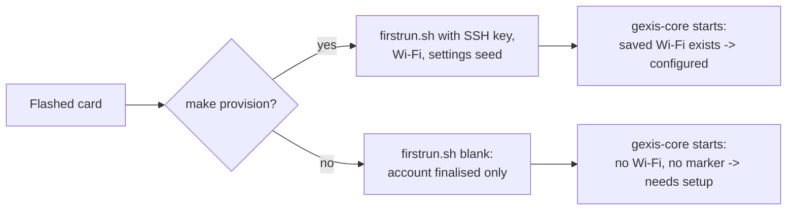
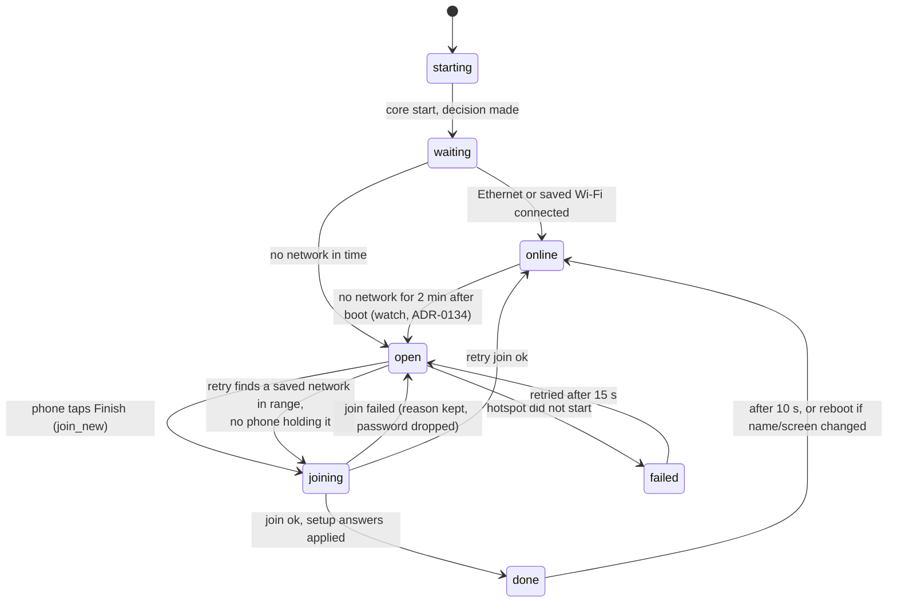
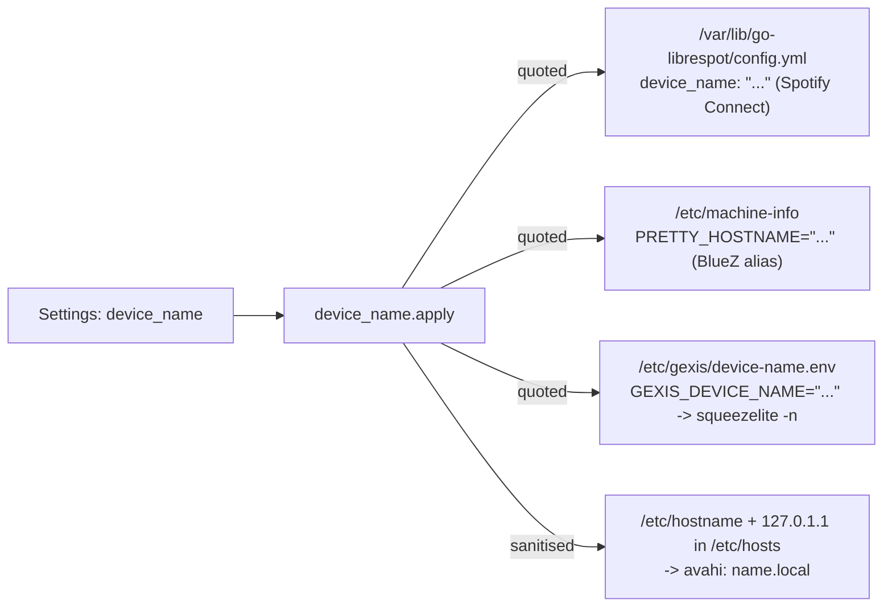

# Setup and network

How a freshly flashed card becomes a player on someone's network: the one-shot
first-boot script, the core's decision whether setup is needed, the setup
access point the phone joins, and how the answers are applied. Also how the
device's one name reaches the services that advertise it, and how Wi-Fi is
changed afterwards.

Decisions: ADR-0031 (setup access point, amended 2026-09-28), ADR-0104 (how the
device knows it needs setup), ADR-0048 (the device name), ADR-0109 (the Screen
step), ADR-0111 (the Visualiser step), ADR-0083 (backup and restore),
ADR-0132 (reset to factory settings).

Code: `core/src/gexis_core/setup_network.py`, `setup_flow.py`, `wifi.py`,
`device_name.py`, `discovery.py`, `factory_reset.py`; UI `ui/src/screens/SetupPage.svelte` (phone)
and `SetupScreen.svelte` (panel); image `image/stage-gexis/01-firstboot/`.

---

## 1. First boot: `firstrun.sh`

The image has no cloud-init and no interactive wizard. Stage
`image/stage-gexis/01-firstboot/00-run.sh` installs `firstrun.sh` on the boot
partition and appends `systemd.run=/boot/firstrun.sh ... systemd.unit=kernel-command-line.target`
to `cmdline.txt`, so the script runs once, very early, then reboots. The
stage fails the build if the script is missing, if `cmdline.txt` does not call
it, or if stale cloud-init templates are present.

`firstrun.sh` calls the same platform helpers Raspberry Pi Imager's generated
script calls (`imager_custom`, `userconf`), each only if its variable is set:

| Variable | Effect |
|---|---|
| `SSH_PUBKEY` | enables SSH with that key (the image is key-only) |
| `WIFI_SSID` / `WIFI_PASS` / `WIFI_COUNTRY` | saves a NetworkManager connection named `preconfigured` and sets the country |
| `HOSTNAME`, `TIMEZONE` | as named |
| `IDLE_URL` | appended to `/etc/gexis/core.toml` |
| `SETTINGS` | JSON written to `/etc/gexis/settings-seed.json`; the settings registry treats it as defaults, so later changes still win. Seeds for `output_device` and `skin` are checked for form only (a non-empty name), since only the daemon can list their options, and at run time |
| `DEV_SUDO` | test cards only: `yes` writes `/etc/sudoers.d/010_pi-nopasswd`, mode 440 and `visudo`-checked before it is renamed into place (ADR-0139) |

`userconf pi ""` always runs: it finalises the `pi` account and cancels the
stock first-boot wizard. The script then deletes itself and its `cmdline.txt`
entry. **The public image gives `pi` no sudo** (ADR-0139): `pi` runs the kiosk
and Squeezelite, and a flaw in either would otherwise be a flaw as root.
Nothing in the player calls sudo; `verify-image.sh` asserts the image has no
sudoers rule for `pi`, and only `DEV_SUDO="yes"` puts one on a test card.

**On a user's card every variable is blank** except `WIFI_COUNTRY`, which is
used only when `WIFI_SSID` is set; so first boot only finalises the account, and the core's setup flow (below) does the rest.

**On a developer's card**, `make provision DEVICE=/dev/sdX` runs
`image/provision.sh`: it mounts the flashed card's boot partition, rewrites
`firstrun.sh`'s variable lines from `image/provision.local.env` (single-quoted,
so a password containing `$(...)` is data, not code), parses each line back to
verify the round trip, and clears stale SSH host keys for the hostname. It
refuses an empty `SSH_PUBKEY` and invalid `SETTINGS` JSON. A card provisioned
with Wi-Fi has a saved connection, so it **never sees setup** (ADR-0104 §2).



---

## 2. Two questions, kept apart (ADR-0104 §1)

`SetupNetwork._run()` decides once, at core start:

- **Does the device need setup?** `needs_setup()` is true when NetworkManager
  holds no saved Wi-Fi connection (other than the setup profile itself) **and**
  `/var/lib/gexis/setup-done` does not exist. Either one means someone already
  configured it. Finishing setup writes the marker, so a device set up on
  Ethernet only does not ask again.
- **Does it need the setup network?** A fact about the radio now. A configured
  device that cannot reach its Wi-Fi needs the network but not setup; a new
  device on Ethernet needs setup but not the network.

`_wait_for_network()` then waits for NetworkManager to report an Ethernet or
Wi-Fi device `connected`:

| Device | Waits | Then |
|---|---|---|
| Needs setup, no Ethernet carrier (read from `/sys/class/net/*/carrier`) | 15 s | opens the setup network |
| Needs setup, cable has link | up to 90 s for an address | Ethernet: setup served over the LAN, no setup network (ADR-0031 amendment 8) |
| Configured | up to 90 s | online: nothing; otherwise opens the setup network |

The setup network **never opens while Ethernet has an address**. It is
decided at boot and, since ADR-0134, also two minutes after a running device
loses its network (§3); ADR-0104's answer 3 (*at boot only*) stood until then.

**A cable that gets its address back closes it.** A setup network opened at
boot, or after a lost network (§3), is closed as soon as Ethernet has an
address again (`_cable_back()`, looked for every `WATCH_S` inside `_hold()`),
and the state goes `online`. A new player, which needs setup, waits while a
phone is on the setup network: that phone may be half-way through setup, and
setup over the cable can start once it leaves.

**Setup over the cable counts as setup running** (`_setup_running()` in
`__main__.py`): while setup is still needed, a screen chosen during it does
not restart the player; setup's own restart after Finish is the only one.

A test hook: `/run/gexis-setup-trial` present at start opens the setup network
on a configured device regardless; it is read once and deleted, and a
`retry=<seconds>` line shortens the retry.

---

## 3. The setup network



**After boot** `SetupNetwork.watch()` (ADR-0134) looks every 15 s
(`WATCH_S`), only while the state is `online`, setup is finished and no
`join_new` is under way. Two minutes (`LOST_S`) with no device `online()`
accepts opens the setup network and runs the same `_hold` retry as at boot.

State strings are the ones `SetupNetwork.status()` publishes:
`starting`, `waiting`, `open`, `joining`, `failed`, `done`, `online`.

**Opening** (`SetupNetwork.open()`), in order:

1. `rfkill unblock wifi` and `nmcli radio wifi on`. A blank card's radio is
   blocked: Raspberry Pi OS starts with `rfkill.default_state=0`, and pi-gen
   ships NetworkManager with wireless disabled when the build sets no country.
   The image deliberately has no default country (world regulatory domain).
2. Wait up to 20 s for NetworkManager to call `wlan0` usable (unblocking is
   not the chip being ready).
3. `nmcli device wifi hotspot` with profile and SSID `gexis-setup`, WPA2,
   **pinned to 2.4 GHz** (`band bg`) so nothing radiates on 5 GHz before a
   country is known. NetworkManager's shared mode serves DHCP and DNS
   (its own dnsmasq) on a private subnet.
4. `connection.autoconnect no`, read back: a profile left by a crash must never
   come up at boot in place of the home Wi-Fi. Any leftover profile is deleted
   at start.

**The password**: with a panel attached (an `HDMI-A-*` connector reporting
`connected`) *and* a screen already confirmed on it (ADR-0109 decision 5), eight
characters from an alphabet without `0 o 1 l`, made once and kept in
`/var/lib/gexis/setup-password` (0600) so it survives reboots. Otherwise a
fixed, documented password, since nothing can show a made-up one.

**No captive portal** (ADR-0031 amendment 2). The panel shows two QR codes in
sequence: one that joins the network, then one for the page,
`http://<setup address>:8090/`. The panel's copy tells the user to turn mobile
data off, because the setup network has no internet and phones otherwise send
the request over mobile data.

**Following the phone**: every 2 s while open, `iw dev wlan0 station dump`
MACs are intersected with unexpired dnsmasq leases. Association alone fired
before the phone could reach the page; a lease is the step after which it can.
The page's first `GET /setup/answers` marks `page_opened`. The panel
(`SetupScreen.svelte`) walks *join -> joined -> page -> phone -> joining* from
these, and takes no input (ADR-0029).

**Retry** (`_hold()`): every 5 minutes, *only if no phone holds the player*,
scan while hosting; if a saved network is in range, take the setup network
down and join it, reopening it if the join fails. On a new player (setup
needed) any associated phone holds it, as it has nothing saved to go back to.
On a configured one a phone holds it only while the setup page is in use
(George, 2026-10-12): a request to `/` or a `/setup/...` route from a phone in
the last `SETUP_ACTIVE_S` (600 s) - noted by the `_note_setup_use`
middleware in `wsserver.py`, the panel's own loopback requests excluded - or
when the retry first found a phone on the network less than `SETUP_ACTIVE_S`
ago (`_phone_since`, cleared when a retry finds none), so a phone that has
just joined is not left behind. The page's live status comes over the state
socket, which does not count, so `SetupPage.svelte` asks `/setup/status` once
a minute while it is in front. A phone that joined by itself and never opened
the page no longer holds a configured player off its Wi-Fi for ever. A failed hotspot start is retried
every 15 s instead. Every 15 s it also looks for a cable with an address,
which closes the setup network (§2).

---

## 4. The phone-driven flow

One radio means the phone loses the page the moment the device leaves the
setup network, so **the core holds the answers, not the page** (ADR-0104 §4).
Each step's Continue saves to `/var/lib/gexis/setup-answers.json`, written
atomically and 0600 from the first byte (it holds the Wi-Fi password). A page
that reloads resumes from it; the password is never handed back, only
`has_password`.

The phone's steps (`SetupPage.svelte`): Network, Start (ADR-0131: a new
player or a backup), Name, Time (zone and 12/24 h), Output, Music, Screen,
Visualiser (skipped for headless or for screens no skin pack fits), Plugins
(ADR-0128; every plugin the release ships beyond the built-in sources, from
`GET /setup/plugins`; skipped when there are none), Review. Restoring asks
Output and Screen, which are this player's hardware (`ASKED`), and skips the
rest from Name to Plugins: the backup answers them, and Review shows it.

```mermaid
sequenceDiagram
  autonumber
  participant P as Panel (SetupScreen)
  participant Ph as Phone (SetupPage)
  participant C as gexis-core
  participant NM as NetworkManager

  C->>NM: hotspot gexis-setup (WPA2, 2.4 GHz)
  P->>C: GET /setup/status (loopback: includes password)
  P-->>Ph: QR code: join the network
  Ph->>NM: associate, DHCP lease
  C->>C: station dump ∩ leases -> phones=1
  P-->>Ph: QR code: open the page
  Ph->>C: GET /setup/answers (page_opened)
  Ph->>C: GET /setup/networks (scan while hosting)
  loop each step
    Ph->>C: POST /setup/answers {step fields}
    C->>C: validate, save setup-answers.json
  end
  Ph->>C: POST /setup/finish
  C-->>Ph: 202 {"finishing": true, "keep_question": ...}
  Note over C: _apply(): settings first, via Settings.set
  C->>C: Wi-Fi country from time zone (raspi-config)
  C->>C: wait 3 s so the phone's last screen arrives
  C->>NM: take the setup network down
  C->>NM: add profile for chosen SSID, connection up
  alt join succeeds
    C->>C: touch setup-done, delete answers file
    C->>C: Lyrion: find / given address / off
    C->>C: plugins on or off as chosen; settling.json (ADR-0128)
    C-->>P: state done (network, library, restart reason)
    C->>C: after 10 s: reboot if a screen was chosen or the name differs from the old one, else online
  else join fails
    C->>NM: delete the profile just made
    C->>C: drop password, keep other answers + error, step=wifi
    C->>NM: reopen the setup network (only if it was the way in, or nothing else is online)
    Ph->>C: (rejoins) page opens on Network with the reason
  end
```

**Applying** (`SetupFlow._apply()`):

1. **Settings first**, each through `Settings.set` so it does exactly what it
   does from Settings: `device_name`, `timezone`, `clock_format`,
   `output_device`, `lms_server` (only when "Enter an address" was chosen),
   `spotify_enabled`, `bt_enabled`, `headless`, `screen`, `visualiser_skins`.
   One refusing setting is logged and the rest go on; nothing strands the
   device on the setup network.
2. **Wi-Fi country** from the time zone via tzdata's `zone.tab` (not
   `zone1970.tab`, which lists several countries per zone), applied with
   `raspi-config nonint do_wifi_country`, which lifts the radio block for good.
3. **The network, last**, because it is the step that loses the page.
   `join_new()` replaces only a profile named after the network; a failed join
   deletes what it saved, since NetworkManager would otherwise retry a wrong
   password forever. It brings the setup network back only when that was the
   way in, or when nothing else is online: a failed join during setup over the
   cable stays on the cable.
4. On success: write `setup-done`, delete the answers, then **Lyrion**. Over the
   setup network there is nothing to discover, so the Music step's *Find* mode
   runs after the join: `discovery.find_servers()` broadcasts Lyrion's UDP
   discovery datagram on port 3483 and takes each reply's source address.
   Exactly one server is used; several are named and left to Settings; *Off*
   sets `lms_enabled` false.
5. The panel shows the result for 10 s, then the device **reboots** if any
   screen was chosen in setup, or if the name differs from the old one (both
   apply at a restart; the Screen step's restart is where *Keep this screen?*
   is asked, ADR-0109), otherwise goes `online`.

**Restoring a backup instead** (ADR-0131, `SetupFlow._apply_restore()`):

1. **The upload.** `POST /setup/backup` streams the file to
   `setup-backup.tgz.part` beside the answers (cap 1 GB). `take_backup()`
   reads it with `backups.inspect()`:
   - it refuses, in a sentence, a file that is not a gzip tar, one with a
     path no backup holds (matched by whole path component), a link, a
     device or a pipe, or a name not in plain form (`..`, `.`, an empty
     part, a leading `/`), one with no settings, or one whose `settings.db`
     will not open or has no `settings` table (`backups._checked()`, the same
     check a restore from Settings makes);
   - it returns the backup's main settings (`backups.APPLIED`), the plugins
     it has on, what else it carries, when it was made (from its name), and
     whether a newer release made it (more migrations than this one knows).

   The file is kept as `setup-backup.tgz` (0600), and the review is saved in
   the answers as `backup`, with `start: "restore"`. `DELETE /setup/backup`
   forgets it.
2. **Output and Screen** are asked as a new player's are, opening on what
   this player detects, never on the backup's: a backup from another player
   names that player's DAC and screen.
3. **The review** is the new player's Review, with *Change* on each answer:
   the page fills the other steps from the backup (`fromBackup`), and a step
   continued from is saved as a setup answer. `_restore_values()` lays those
   answers over the backup's settings.
4. **Finishing**:
   - the Wi-Fi country from the time zone, then the join (a failed join keeps
     the backup and returns to Network);
   - the main settings through `Settings.set` (`backups.APPLIED`), as
     setup's own answers, because the screen (`screen.json`), the time zone
     and the name live outside the store too. **Before the files go back**:
     once the settings file is replaced, the store the core holds open
     refuses every write. A screen this version does not know is left to
     Settings;
   - `backups.restore_file()`, with the two databases written beside
     themselves and renamed into place, so the core's open connection is
     never overwritten underneath it. The rest is extracted with Python's
     `tar` filter (owners kept, setuid bits dropped). A backup that brings
     `var/lib/beszel-hub` stops `beszel-hub.service` first
     (`STOPPED_FOR_RESTORE`; the reboot starts it again), and a `-wal` or
     `-shm` file the archive does not bring is removed from beside each file
     it restores. (When a backup is made, a live SQLite database with a
     `-wal` beside it - the Beszel hub's - goes in as one consistent file,
     copied with SQLite's own backup, without its `-wal` and `-shm`.)
   - with a name that differs from the backup's and `second_player` not
     false, `backups.IDENTITIES` are left out of `restore_file()` (the
     Beszel agent's data, Plexamp's store, go-librespot's `state.json` and
     `/var/lib/bluetooth`), and `backups.forget_settings()` removes
     `IDENTITY_SETTINGS` from the restored settings: every `beszel.` key
     and `plexamp.claim_token`;
   - `backups.write_settings()`: the answers changed in setup (and a Lyrion
     server found after the join) written into the restored settings, which
     the next start reads;
   - `device_name.apply()` with the changed name, after the backup's own
     name file is back, or `device_name.apply_restored()` when it was not
     changed; `settling.json` for the skins and each downloading plugin that
     is on;
   - the panel's `restart_for: "restore"`, and the reboot. The file is
     deleted whatever happens.

**Setup's own screens are laid out for the attached screen** (ADR-0109
amended 2026-10-07): `gexis-screen-check` runs before the kiosk during setup
too and applies the recognised model, the one listed bar of its mode
(restarting first for a bar's kernel mode), or the screen's own mode, scale
only. The choice is **provisional** in `screen.json`: no Keep is asked, and
`screen_apply.confirmed()` stays false, so the setup network keeps the fixed
password. The Screen step confirms it, or replaces it and asks Keep.

**The port is part of what is applied** (ADR-0109 amended 2026-10-12):
`screen.json` keeps the HDMI connector the screen was seen on
(`screen_apply.connector_now`: the connected one, else the one applied last,
else HDMI-A-1). At each start `screen_watch.moved()` re-applies the same
screen on a new port; for a bar that moves its `video=` and goes through
Keep, a screen without a forced mode moves silently, and a provisional
setup screen stays provisional.

**With both ports connected** (ADR-0141 D2/D4, 2026-10-12):
In Settings the two rows are **one Screen tile** (George, 2026-10-13): the
UI draws `screen_port` (or `screen_port_info`) at `screen`'s place, showing
the display in use; a tap opens `screen_port`'s choice, *Change* opens
`screen`'s list of models. `screen_detect.seen()` picks **the port chosen under *Screen port*** when
something is connected there (ADR-0147 D1: `chosen` in screen.json's
`current`), else the applied port if a known panel is there, any port a known
panel is on, the applied port, else the first connected. `screen_detect.ports()` lists both for
*Screen port*: each port's line (`_port_line`) is its option note, a port with
nothing connected is `unavailable`, and on a one-port board the read-only
`screen_port_info` shows instead. Choosing applies **the screen on that port**
(`screen_watch.target`: the panel recognised there, else the device by its own
mode, `screens.fitted` holding a 16:9 screen larger than 1080p to
`other-1920x1080-capped`, which carries a kernel `video=` mode) marked
`chosen`, through `screen_apply.choose` (restart, Keep), dropping its stored
value so the row reads the port in use. `gexis-kiosk-start` then pins the
window to the screen's port whenever both are connected.

**A screen without touch** (ADR-0147 D3, D5): `screen_detect.has_touch` is a
fingerprint with a USB touch id. Without one, the Keep question carries
`phone: true`, `POST /screen/keep|revert` is accepted from the phone as well
as the panel, and the phone page shows `PhoneKeepScreen`; the panel's own
Keep says to answer on the phone. screen.env carries `GEXIS_SCREEN_TOUCH_USB`
(the screen's) and `GEXIS_PANEL_TOUCH_USB` (every known panel's);
while the screen has no touch, screen.env's `GEXIS_OUTPUTS_OFF` names the
ports with a known panel and `gexis-kiosk-start` turns them off with
`wlr-randr`, and the boot's `screen_watch.touch_rules` writes
`/run/udev/rules.d/90-gexis-panel-touch-off.rules`
(`LIBINPUT_IGNORE_DEVICE` on each known panel's USB id; labwc's own
per-device `sendEventsMode` did not hold on sofapi). A TV's mode comes from
`screen_detect.tv_mode` (the kernel's mode list, 1080p first) as
`other-WxH-capped`, held at boot by its `video=` and after it by the kiosk
(`GEXIS_SCREEN_MODE`, `wlr-randr --mode`: labwc otherwise takes the device's
preferred mode, a receiver's 1280 x 720), and a chosen port is not asked
about at the start. With two screens connected, `gexis-splash-fb` makes the
gap after plymouth black: fbdev is one buffer, sized for one of them.
Display standby leaves an output carrying the sound on
(`standby.carries_sound`).

**Errors** reach the phone as sentences (`setup_flow.said()`); the core's own
text goes to the log.

### Routes

All under the core's HTTP server on port 8090 (`wsserver.py`):

| Route | Purpose |
|---|---|
| `GET /setup/status` | state; the **password only to a loopback caller** (the panel). Phones and the `/state` broadcast get `public_status()` without it |
| `GET/POST /setup/answers` | read (resume) / save one step |
| `GET /setup/networks` | Wi-Fi scan, the setup network itself removed |
| `GET /setup/screen` | the Screen step: what the screen reports, the suggested model, all models |
| `POST /setup/finish` | start applying; answers `202` with `{"finishing": true, "keep_question": ...}` |
| `GET /setup/plugins` | ADR-0128: the plugins the Plugins step offers - `id`, `name`, `summary`, `notice`, `from`, `component` |
| `POST /setup/backup` | ADR-0131: a backup as the request body (`?name=` its file name); answers the setup answers with the review, or 400 with the reason |
| `DELETE /setup/backup` | ADR-0131: forget the uploaded backup |

Every route but `/setup/status` answers 409 once setup is over (`_setup_closed`):
a configured device has Settings for all of this. On a phone, `App.svelte`
renders `SetupPage` in place of Settings while setup is needed or the setup
network is up (`open` or `failed`), and holds it once shown so a join cannot
swap it for Settings under the phone. `joining` keeps a page already shown
but never opens one: a page reconnecting as the player rejoins its own Wi-Fi
would otherwise hold a setup page with no setup running (found 2026-10-11).
On the panel, `SetupScreen` covers the ordinary screens.

---

## 5. The device name (ADR-0048)

There is one `device_name` setting and no per-service override (ADR-0022).
`device_name.apply()` writes it to four places, and **none takes effect until
the next restart**: changing the hostname under a phone is how that phone
loses its way back, and applying some targets live would leave the device
advertising two names.



- The three display names keep the name as typed, spaces and capitals and
  all, but quoted: `device_name:` as a YAML double-quoted string (unquoted,
  `Kitchen: Main` made go-librespot's config unparseable and `#2` was cut off
  as a comment), and `PRETTY_HOSTNAME` and `GEXIS_DEVICE_NAME` in systemd's
  env-file form, `"..."` with `\` and `"` escaped (`plugin_env.quote()`).
  Control characters and line breaks are refused by the settings row (*A name
  is one line of text.*); a name that arrives another way (a restored backup,
  setup's own rename) has them turned into a space (`UNWRITABLE`).
- The hostname takes a sanitised form: accents folded, lowercase, anything
  outside `[a-z0-9-]` becomes `-`, capped at 63; an empty result falls back to
  `gexis`. avahi publishes it as `<hostname>.local` (e.g. `gexis.local`).
- BlueZ's name comes from `PRETTY_HOSTNAME`, not `main.conf`'s `Name =`, which
  the hostname plugin overrides.
- `/etc/hosts` carries both old and new names between a rename and its restart,
  so the running hostname still resolves.
- The core finds its own LMS player by the name squeezelite announces, read
  from `device-name.env` at start (`lms_player()`), so the two cannot disagree.
- Each target is attempted; the result names any that failed.
- A restore (ADR-0083) carries `device-name.env` but not the hostname or
  `machine-info`, so `apply_restored()` re-applies the restored name to all four
  before the restore's reboot.

---

## 6. Wi-Fi after setup

Settings' Wi-Fi row is a `list` row (ADR-0044) backed by `wifi.py`, through
`nmcli` (the core runs as root, so there is no polkit or secret-agent dance):

- `GET /settings/wifi/items`: a scan, with signal bars and which networks are
  saved. `saved_ssids()` maps SSID to connection by reading each profile's
  SSID, because profiles are not named after networks (the provisioned one is
  called `preconfigured`).
- `POST /settings/wifi/items` with `join` (optional password) or `forget`.
  A refused password is a 200 with the reason, so the sheet can offer a retry.
- The connected SSID is refreshed in the background every 20 s; it was once
  read on the request path and blocked the daemon for seconds.
- Nothing changes the connection the daemon is reached over without an explicit
  per-item action. A device that loses its network opens the setup network
  after two minutes and goes back to its saved one when it returns (§3,
  ADR-0134); it no longer needs a restart.

## 6b. The cable, and the Wi-Fi address (ADR-0123)

`wired.py`, through `nmcli` like the Wi-Fi. One class, `Cable`, serves both
ports: `eth0` for the Cable row, `wlan0` and the connected network's profile
for the Wi-Fi address (`/network/wifi/address`; `/network/wifi` is the
connected network's details). One change waits at a time.

- **State:** link and speed from `/sys/class/net/eth0/{carrier,speed}` (cheap,
  read with every settings listing for the row); the profile on the port
  (`GENERAL.CONNECTION`, *Wired connection 1* as NetworkManager names it), its
  IPv4 method, and the address, gateway and DNS in use.
- **The row** `cable` (Device) is an action row of `kind: "cable"`, shown by a
  `shown` provider while the port has a link or holds a manual address; its
  line is the `notes` provider `Cable.note()`, kept current by `Cable.follow()`
  every 10 s.
- **A change** (`POST /network/cable` with `method`, and for Manual
  `address`/`gateway`/`dns`): `check()`, then the profile's IPv4 settings are
  saved, modified and brought up; if the port refuses, they are put back.
- **The safeguard:** the change is pending for 60 s. `POST /network/keep`
  keeps it only if the request arrived at the new address (the socket's own
  address) or from loopback (the panel); otherwise the saved settings come
  back. Every page shows `CableKeep` while `GET /network/cable` has `pending`,
  read again whenever `settings_revision` moves.

**The cable wins** (ADR-0123 as amended): `wired.CableFirst`, every 5 s.
While `eth0` has a link *and* is connected (an address, not only a link),
a connected `wlan0` is disconnected with `nmcli device disconnect` -
unless it hosts the setup network (`gexis-setup`). When the link goes,
`nmcli device connect wlan0` brings back the best saved network. A join from
Settings while the cable is in answers with `notice`.

## 7. Bluetooth pairing, briefly

Pairing is confirmed on the panel on a device's first pair only (ADR-0045,
reversing ADR-0024). `bluetooth_agent.py` registers the core's own BlueZ
`Agent1` with capability `DisplayYesNo` by default, which makes BlueZ produce a
six-digit code (`RequestConfirmation`) to show on the panel and match on the
phone; a "PIN-free" pairing setting registers `NoInputNoOutput` instead
(`capability_for()`). The
agent's timeout is the only clock: the panel's countdown displays it, and the
prompt disappears when the agent says so.

## The first start after setup (ADR-0128)

**The skin pack waits until setup is over** (amended 2026-10-10): while
`SetupNetwork.needed`, `_skins_ensure` in `__main__.py` does nothing and
notes that it waited; it runs at the next start, or from the setup network's
change callback when setup ends without a restart. An install holds the
updater's shutdown block, and setup's restart is refused while it is held
(`_systemctl_reboot` now asks again every 15 s, up to 30 minutes).

After the join, `SetupFlow._plugins_and_settling` switches every offered
plugin on or off as chosen - explicitly, since a plugin switch defaults to on -
and records in `/var/lib/gexis/settling.json` what the first start waits for:
the visualiser's skins (component `skins`) when chosen, and each chosen plugin
that downloads (its component name). Nothing to wait for writes nothing.

The core reads it every 2 s (`_follow_settling`) against `_all_components()`
and publishes `settling` on `/state` (`settling.view`): each item `waiting`,
`busy` (with `received`/`total`), `done` or `failed` (with `error`), and the
phase `settling`, `ready` or `failed`. An item still waiting 10 minutes after
setup (`WAIT_S`; no home network, most likely) is failed with *The download
did not start*. `ready` stays up 4 s (`READY_S`), then the file is removed;
`failed` stays until `POST /settling/done`. The panel draws
`SettlingScreen.svelte` over everything but *Keep this screen?* and the update
lock; a phone draws it too. *Use the player now* (`POST /settling/hide`,
ADR-0128 amended 2026-10-10) sets `hidden` in the file: both surfaces drop the
screen while the downloads go on, and `view()` clears `hidden` when anything
fails, so a failure is still shown and answered with OK.

## Reset to factory settings (ADR-0132)

*Settings → System → Reset to factory settings* is an action row with
`hold: true`: `Settings.svelte` confirms it only after the button is held for
3 s (`HOLD_MS`) by pointer, or with Space or Enter held down; a release, a
pointer leaving the button or a cancelled touch starts over. The core's
`_factory_reset()` writes `/var/lib/gexis/factory-reset` (`factory_reset.request`),
puts `resetting` on `/state`, and reboots 3 s later. `ResetScreen.svelte`
covers every surface from then on; the phone that confirmed shows it without
waiting for the state. The UI latches it (`resetting` in `lib/state.js`), so
a phone keeps it after the socket drops - with how to reach setup over
*gexis-setup* or a cable - and a panel loses it only with the restart.

The wipe does not run while the player runs: files such as the settings
database are held open, and the restore path showed a live replacement meets
a read-only store (ADR-0131). `gexis-factory-reset.service`
(`ConditionPathExists=` the request, `DefaultDependencies=no`, wanted by
`sysinit.target`) runs `python -m gexis_core.factory_reset` after the local
file systems are mounted and before NetworkManager, Bluetooth, hostnamed, the
screen check, the core, the kiosk, the renderers and the Lyrion Server.
`wipe()` then:

- removes the files and folders in `REMOVED` (settings and enrichment
  databases, caches, the device name, share passwords, the setup
  marker and answers, the screen and board records, components, uploaded
  plugins, Plexamp, Spotify's state, Beszel, the Lyrion Server's prefs and
  cache, and `/etc/gexis/settings-seed.json`, the settings chosen when the
  card was flashed) and empties those in `EMPTIED` (the backups kept on the player,
  NetworkManager's connections, Bluetooth, the journal, and the panel
  browser's profile in `/var/lib/gexis-kiosk`: cookies, storage, history and
  cache of every page the panel showed), keeping the folders' owners and
  modes. The backups folder is emptied rather than removed because it is the
  Backups share, `pi`'s and group-writable: removed, it came back as root's
  with the next backup and the share refused every file copied into it. The music
  folder (`/var/lib/gexis-music`) and the Pictures share
  (`/var/lib/gexis-core/pictures`) are never touched; Lyrion's new
  preferences point at the music again and it rescans;
- puts `/etc/gexis/core.toml` back to the package's copy,
  `/usr/share/gexis/defaults/core.toml` - the file `gexis-core`'s postinst
  places on a fresh card - so the flash-time `idle_url` goes with it; with no
  such copy (a core from before the package shipped one) it removes
  `core.toml`, which the core reads as its defaults (George, 2026-10-12);
- writes back the image's hostname `raspberrypi` (and sets it on the running
  kernel), Spotify's name `gexis` and the time zone Europe/London;
- strips the screen's `video=` and the Wi-Fi country from `cmdline.txt` and
  the sound card board's block from `config.txt`;
- purges every installed `gexis-skins*` package.

The 2026-10-10 step that kept this boot's log after a reset
(`61-gexis-after-reset.conf`) is gone (ADR-0132, amended 2026-10-12); the core
deletes a leftover drop-in at start.

Each step is on its own: one that fails is logged and the rest go on. The
request is removed last, so the boot continues into setup with no marker
(ADR-0104). The installed release stays; SSH keys provisioned on the card
stay.
