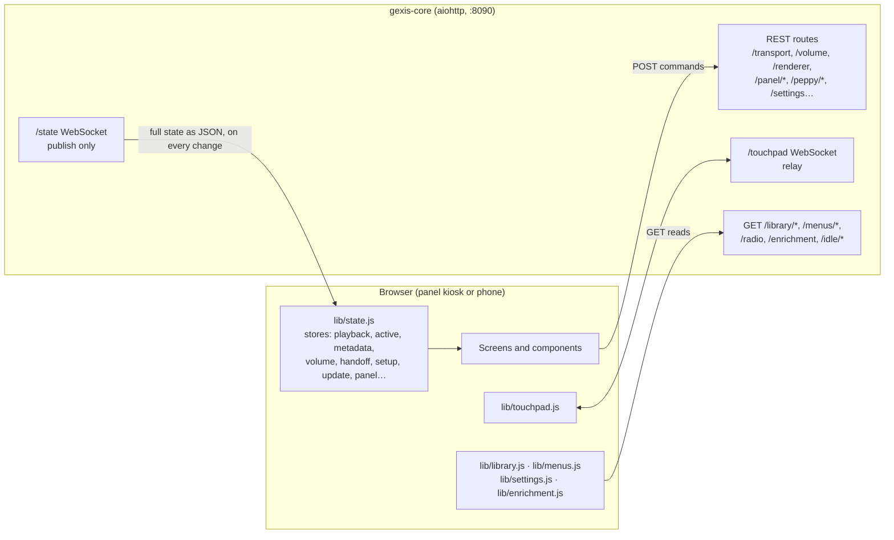
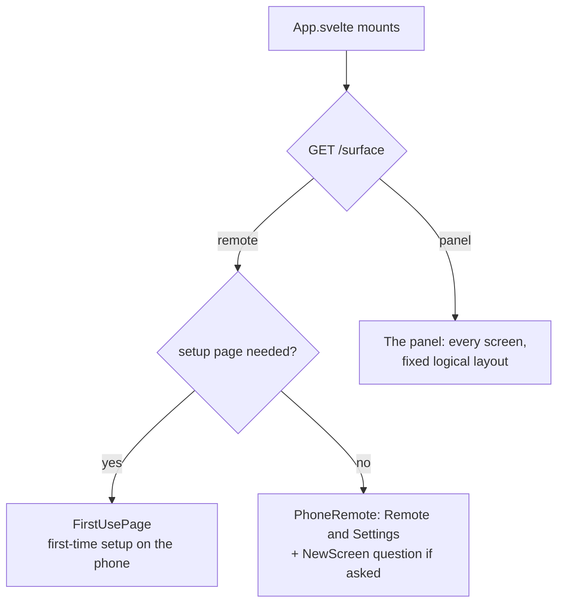
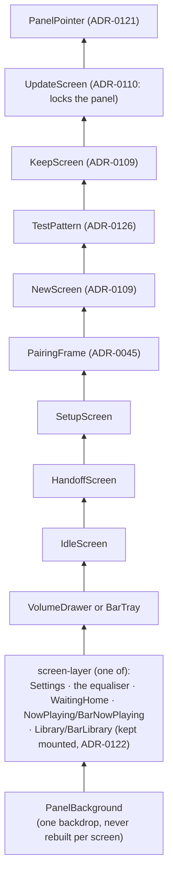
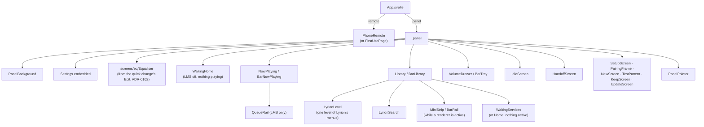
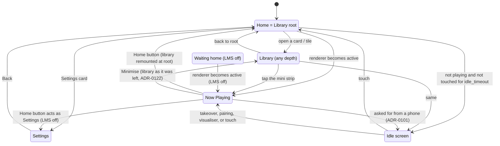
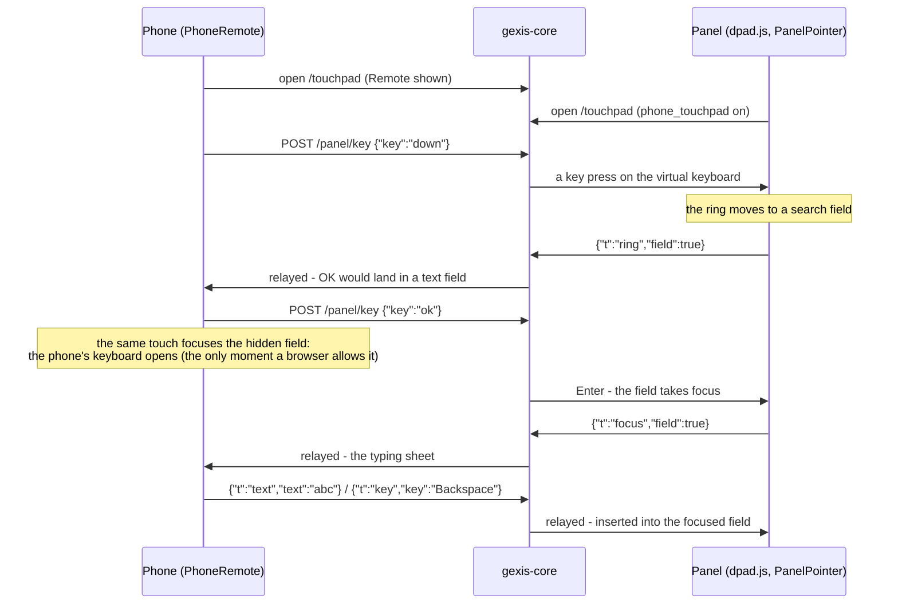
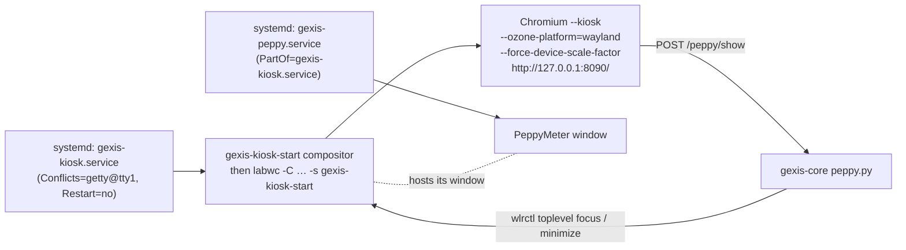

# The UI

The panel's screens and the phone's page are one Svelte 5 application under
`ui/`. `gexis-core` serves it and keeps its state current, and it sends
commands back to the core. This document covers how the app is built and
served, how it chooses what to draw, and how the phone drives the panel.

Related records: ADR-0023 (Svelte), ADR-0028 (the core serves the UI;
commands over REST), ADR-0032 (one page, two surfaces), ADR-0164 (the
phone's remote, after ADR-0101's mini player), ADR-0109 (screen families),
ADR-0121 (the touchpad relay and the panel's pointer).

---

## 1. Build and delivery

| Piece | Where | Notes |
|---|---|---|
| Source | `ui/src/` | Svelte 5 (runes), Vite 8, target `es2022` |
| Entry | `ui/src/main.js` | Imports the bundled fonts and `styles/tokens.css`, then mounts `App.svelte` on `#app` |
| Build | `npm run build` (`make ui`) | `vite build`, then `scripts/licenses.mjs` writes the licences of bundled code |
| Output | `ui/dist/` | `index.html` plus hashed files under `assets/` |
| Package | `packaging/ui/build.sh` | Packs `ui/dist` into `gexis-ui` at `/opt/gexis-ui` (ADR-0107) |
| Served by | `core/src/gexis_core/wsserver.py` | `/`, `/assets/*`, and the few named app files a phone reads to install Settings as an app (ADR-0102) |

Node never runs on the device. The image ships only the static output
(ADR-0023). The fonts are bundled because the panel may have no internet.

Vite writes everything into `assets/` so the daemon needs only two static
routes. The UI routes are registered **after** the API routes. aiohttp
matches routes in the order they were registered, so a static path can never
shadow `/state` or a command.

`npm run dev` serves the UI from Vite and proxies to a running core
(`GEXIS_CORE`, default `http://gexis.local:8090`). See the disagreements at
the end: the proxy list is incomplete.

---

## 2. Talking to the core

- **State comes in one way.** `lib/state.js` is the only module that opens
  `/state`. Every frame is the whole `PlaybackState` as JSON
  (`state.to_json()` in the core). The module exposes derived stores
  (`active`, `metadata`, `volume`, `capabilities`, `available`, `queue`,
  `handoff`, `pairing`, `panel`, `setup`, `update`, `screenConfirm`,
  `screenNew`, `screenCheck`, `sources`, …). Components subscribe to these stores and
  never read the socket. Reconnects back off from 0.5 s to 5 s, because the
  kiosk has to outlive any number of core restarts.
- **Commands go over REST, never the socket** (ADR-0028). `post()` in
  `state.js` raises the server's own `error` text, which lets messages such
  as "LMS unreachable" reach the user. A command's result is not taken from
  its response: it comes back on `/state`. For example, a play/pause button
  shows what the renderer reports, not what was pressed (ADR-0037).
- **Reads go over GET.** Library data comes from `/library/...` (typed LMS
  queries the core runs, ADR-0038), from `/menus/...` (Lyrion's own menus,
  addressed by handles the core issued, ADR-0118) and from `/radio`. Cover
  URLs point straight at LMS (ADR-0020).
- **Settings** are loaded from `/settings` (ADR-0035) and loaded again
  whenever `settings_revision` changes in the state. A change made on the
  phone therefore reaches the panel. The page that saved reloads **once**:
  the save's answer names the revision it made, and the broadcast of that
  revision is then not a second reload (2026-10-16).
- **A multi-choice sheet** (Wallpaper topics) draws a copy at the tap and
  writes it 300 ms after the last tap, or as the sheet closes, another
  opens or Settings is left; a set the core refuses puts the copy back
  (2026-10-16, as the standby times do). Each tap used to wait for its
  write and a full reload, 0.4-0.65 s on sofapi.
- **Settings' requests end** (George, 2026-10-12). One the player took but
  never answered used to leave a sheet spinning; Settings' requests now go
  through `ask()` in `lib/settings.js`, which aborts one
  (`AbortController`, the body's read included) after `REQUEST_TIMEOUT_MS`
  (20 s); `LONG_REQUEST_TIMEOUT_MS` (120 s) for what is slow on purpose - a
  Wi-Fi join, anything on the network shares (search, browse, add, forget),
  a Wi-Fi scan, making a backup, an address change (`CableSheet.svelte`), a
  plugin's removal, a problem report's start, and a plugin upload (an
  `XMLHttpRequest`, for its progress), where the limit counts silence (no bytes going out, or no answer once all are sent) rather
  than the whole request; `RESTORE_TIMEOUT_MS` (15 min) for a restore, which
  answers only once every file is back. A timeout ends as the failure its
  caller already handles, with `UNREACHED`: *"The player did not answer.
  Check the connection and try again."*, which Settings' plain-words filter
  lets through.

---

## 3. One bundle, two surfaces

The same `index.html` is served to everyone. On mount, `App.svelte` asks
`GET /surface`. The core answers `panel` when the request comes from loopback
(the kiosk loads `http://127.0.0.1:8090/`) and `remote` for anything else.
If the request fails it is asked again, backing off to every 5 s, and nothing
is drawn meanwhile: a phone taken for a panel would draw at panel size and
report its taps as the panel's (code review, 2026-10-12). **The panel then
waits for the core's first state** on the socket before drawing (ADR-0149
decision 44): until then it does not know whether part 2 or setup is owed,
and drew its own screens for a moment before *Make it yours*.

- **Panel**: renders everything. The panel reports touches (`/touch`,
  throttled to one a second), its first painted frame (`/panel/painted`, which
  ends the boot animation, ADR-0043), and what it shows (`/panel/shown`).
  Only the panel reports touches, so that a tap on a phone does not count as
  attention and take the visualiser down (ADR-0036).
- **Remote (phone)**: the phone's remote, with Settings - the only
  responsive screen (ADR-0032) - as its second page (ADR-0164). During
  setup it shows
  `FirstUsePage` instead (ADR-0104, ADR-0149). The first-boot flow is covered in
  `setup-and-network.md`.

---

## 4. Screen families and sizes

The layout is designed at a fixed logical size and scaled to the screen.
Chromium's device scale factor does the scaling (ADR-0109).

| Family | Aspect (width/height) | Logical size | Scale factor |
|---|---|---|---|
| **Standard** | about 1.5–1.8 | 1280 wide; height is what the screen leaves (800 on the 1280x800 panel) | screen width ÷ 1280 |
| **Bar** | about 3–5 | 400 tall; width is what the screen leaves (1280 on 1280x400, 1850 on 1480x320) | screen height ÷ 400 |

How a screen gets its scale:

1. When a screen is chosen, the core writes `/etc/gexis/screen.env`
   (`core/src/gexis_core/screen_apply.py: env_for`): `GEXIS_SCREEN_FAMILY`,
   `GEXIS_SCREEN_SCALE`, `GEXIS_SCREEN_TRANSFORM` and the connector - the
   HDMI port the screen was seen on, kept in `/var/lib/gexis/screen.json`
   (HDMI-A-1 for a state older than that, or with nothing ever seen). The
   known screens come from `screens_data/display_presets.json` and
   `screens.py`.
2. `gexis-kiosk-start` rotates the output with `wlr-randr` (bar panels are
   portrait panels used sideways) and starts Chromium with
   `--force-device-scale-factor`.
3. In the page, `ui/src/lib/family.svelte.js` derives the family from the
   viewport alone: `width / height >= 2.4` is `bar`, anything else is
   `standard`. It recomputes on resize.

`App.svelte` then mounts the matching component for each role:

| Role | Standard | Bar |
|---|---|---|
| Now Playing | `screens/NowPlaying.svelte` | `screens/bar/BarNowPlaying.svelte` |
| Library | `screens/Library.svelte` | `screens/bar/BarLibrary.svelte` |
| Mini player inside the library | `screens/MiniStrip.svelte` (bottom strip) | `screens/bar/BarRail.svelte` (124 px rail on the right) |
| Volume / Home / visualiser controls | `screens/VolumeDrawer.svelte` plus Now Playing's buttons | `screens/bar/BarTray.svelte` (pull-down tray over every screen) |

Each bar component takes the same props as its Standard counterpart and keeps
the same data and actions. Only the drawing differs. A bar drops some content
by design: the biography, Popular, similar artists, tags, and the Artist and
Release tabs (ADR-0109 decision 7). Lists run sideways on a bar
(`bar/sideways.svelte.js`). `bar/JumpStrip.svelte` is the letter-pair jump
strip; Artists and Lyrion's lettered lists share it.

A volume drawer or bar tray that opened by itself, for a change made
elsewhere, takes no touch on its level or mute for 400 ms
(`VOLUME_ARM_MS` in `App.svelte`), so a tap meant for what was under it does
not set the level; one opened from the panel is unaffected.

### The equaliser (ADR-0162)

`screens/eq/`, from `design/source/20` (look 3a, Ridge): `Equaliser.svelte`
is the editor on all three surfaces (`surface`: `panel`, `bar`, `phone`);
`EqGraph` the upright bands of the panel and bars, `EqCurve` and `EqRows`
the phone's picture and sideways sliders, `EqQuick` the quick change in the
volume drawer, the bar's tray (its second band, under an EQ button); the phone's is the
remote's EQ sheet (`screens/remote/EqSheet.svelte`). All draw from `/state`'s `equaliser`
(`lib/equaliser.svelte.js`): the line through the knobs is a monotone cubic
(`ridge`), a dragged band sends the whole bands with one request in flight
and the latest after it (`BandSender`), and choosing a setting glides the
drawn levels to it (`Glide`, 380 ms each, 32 ms apart) while the setting is
chosen at once. Settings' *Equaliser* row (`kind: equaliser`) opens the
editor inside Settings; the quick change's Edit opens it as a screen of its
own (`App.svelte`'s `openEqualiser`).

---

## 5. The panel's layer stack

Exactly one screen is drawn at a time, over one shared backdrop
(`PanelBackground.svelte`: the design's weave plus the blurred artwork; with
no artwork, one of the player's own Calm wallpapers, blurred the same way, so
the library with nothing playing is not plain grey).
Screens are transparent, and changing screen has no animation. The overlays
sit above the screen in a fixed z-order:

Component tree, as `App.svelte` mounts it:

### The D-pad (ADR-0161)

`lib/dpad.js`, started by `App.svelte` on the panel only, answers a
keyboard's arrows, Enter and Escape - from the core's virtual keyboard (Home
Assistant's remote, `POST /panel/key`) or a USB keyboard; made-up events are
ignored. It moves a ring (`.dpad-ring`, styled in `styles/tokens.css` from
the design's tokens) to the nearest control in the pressed direction within
the topmost layer, scrolling lists to keep it in view. Screens take part by
attributes and two events, so a new screen needs nothing in the module:

| | |
|---|---|
| `role="dialog"`, `data-dpad-layer` | an overlay the focus is kept inside while it is open |
| `data-dpad-main` | the control a screen or layer starts on |
| `data-dpad-start` | the area whose first item a screen starts on |
| `data-dpad-back` | what Back presses (a screen's Back, Minimise, Cancel) |
| `dpadback` event | a layer closing itself on Back (`preventDefault()` when done) |
| `dpadstep` event | Left or Right on a custom slider (`detail.step`: +1 or -1); Up or Down on one with `aria-orientation="vertical"` (the equaliser's bands), whose Left and Right go to its neighbours |
| `data-dpad-box` | inside a control: the parts the ring goes round |
| `data-dpad-ring="inset"` / `"outside"` | the ring's form, where the rule would choose the other |
| `data-dpad-skip`, `data-dpad-off` | not a stop; a screen the D-pad leaves alone (setup, updates) |
| `data-dpad-cover` | a screen over everything (the idle screen, a takeover's): no ring while it is up, and a press only takes it down |

A touch hides the ring, and so does the panel's pointer (ADR-0121): its moves
and taps are made up in the page, so `PanelPointer.svelte` says so with a
`panelpointer` event. The phone's remote drives the ring itself (section 7):
its steps are keys, its scroll strips a `dpadscroll` event, and `dpadring`
tells the phone when OK would land in a text field. The ring leaves a layer the moment it closes (a
`MutationObserver` on the page, besides a check four times a second) and
lands on the control beneath 150 ms later.

---

## 6. Which screen shows: navigation

`App.svelte` is the router. There is no URL routing; the screen follows from a
few values:

- `$active`: the renderer holding the device, or `null` (ADR-0027 makes "no
  renderer" a routine state).
- `lms_enabled`: the *setting*, not LMS's reachability. With LMS off the panel
  has no library and is two screens (ADR-0079).
- `libraryRequested`: set by Home or Minimise, cleared by the mini strip.
- `settingsOpen`, `idle`.

Home *is* the library's root (ADR-0033): it is the screen shown when nothing
is connected. When a renderer arrives, Now Playing shows.

Details worth knowing:

- **Minimise vs Home (ADR-0122).** The library stays *mounted* while Now
  Playing is up (`.is-kept` uses `content-visibility: hidden`, which keeps
  scroll positions). Minimise reveals it as it was left. Home remounts it at
  the root (`{#key libraryHome}`).
- **Idle (ADR-0033)** means "not playing and not touched" for
  `idle_timeout` minutes (default 5). `?idle_seconds=` overrides it for
  testing. The panel wakes from idle on a takeover, a pairing request, the
  visualiser being raised, or the end of setup. All of these also count as a
  touch, so the panel does not drop straight back to idle. The idle screen is
  suppressed while setup is shown.
- **Handoff (ADR-0094).** When `$handoff` appears, `HandoffScreen` shows for
  at least `handoff_duration` seconds (default 1.5), or for as long as the
  takeover lasts if that is longer. The `show_transition` setting turns it
  off.
- **The phone can steer the panel.** It asks for `home`, `now`, `lyrics`,
  `track` or `minimise` (`POST /panel/go/{to}`), and for the idle screen to
  be shown or hidden (`POST /panel/idle/{show|hide}`). The asks come back to
  the panel in `panel.view_request` / `panel.idle_request`. Each ask is
  numbered, applied once, and ignored if it is older than 60 s, so a panel
  that reloads does not replay it.

### Library structure

`Library.svelte` holds the navigation path (`path`, with `here.kind` in
`artists`, `artist`, `album`, `browse`, `playlists`, `playlist`, `radio`,
`menu`, `menusearch`), the header and the footer. The region between them is
drawn per kind:

- **Typed screens** (Artists grid, artist page, album, Browse, playlists)
  read `/library/...` (ADR-0038). Long lists build only what is on screen
  (ADR-0065, ADR-0067). The artist grid builds by letter group, with spacers
  standing in for the groups not on screen. On an album's tracks (the album
  page and Browse's track pane, on the panel and the bar) a track's own
  `artist` shows under its title when it is not the album's
  (`trackArtist` in `lib/library.js`, compared through `foldedName`): a
  guest on one track, every track of a compilation (George, 2026-10-21).
- **Radio** uses the core's SlimBrowse walker (ADR-0030, ADR-0038 §5).
- **Lyrion's own menus** (My Music, Favourites, Apps) are added by the
  *Extended navigation* setting (`lms_extended_nav`, default off; ADR-0118),
  chosen as *Navigation → Extended* (`library_navigation`, below).
  `LyrionLevel.svelte` draws one level. "What an entry opens decides its
  shape": branches become tinted-disc tiles, albums and playlists a cover
  grid, and tracks and stations leaf rows. A leaf row reveals Play / Play
  next / Add on the first tap. An album or playlist with a cover opens as
  the album page (`layout === 'album'`); when its tracks' artists differ, each
  row shows the artist under the title, taken from the second line before
  the album (Spotty's `Artist • Album`, Qobuz's `Artist - Album`).
  The page says *Play playlist* for a playlist: the core's `hint:
  "playlist"` (`menus._hint`: a `:playlist:` favourites link, Spotty's; a
  cover under `/images/playlists/`, Qobuz's), else the list it was opened
  from (`ctx.under` matching "playlist"), else tracks by different artists
  on a page the service did not mark an album.
  Every search entry (`searchy`: a `search` row, or an app's first-level
  "Search" folder) opens on its field (`onsearchentry`) and carries
  `data-text-entry`, so OK from the phone's remote on it raises the phone's
  keyboard.
  A row whose actions are revealed is the selection, teal
  (`is-revealed` in `Library.svelte`, `is-on` on the bar, `is-sel` in
  Lyrion's lists); the artist page's Popular reveals like any track list.
  `LyrionSearch.svelte` runs a search entry's
  searches as typing pauses. The panel only ever holds *handles* the core
  issued (`lib/menus.js`), never Lyrion commands. Each list's list/tiles
  choice is kept in `localStorage`.
- **Footer**: `MiniStrip` while something is active. At Home with nothing
  active, `WaitingServices` shows the waiting renderers' marks instead.

### Text size (ADR-0148)

`text_size` (90-130 %, default 100) sets `--text-scale` on `<html>`, on the
panel only (`App.svelte`). A PostCSS step in `vite.config.js` rewrites every
`font-size` in pixels and every `--t-*` type token to
`calc(Npx * var(--text-scale, 1))` at build time, so no screen spells it. Home's
tiles take `--tile-grow: max(1, var(--text-scale))`: both sides on a Standard
screen (`.cards`, `.card` in `Library.svelte`), width only on a bar
(`.cards--more` in `BarLibrary.svelte`). A zoom of the whole page (the device
scale factor) was tried first and set aside: the layouts are drawn for a
1280 x 800 page (400 high on a bar) and clipped or left a third empty.

### Waiting screen (LMS off)

`WaitingHome.svelte` (ADR-0079, drawn as ADR-0133) is the panel's root while
`lms_enabled` is off and nothing is active: `Backdrop` behind a veil, the
clock, date and device name top left (`waiting_clock`), and a tile per
renderer in `$sources` that `availability` marks waiting - drawn by
`WaitingServices`, the library's waiting footer, in its `bare` form: the
pulsing marks with their names and states straight on the picture, no plate
(George, 2026-10-18: tiles cut the names with five sources). From four
sources the columns narrow to fit, on the panel and on a bar. The picture's credit sits at the foot. With
every source off it says so, and the Settings button stays in the corner.
Tiles are a translucent plate: ADR-0041 bans live backdrop blur.

`Backdrop.svelte` is the background picture for both this and the idle
screen, each from its own rows since 2026-10-11 (ADR-0133 amended): with
`screen="home"` it reads `waiting_background`, `waiting_background_brightness`
and `waiting_background_interval` and asks `/idle/wallpaper?for=home`;
otherwise the idle screen's `idle_background`, `background_brightness`,
`background_interval`. It preloads the picture, places it by the core's
`place` (ADR-0120) or the crop rule, dims it and changes it every interval.
The core reads each screen's rows through `StateServer.IDLE_KEYS` and
`HOME_KEYS` and keeps each screen's last picture apart. The screen binds
`picture` and `shown` for its credit line.

The root's data is loaded once at start-up, and its covers are decoded
before it is shown, so that Home appears complete (`lib/library.js`).

### Now Playing structure

`NowPlaying.svelte` has the cover, the transport, and four tabs: **Track,
Lyrics, Artist, Release**. A bar shows Track and Lyrics only. Which controls
appear comes from `capabilities[active].controls`; whether each works right
now comes from `controls.available` (ADR-0037). The `QueueRail` slides in for
LMS only, the one renderer with a queue (ADR-0038 §1). Removing a row is a
swipe (ADR-0062), and rows are keyed by track identity (ADR-0064). Artwork
and artist text that is not on the track's own record comes from enrichment
(`lib/enrichment.js`), held at module level so the mini strip sees the same
answer. Enrichment only adds; it never overwrites what the renderer supplied
(ADR-0012).

### Idle screen

**`idle_enabled`** switches the idle screen off (off on a new player, kept on
for one in use by a migration): `App.svelte` then never starts the idle
timer, ignores the phone's idle request, and the phone hides its idle button.

`IdleScreen.svelte` (ADR-0033, ADR-0047) shows a drifting clock and date and
a weather band (3 days or today only). The background is one of *Gexis
wallpapers*, *Artist pictures*, *Wallpapers online*, *Wallpapers on device*
or *Black* (`idle_background`). The first is the player's own pictures
(ADR-0133): `gexis-wallpapers` installs them at
`/usr/share/gexis/wallpapers/<set>/` with `credits.json`, served at
`/idle/wallpaper/own/<set>/<file>` for names in that list only.
`own_wallpapers.active_sets` chooses the sets a picture may come from - a
holiday's alone on its days (`holiday()`: New Year; Christmas and Easter,
Western or Orthodox, by country), otherwise the chosen styles plus the
hour's and the season's - and `_where()` in `wsserver.py` takes the country
and latitude from the weather location's geocoding, or from `zone.tab` for
the time zone. *Artist pictures* fall back to them while `lms_enabled` is
off. *Space pictures* (NASA and ESA) were removed on 2026-10-11; space is a
Pixabay topic (`PIXABAY_SEARCHES`: an OR of single astronomy words, since
*space* alone matched rooms - ADR-0133), and the core deletes what they had
downloaded once at start. A migration keeps *Artist pictures* on a player already in use, the
old default. It can also show an external page if the
`idle_screen` setting chooses one and the page is embeddable. It reads
`/idle`, `/idle/weather` and `/idle/wallpaper?w=&h=`. The source credits are
drawn on screen because the data licences ask for them. Legibility comes
from a contour on the glyphs, not from a plate behind them (ADR-0041 bans
live backdrop blur).

**The moon at night** (ADR-0153). Between today's sunrise and sunset, by the
screen's own clock against `sun.rise_at` and `sun.sets_at` (moments the core
sends), the current conditions' `WeatherIcon` draws the moon wherever it would
draw a sun; the forecast days keep their sun. `lib/moon.js` gives the phase
from the date (a mean synodic month from the new moon of 6 January 2000) and
the lit part as an SVG path; the icon mirrors it for a waning moon and again
when the core sends `south`. One design per icon set: Solid with maria and two
stars, Duotone with a shadow disc behind, Neon as a cyan line on a faint ring.

**Seven icon sets** (ADR-0047, ADR-0154). Solid, Duotone and Neon are the
design's DOM shapes in `WeatherIcon.svelte`. Modern, Futuristic, Photographic
and Atmospheric are SVG strings from `lib/weatherSets.js`, given to
`WeatherIcon` through `{@html}`, each id made unique to its icon; their motion
is global CSS under the icon's root, and *Weather icon motion* Static stills
it as it stills the others. Photographic and Atmospheric light their clouds
with an SVG lighting filter over fractal noise; Photographic's Sun and Moon
are NASA photographs (`assets/weather/`, credited in Credits).

---

## 7. The phone page

On a phone, `screens/remote/PhoneRemote.svelte` fills the page (ADR-0164,
built from `design/source/21`): a player picker over `/players` (ADR-0136;
another player opens its own page, C1) and a Remote / Settings switch, the
two pages side by side. Settings is `Settings.svelte` with
`switcher={false}`, mounted on its first visit. During setup, first use and
*Personalise*, `FirstUsePage` takes the page instead, as before.

The Remote page, **with a screen** (`RemoteScreen.svelte`): now playing with
`RemoteTransport.svelte` (what the renderer declares, ADR-0037; repeat off,
all, one), the touch area (`TouchArea.svelte`), the quick actions
(`QuickActions.svelte`) and the volume row (`VolumeRow.svelte`: `POST
/volume` one request at a time, `/volume/mute`, the padlock under Fixed
output, the EQ button). **Without one** (`headless`): `RemoteNoScreen.svelte`,
whose seek bar sends `POST /transport/seek` on release while
`controls.available` has `seek`.

- **The touchpad**: 52 px of travel on the main axis is one step, `POST
  /panel/key` (ADR-0161), sent one at a time and in order (`commands.js`,
  `key`); a release that never stepped is OK under 12 px, otherwise a step its
  way. The scroll strips send `{"t":"scroll","step":"y","by":1}` each 24 px
  over `/touchpad`; the panel's `dpad.js` scrolls the list around its ring, or
  the top layer's largest, by a fifth of it (`dpadscroll`).
- **The D-pad**: the same keys, as buttons.
- **Corners and quick actions**: `/panel/go`, `/peppy/show|hide`,
  `/panel/dashboard`, `/panel/idle`, `/panel/standby`; a view asked for in
  standby wakes the screen first. Lit from `/state`'s `panel`
  (`commands.js`, `showing`).
- **The pad** last used is kept in the phone's `localStorage`
  (`gexis.remote.pad`); with `phone_touchpad` off, the D-pad alone.
- **The sheets**: the player menu, the EQ sheet (`EqSheet.svelte`, with
  Phase 20's `note` and `stateLine`) and the typing sheet
  (`TypingSheet.svelte`, kept above the keyboard with `visualViewport` where
  the page is not shortened by it).

### Touchpad relay

One WebSocket, `/touchpad`, between the phones and the panel (ADR-0121). The
core relays messages and never interprets them:

- It tells the two ends apart by loopback (the panel) or LAN (a phone).
- It accepts only `move`, `tap`, `text`, `key`, `scroll`, `zoom` from phones
  and `over`, `focus`, `ring`, `untyped` from the panel.
- It drops messages over 2 KB, and drops everything while the
  `phone_touchpad` setting is off.
- When a phone disconnects, it tells the panels `gone`, and the panels zoom
  back out.

The remote opens it while its Remote page shows a player with a screen; the
panel, while `phone_touchpad` is on. `/state` stays publish-only (ADR-0028).

- **Typing** is inserted as `InputEvent`s into the focused field, so any
  character works. There is no on-screen keyboard (ADR-0029).
- **Reconnect**: `lib/touchpad.js` opens a fresh socket on
  `visibilitychange`, `pageshow` and `online`. A phone browser that was in
  the background can lose its socket without the page ever being told.
  **A socket that died quietly is found too** (George, 2026-10-14): every 2 s
  the page sends `{"t":"ping"}`, which the core answers to the sender alone
  with `{"t":"pong"}` (even while the touchpad is off); nothing heard for 5 s,
  or a gesture into a closed socket, opens a fresh one. **And at the first
  touch after a quiet spell** (`probe`, called from the pad's
  `pointerdown`): nothing heard for 1.5 s, a ping at once, and a fresh socket
  if no answer comes within 0.8 s.
- **Wi-Fi power saving is off on a player**
  (`/etc/NetworkManager/conf.d/gexis-wifi-powersave.conf`, `wifi.powersave =
  2`, and `iw ... set power_save off` at install): on sofapi, round trips
  from idle spiked to 85-98 ms with it on, 10-11 ms at most with it off.

### The panel's pointer (ADR-0121)

The panel still draws a pointer for `move`, `tap` and `zoom`
(`lib/PanelPointer.svelte`; the compositor's cursor is a blank theme), which
the phone has not sent since ADR-0164. As built:

- **Moves are relative**, like a laptop touchpad, and scaled by the
  *Pointer speed* setting, so a bar and a 16:9 panel feel the same. The
  pointer hides after 5 s without input.
- **Taps** dispatch real pointer and mouse events at
  `document.elementFromPoint`, then focus the field if one is there.
- **Two fingers** either scroll (the scroll is applied smoothly over several
  frames) or pinch-zoom the panel up to 3x.
- **The panel's work per move**: what lies under the pointer (`look`:
  `elementFromPoint`, hover events, the outline) is asked at most every
  80 ms while the pointer moves, and on the frame it stops, not every frame.
- **The outline** follows whatever pressable is under the pointer, in its
  own box and corner radius, 6 px out; a light fill only on a small icon
  button. It skips anything covering half the screen, and a row whose
  actions are revealed (an `.act` inside it or beside it); the actions
  themselves are always outlined. **Only the part
  that shows is outlined** (`visiblePart`): cut at the edge of a clipping
  container that hides part of the element, and at whatever covers it (the
  mini strip), found with `elementFromPoint` halving between the pointer and
  the element's edge; drawn as a `clip-path: inset(...)` on the outline. The
  Dot shrinks to its small dot inside any outline. What lies *behind* the
  element (an ancestor, such as the bar a round button sits on) never counts
  as covering it: only something drawn over it does.
- **An underline instead of the outline**: an element marked
  `data-pointer="underline"` (Now Playing's tabs) gets `data-pointer-over`
  while the pointer is on it and draws its own underline; its CSS selects
  the attribute with `:global(...)`, since Svelte drops a selector for an
  attribute its markup never sets.
- **A tap over the visualiser** (`$panel.visualiser`) only reports a touch
  (`reportTouch`): the meters are a window over the page, and a tap replayed
  in the page pressed whatever the pointer rested on - the visualiser's
  button, or Next.

---

## 8. The kiosk, and the Peppy screen beside it

- `image/stage-gexis/04-ui/files/gexis-kiosk.service` starts labwc on tty1
  with a logind seat. The service runs `gexis-splash-fb handover` first, so
  the boot picture carries over to labwc without a black frame (ADR-0043).
  It runs `gexis-kiosk-start compositor`, which copies `/etc/xdg/labwc` to
  `$XDG_RUNTIME_DIR/gexis-labwc` with touch mapped to the screen's port (and,
  off HDMI-A-1, a window rule moving every window there), then becomes
  `labwc -C` on that copy - or on the installed file if the copy fails.
  labwc's session script is `gexis-kiosk-start` again. When the script exits,
  labwc exits, so Chromium is never left running as an orphan.
- `gexis-kiosk-start` reads `/etc/gexis/kiosk.env` (the URL and profile
  directory) and `/etc/gexis/screen.env` (§4). It sets a `swaybg` wallpaper
  to cover the gap before the first paint. It removes Chromium's profile
  lock, which goes stale after a hostname change, then runs Chromium with
  kiosk flags. Each flag is justified in the script, for example
  `--disable-lcd-text` (ADR-0061), `--disable-pinch` and
  `--overscroll-history-navigation=0`.
- `labwc-rc.xml` is deliberately almost empty: no decorations, no
  keybindings, and touch mapped to HDMI-A-1; the copy written at each start
  names the screen's actual port (ADR-0109, amended 2026-10-12). One window
  rule maximises every window. Without it, labwc places a window that opens
  after Chromium (the visualiser, restarted when its skin changes) offset
  from the corner, and the meter is drawn partly off the screen. The copy
  written at each start adds `MoveToOutput` to the same rule, so the window
  lands on the panel's port before it is maximised (2026-10-18).
- **A first read of the library keeps the waiting screen** (ADR-0115
  decision 29): `App.svelte` opens `WaitingHome` while Lyrion is
  downloading or `components.lyrion.after.first` holds, and nothing plays,
  and hands it the stage as `reading` - a large block between the clock and
  the sources, Lyrion's mark left out of them.
- **A source with nothing to show is no source** (`idleSource`; the core
  side is ADR-0027 as amended 2026-10-18): a current
  source that is not playing and has no title opens the home - the library,
  or the waiting screen with the client off - never an empty Now Playing.
- **The Peppy screen is not part of this app** (ADR-0014, ADR-0026).
  PeppyMeter is a separate native window under the same compositor. The UI
  only asks for it (`POST /peppy/show`, `/peppy/hide`). `core/.../peppy.py`
  raises or minimises that window through `wlrctl` (matching
  `title:pygame window`). The meter process keeps running while hidden but
  **does not draw** (ADR-0019 as amended 2026-10-07, Finding 112): the core
  writes `/run/gexis/visualiser-shown` (`0` hidden, `1` before a show), the
  driver skips its own drawing and slows to five frames a second while it
  reads `0`, and the core waits 0.25 s after writing `1` before raising the
  window, so the first frame shown is finished. Hidden while music plays it
  takes about 6 % of a core instead of 57 %. The core also raises it after five
  minutes of unattended playback (ADR-0036). Its visibility is published as
  `panel.visualiser`, and the UI clears the idle screen when it goes up.
  While an update runs, the panel hides it.

---

## 9. Other full-screen states

| Screen | When | Notes |
|---|---|---|
| `HandoffScreen` | `$handoff` set | From → to, minimum length a setting (ADR-0094) |
| `PairingFrame` | `$pairing` set | Bluetooth first-pair confirmation. The agent dismisses it, not the frame's own countdown (ADR-0045) |
| `SetupScreen` (panel) | setup network up, or the device needs setup | Shows QR codes and the way in. Takes no input. Readable from 2 m (ADR-0104 §5). The password comes from loopback-only `/setup/status`, never from `/state` |
| `FirstUsePage` (phone) | the device needs setup (`mode="p1"`), or part 2 is owed (`mode="p2"`) | First use, generated from the design files by `tools/design/gen_personalise.py`: setup, its answers saved step by step to the core; then Make it yours |
| `NewScreen` / `KeepScreen` | a different screen is attached / a new screen awaits confirmation | Keep is answered on the panel for a fingerprinted touch panel; another listed panel shows its buttons (`panel_buttons`) and the phone's `PhoneKeepScreen` answers too, and a TV or an unlisted screen is answered on the phone alone (`phone`; ADR-0147 D3 as amended by Finding 125). A countdown reverts (ADR-0109 decision 5). The countdown starts when the question is drawn: two frames after it appears the panel posts `/screen/shown` (repeated every 3 s until the core's `deadline` arrives); before that, `NEVER_DRAWN_S` (120 s from the core's start) still reverts |
| `TestPattern` (panel) | `screen_check` showing | The hardware feedback's test pattern; the panel's four corner taps go back to the core. Mounted over everything but *Keep this screen?* and the update lock (ADR-0126) |
| `UpdateModal` (Settings) | the user checks for an update | One modal, from the check to the outcome (ADR-0110 §3). It notes the status when it asks and takes any change from it as the answer, not a comparison of the player's clock with the phone's |
| `UpdateScreen` (panel) | `update.active`, or *Update* tapped on the panel (`updateAsked`) | Locks the panel from the tap - not a few seconds later, when the updater first reports (George, 2026-10-15) - and stays up through the core restart and reconnect. At the end it waits for Done, or 10 min. An update that goes inactive with no *done* or *failed* (an updater killed mid-install) lets the panel go after 30 s with the socket open (`STRANDED_MS` in `App.svelte`), as does a tap whose install never starts. It reloads the page if the installed release changed (ADR-0110 §6). Separately, the panel reads its own `index.html` once a minute and reloads when the UI build it names differs from the one running, unless the update lock, setup, *Keep this screen?* or the test pattern is up (ADR-0110 as amended 2026-10-09) |

---

## Where code and docs disagree (code wins)

None are known as of 2026-10-07.
