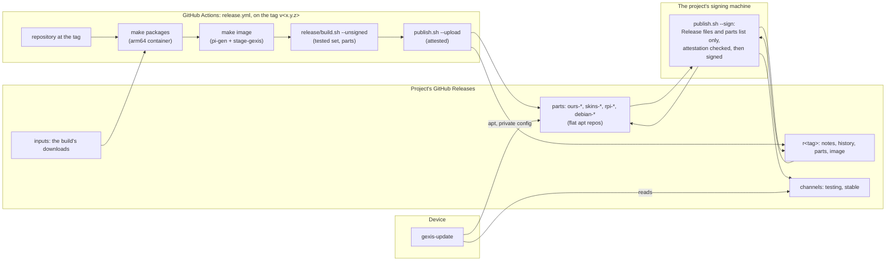
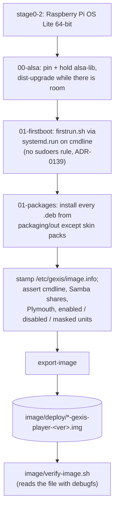
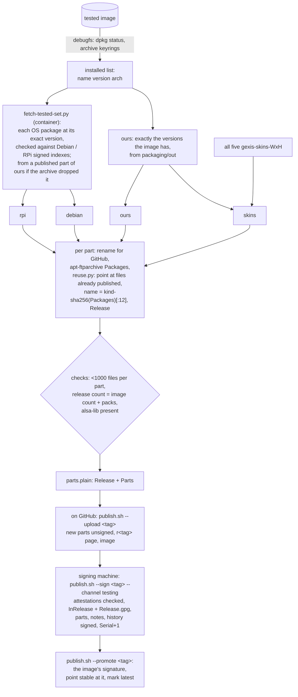
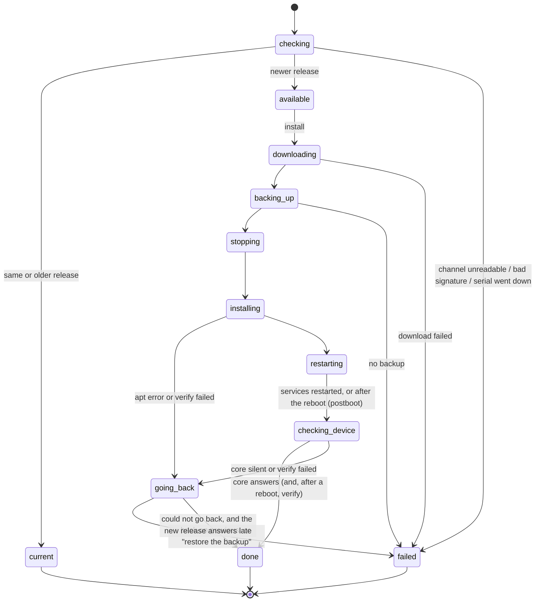

# Updates, releases and the image

How Gexis Player's software reaches a device: as Debian packages, built on
GitHub's arm64 machines from the release's tag, published as signed apt
repositories on the project's GitHub Releases - signed on one machine of
the project's, never on GitHub - found through a signed channel file, and
installed by a standalone updater that can put the previous release back. The
flashable image is built from the same packages, in the same run.

Decisions: ADR-0021 (flashable image), ADR-0042 (download cache), ADR-0100
(fetched software), ADR-0105 (updates over the network), ADR-0106 (plugins),
ADR-0107 (packages), ADR-0108 (publishing), ADR-0110 (the update experience),
ADR-0111 / ADR-0113 (skin packs), ADR-0116 (change logs), ADR-0173 (releases
built on GitHub).

---

## 1. The big picture



Three ideas carry the design:

- **A release is exactly what was tested** (ADR-0105 §3). The release package
  `gexis-player` depends on exact versions of every one of our packages and of
  alsa-lib, and the release carries every OS package the tested image had, at
  that image's versions. An update moves a device onto that set, nothing newer.
- **Everything is signed by one release key** (the public half is
  `packaging/keys/gexis-release.asc`, shipped by `gexis-core` to
  `/usr/share/gexis/keys/`). The channel file, each part's `InRelease`, a
  release's `parts` file and its notes are all verified on the device with
  `gpgv` before being believed. The key is on one machine of the project's
  (ADR-0105) and never on GitHub: what GitHub builds is installed by no
  device until that machine has signed it (ADR-0173).
- **The updater outlives what it installs.** It is a standalone script on the
  system Python and standard library, run by its own systemd units, never by
  the core (an install restarts the core).

---

## 2. Our parts as Debian packages (ADR-0107)

`packaging/build.sh [package ...]` builds into `packaging/out/`, one
`packaging/<name>/build.sh` per package, each run inside the
`gexis-deb-builder` container (`packaging/builder.Dockerfile`, arm64 Debian
trixie under qemu; rebuilt when the Dockerfile's hash changes). `make packages`
builds the UI first (`npm ci && npm run build`) and then all packages.

| Package | Carries |
|---|---|
| `gexis-core` | the core in its own venv at `/opt/gexis-core/venv`, its units, built-in plugin manifests, **the updater** (`/usr/lib/gexis/gexis-update`) and its four units (`gexis-update-check.service`, `gexis-update-check.timer`, `gexis-update-checknow.service`, `gexis-update-install.service`), the release key |
| `gexis-ui` | the built Svelte pages |
| `gexis-wallpapers` | the player's own pictures (`wallpapers/` in the repository) at `/usr/share/gexis/wallpapers/<set>/`, with `credits.json` - every picture's author, licence and source, which the screens draw from (ADR-0133). The build refuses a picture without a credit |
| `gexis-system` | our units, ALSA files, kiosk, splash, Samba/Avahi files, the Peppy driver - built from `image/stage-gexis/*/files`. Files the player rewrites are placed once. PeppyMeter's config comes with each version, but its preinst keeps the device's copy and postinst puts back the five keys the core writes (the pack, the screen size, the needle's smoothing), so an upgrade never resets the visualiser (ADR-0107 amended 2026-10-18) |
| `gexis-peppyalsa`, `gexis-peppy-engines` | the meter tap library; PeppyMeter/PeppySpectrum |
| `gexis-go-librespot`, `gexis-camilladsp` | upstream binaries, as built upstream (ADR-0093; CamillaDSP for the equaliser, ADR-0162) |
| `gexis-squeezelite` | Lyrion's player: the commit Debian trixie packages, built with Debian's options and our patch that folds multichannel files down to stereo (ADR-0145); `Provides`/`Conflicts`/`Replaces: squeezelite`, Debian's package, which a device updated from an earlier release has removed |
| `gexis-lyrion-server` | a plugin; the Lyrion server itself is *not* inside (see §7) |
| `gexis-skins-<W>x<H>` | one visualiser skin pack per screen size (ADR-0111); never in the image. Until one is installed, `gexis-peppy` exits cleanly saying so, and the core restarts it once the pack is in (2026-10-09). `gexis-update pack-install` fetches it at 3 MB/s (apt's `Dl-Limit`) while the player is in use - a card playing, or go-librespot, BlueALSA or BlueZ active in the last 10 min - and restarts apt at the other speed when that changes, resuming the partial file (ADR-0111 amended 2026-10-07) |
| `gexis-player` | **the release**: exact `Depends` on all of the above (skins excepted), on `libasound2t64`, and the OS packages the device runs |

**Versioning.** A package's version is the `git describe` of the *last commit
that changed its inputs* (`inputs()` in `packaging/build.sh`), rewritten as
`0.9.1+git42.ba6900a`. Third-party components carry upstream's version, plus
our commit when the package also carries our files. `gexis-player` is the
repository as a whole; a published release is built from a `v<x.y.z>` tag, so
its version is plain `x.y.z` (ADR-0110 §1). A dirty tree appends `.dirty`.

**Reproducible.** `SOURCE_DATE_EPOCH` is the commit time of the package's
inputs, so an unchanged package rebuilds byte-identical. That is what lets
publishing skip files already uploaded. Skin packs and `gexis-wallpapers` are
additionally reused from a local cache (`~/.cache/gexis-player/debs`) when
their version is unchanged.

**alsa-lib is pinned.** The image installs and holds
`libasound2t64=1.2.14-1+rpt1+deb13u1` (`image/stage-gexis/00-alsa`), and
`gexis-player` depends on that exact version, so apt cannot move it without
removing the release. The updater checks it again after installing.

---

## 3. The image (ADR-0021, ADR-0042)

`make image` = `packages` + `skins` (corpus validation) + `check-skins` (every
skin of every pack drawn whole, and again after a lost frame, headless with
the shipped driver and engine - `packaging/skin-packs/check.sh`, Docker, about
a minute; Finding 131) + `prune` +
`fresh-stage-gexis`, then pi-gen's own `build-docker.sh`, unmodified, with
`image/config` (stages 0-2 plus `stage-gexis`, no cloud-init, uncompressed
output). The repository's `image/stage-gexis`, `packaging/out` and the download
cache are bind-mounted in. Warm builds reuse the preserved `pigen_work`
container (`CONTINUE=1 PRESERVE_CONTAINER=1`); see `image/README.md` for host
prerequisites and disk housekeeping.



- Most `stage-gexis/NN-*/files` directories are no longer installed by the
  stage; they are inputs to `gexis-system` and friends. The stage scripts that
  remain install packages and **assert** the result, failing the build rather
  than a flashed card.
- **Vendored downloads** go through `image/stage-gexis/fetch-cached.sh`:
  `fetch_cached <url> <sha256> <dest>` looks in a content-addressed cache
  first (the file is named by its checksum), verifies on the way in and out,
  and works with no cache at all (ADR-0042). Another project's source pinned
  by commit is GitHub's archive of that commit, through the same cache
  (`packaging/fetch-source.sh`), checked by commit, date and a sha256 of its
  files.
- **The `inputs` mirror** (ADR-0173): a pre-release holding every download
  under its sha256, as `packaging/inputs.tsv` lists them with their licences.
  `packaging/inputs.sh fill <cache>` fills a build's empty cache from it;
  `unlisted <cache>` fails a release build that downloaded anything the list
  lacks; `publish` uploads what the mirror lacks. A download not yet in the
  mirror comes from upstream.
- **On GitHub every image is built cold**, on `ubuntu-24.04-arm` without
  qemu: about 7 minutes for the image, 19 for the whole release with the
  published skin packs reused (Finding 140).
- **`image/verify-image.sh `** checks the artefact before anyone flashes
  it: it reads the root partition with `debugfs` (no root, no loop device) and
  compares files byte for byte with the checkout - units, kiosk, Peppy driver,
  the venv against `core/src`, the UI against `ui/dist` - plus enabled units,
  no skin pack installed, plugins shipped off, licences present, and the ALSA
  default.
- **`image/provision.sh <device>`** (`make provision`) prepares a flashed card
  for development: it mounts the boot partition and writes values from the
  git-ignored `image/provision.local.env` (SSH key, optional Wi-Fi, hostname,
  timezone, initial settings JSON) into `firstrun.sh`, shell-escaped. A card
  shipped to a user is not provisioned; it uses the setup access point
  (`setup-and-network.md`).

---

## 4. Building and publishing a release (ADR-0108)

A release is built **from the image it was tested as**, not from a package
list. `packaging/release/build.sh <image.img>` refuses to run if the image's
`gexis-player` differs from the one in `packaging/out`. **Since 1.12.1 it is
built on GitHub** (ADR-0173) by `.github/workflows/release.yml`, in one run
with the packages and the image, and signed on the signing machine.

### The steps, in order

1. **Notes** into `core/src/gexis_core/release_notes.json` (New / Fixed / Good
   to know, impersonal, no restart promises), approved by George; then
   `python -m gexis_core.changelog ../CHANGELOG.md` from `core/`. Commit
   "Release notes: X (approved by George)" on `next` (the release branch) and tag `vX`.
2. **Build, on GitHub**: pushing the tag runs `release.yml` (about 20
   minutes). Its *Packages and image* job, with read access only:
   - fills the download cache from the `inputs` mirror;
   - proves every published part's index with the release key
     (`packaging/release/published.py`) and takes the last release's skin
     packs and wallpapers;
   - runs `make packages` and `make image`, then `image/verify-image.sh` from
     the same checkout;
   - fails on a download `packaging/inputs.tsv` does not list;
   - builds the parts with `packaging/release/build.sh <image> --unsigned`
     and compresses the image.

   Its *Upload, unsigned* job, the only one that may write, attests the
   Release files, the parts list and the image (`actions/attest-build-provenance`)
   and runs `publish.sh --upload rX`: the new parts' packages and indexes, the
   release page with its notes and a link to the run, the image with its
   checksum and package list. Nothing is installable yet: no part has an
   `InRelease`.
3. **Sign, on the signing machine**: `packaging/release/publish.sh --sign rX
   --channel testing` downloads only what it signs - each new part's `Release`
   and `Packages`, the parts list - checks each with `gh attestation verify`
   (this workflow, this tag), signs them (`packaging/release/sign.sh`), signs
   the notes and the history, uploads the signatures and moves the channel.
   Read the channel file back from GitHub and verify it with the release key
   (serial, release).
3a. **The API's page on GitHub** (ADR-0152) is built by
   `.github/workflows/api-docs.yml` when the tag `vX` is pushed, from the
   `openapi.json` the release ships, with the release's number and trying
   switched off. Before the first one, GitHub Pages is switched on for the
   repository with *GitHub Actions* as its source (Settings → Pages, or
   `gh api -X POST repos/<owner>/<repo>/pages -f build_type=workflow`).
4. **PR**: push the tag and a `release-X` branch at the tagged commit; open
   one PR into `main` with the approved notes and what was checked. **George
   merges it**, never Claude. `main`'s ruleset (2026-10-18) takes changes only
   through a pull request, never a force-push, and only once both checks of
   `.github/workflows/tests.yml` pass: *Core tests* (Python 3.13, the
   player's) and *UI build*. They run on every push to any branch, so a
   release branch shows its result before the PR is opened. GitHub deletes
   the PR's branch when it is merged.
5. **After the merge**: merge `origin/main` into `docs` and `next`, delete
   `release-X` **on GitHub and locally** (`git push origin --delete
   release-X`; seven release branches were left on GitHub until 2026-10-18),
   then the routine clean-up (`docs/ROUTINE-CLEANUP.md`).
6. **Promotion to Stable** (when George says): `publish.sh --promote rX`
   downloads the release's `gexis-player.img.xz`, checks it against its
   checksum and its attestation, attaches its signature, points `stable` at
   the release and marks it GitHub's latest. Then **README's
   *Download and install* section** (George, 2026-10-12: *"a section on the
   overview page in GitHub pointing to the IMG file download with a brief
   installation instruction"*):
   - at the **first** Stable release it goes into that release's PR (step 4),
     replacing the *"Testing releases are out"* note, from the text below -
     README reaches `main` only with a release PR, and the link works only
     once a release is promoted;
   - at **every** promotion, check it still names the right version and
     that `releases/latest/download/gexis-player.img.xz` downloads (and its
     `.sha256` matches) - before telling anyone it is out;
   - the image is about 1.1 GB compressed (0.10.2, 2026-10-12), under GitHub's
     2 GB limit per file; check the size if the image grows.

The section, to paste and fill in:

```markdown
## 💾 Download and install

**Gexis Player X** is the current release. You need a Raspberry Pi 4 and a
microSD card of 32 GB or more. A DAC gives the best sound (the
[hardware list](docs/HARDWARE.md) says which are tested), but the Pi's own
HDMI (to a sound bar or AV receiver) or headphone jack works too; an HDMI
touch screen from the hardware list is optional.

1. **Download** [gexis-player.img.xz](https://github.com/gcarstoiu/gexis-player/releases/latest/download/gexis-player.img.xz)
   ([checksum](https://github.com/gcarstoiu/gexis-player/releases/latest/download/gexis-player.img.xz.sha256),
   [signature](https://github.com/gcarstoiu/gexis-player/releases/latest/download/gexis-player.img.xz.asc)).
2. **Write it to the card** with [Raspberry Pi Imager](https://www.raspberrypi.com/software/):
   choose *Use custom* at the bottom of the operating systems and pick the file.
3. **Start the Pi** with the card in, and the DAC and screen if you use them.
   The screen shows two QR codes: the first joins your phone to the player's
   own Wi-Fi, **gexis-setup**, the second opens the setup page. Without a screen, join
   **gexis-setup** (password `gexis-setup`) and open http://10.42.0.1:8090.
   Setup takes a few minutes.

Updates arrive over the network from then on; you never need to flash again.
The [installation guide](docs/INSTALL.md) has every step in detail.
```

**Previews** are built by the same workflow by hand: *Run workflow* with a
branch and *kind: preview* (`gh workflow run release.yml -f ref=<branch> -f
kind=preview`) builds that branch's packages only; `gh run download <run>
--name packages` brings them to the machine that installs them on a test
player over SSH. *kind: release* builds the whole release without uploading
it.

**Built locally instead** (GitHub unavailable): the same scripts still work on
an arm64 or qemu machine - a worktree at the tag, `make image`,
`image/verify-image.sh` from that worktree, `packaging/release/build.sh
<image>` (which signs, when the key is there) and `publish.sh rX --channel
testing`, with every download listed in `packaging/inputs.tsv` in the cache
or upstream.

Three things that have each cost a build:

- **A local release worktree needs `git submodule update --init`** before
  `make image`: pi-gen is a submodule, and a fresh worktree has it empty.
- **Raising a pinned binary raises the image check's checksums too**:
  `image/verify-image.sh` holds the tested binary's SHA-256 beside its pin
  (CamillaDSP's; Beszel's until ADR-0174 - 0.9.5's first image check failed
  on exactly that, with the right binaries in the image).
- **`python -m gexis_core.changelog` writes `CHANGELOG.md` in the current
  directory**: run it from the repository root, or pass the path.



**Parts, named by content.** A release is four flat apt repositories, each its
own GitHub release: `ours`, `skins`, `rpi` (Raspberry Pi archive's share of the
tested set) and `debian`. A part's name is `<kind>-<first 12 hex of its
Packages' sha256>`, which is also its apt suite. Unchanged parts already exist
on GitHub and are not uploaded again - except the indexes of a part not yet
signed, which each upload replaces: its `Release` is dated, so one left by a
tag that was never signed would not carry the next tag's attestation, and
`--sign` checks that. `packaging/release/reuse.py` goes further:
a file any published part already holds byte-for-byte is referenced from there
(`Filename: ../<other-part>/<file>`), so each file is uploaded once, ever. "The
same bytes" is proven by the holding part's own index, itself proven by its
`InRelease` (`published.py`), so no earlier release has to be on the building
machine. A skin pack rebuilt at a published version is replaced by the
published file (`published.py prefer`): one name and version, one content.

**The release page** `r<version>` (with `+` spelled `-`) holds:

- `parts` - clearsigned `Release:` and `Parts:`; this is how a later updater
  finds the release to go *back* to;
- `notes` - clearsigned release notes, taken from the tagged commit's
  `core/src/gexis_core/release_notes.json` (ADR-0116; the same text appears in
  Settings → Change logs and `CHANGELOG.md`). `publish.sh` refuses notes
  without the *New / Fixed / Good to know* sections, or notes that promise a
  restart or its absence (ADR-0110);
- `history` - every release's notes from the same tagged file, clearsigned as
  JSON; the updater keeps the releases newer than the installed one, up to
  the waiting one, as `whats_new_all`, so a device several releases behind
  shows each one it skips (ADR-0110 amended 2026-10-07). A release without
  one, or one that does not verify, falls back to `notes`;
- `gexis-player.img.xz` with its checksum and package list
  (`gexis-player.info`), uploaded by the build, and once promoted to stable
  its signature;
- `parts.plain` and `build.txt` (the run and commit that built it), attested.

**Channels.** A permanent release named `channels` holds two clearsigned files,
`testing` and `stable`:

```
Channel: testing
Format: 2
Serial: <n>
Date: <UTC>
Release: 0.9.2
Repositories: ours-… skins-… rpi-… debian-…
Notes: <release page URL>
```

`Serial` only increases; the device refuses a file whose serial went down
(rollback attack). The device keeps the serial it last accepted in a file
written beside and renamed, so a cut mid-write leaves the one before; a file
that does not read as a number counts as 0 (`seen_serial()`). `publish.sh`
starts a channel's serial at 1 only when the channel file truly does not
exist: a fetch that fails any other way (a 5xx, the rate limit, no network)
stops it before anything is signed or uploaded, and a 404 is believed only
when GitHub's API, answering (retried, never taken from a failed call), lists
no such file in the `channels` release. It also never goes below the serial
it last gave the channel, kept in `packaging/release/out/serials/<channel>`:
a file an upload cut short left missing, or an older one GitHub still
serves, continues from there. `Format` lets a newer publishing layout tell an older
updater to reflash rather than fail with a 404. A release goes to Testing
first and keeps its number when promoted to Stable.

**Pacing.** `publish.sh` uploads ten files then pauses, and waits minutes on a
refusal, to stay inside GitHub's secondary rate limits. It refuses a
`gexis-player` version that is not a plain `x.y.z`, and a file name GitHub
would rewrite (`~` becomes `.`; `build.sh` renames such packages before
indexing).

---

## 5. The updater on the device

`/usr/lib/gexis/gexis-update` (`core/updater/gexis-update`), as root:

| Command | Run by | Does |
|---|---|---|
| `check` | `gexis-update-checknow.service`, from Settings' *Check for updates* | read and verify the channel, compare with the installed `gexis-player`, write `available` / `current`; installs no new release (a release found cut short is handed to the install unit to finish, below) |
| `install` | `gexis-update-install.service` via the update modal, or a check handing over a repair | check, then the six steps below; only the repair when a check asked for it (`repair-requested`, below) |
| `scheduled` | `gexis-update-check.service`, from its timer (03:00, up to 1 h random delay, persistent) | check; install only if *Updates* is Automatic, nothing is playing (`/proc/asound/card*/pcm*p/sub*/status` RUNNING), and this release has not already failed here |
| `pack-install` / `pack-remove <pkg>` | the core, for skin packs (§6) | install or remove one `gexis-skins-<W>x<H>` |

*Check for updates* runs `check` through its own unit. Until 2026-10-06 it
started the nightly unit, whose `scheduled` run went on to install on a device
set to Automatic with nothing playing; fixed after 0.9.2. **One writer of
`status.json` at a time** (`hold_status()`, a `flock` on `status.lock`): an
install, the nightly run and the boot's check hold it while they run, and a
`check` that finds it held leaves the status alone and ends, so it cannot
write `available` over an install in progress.

The channel is the `update_channel` setting (Stable unless set to Testing),
read straight from the core's SQLite store, read-only. Leaving Testing for
Stable never downgrades: a channel naming an older release is ignored until it
passes the device.

**Private apt.** The updater never touches `/etc/apt`. `apt_env()` writes a
`sources.list` naming only the release's parts (each `signed-by` the release
key), with lists per release under `/var/lib/gexis/updates/apt/<hash>/` and one
shared archive cache. For going back it adds `Pin-Priority: 1001` on the old
release's suites so apt prefers them even over newer versions. When an update
or a skin pack ends well, `prune_cache()` deletes every archive in that cache
except the installed versions (what the next update goes back to) and
half-fetched files; nothing is pruned while a boot still has an update to
check, or when dpkg cannot say what is installed.

**One apt at a time.** An update and a skin pack share the archive cache; a
`flock` on `apt-turn.lock` makes the second wait (up to an hour) and say so,
instead of failing on apt's lock.

### The steps

`STEPS = download, backup, stop, install, restart, check`. Each is `pending`,
`active`, `done` or `failed`, all listed from the start (ADR-0110 §3).

At the start of `install`, before the first step, the updater reads the
*installed* release's signed `parts` file, which names what to go back to. If
it cannot be fetched, the release's legacy names (`<tag>` and `<tag>-debian`)
stand in and the update continues; a `parts` file not signed by the release
key, or for another release, stops the update.

1. **download** - `apt-get update` on the new parts; simulate to plan the
   changes; `--download-only` everything. Then pre-download, from the
   installed release, the current versions of every package that will change
   or be removed (a release that conflicts with one the old release depends
   on), so going back needs no network. If those repositories can't be read,
   or a package can't be fetched from them, the update continues and says
   going back won't be possible.
2. **backup** - `POST /settings/backup?before=update` on the core, then wait
   up to 120 s for a new `.tgz` in `/var/lib/gexis-core/backups/` (ADR-0083).
   No backup, no update. The core names it
   `gexis-<name>.before-update-<stamp>.tgz` (`backups.AUTOMATIC_MARK`) and,
   once it is written, deletes the update backups beyond the newest three
   (`backups.KEEP_AUTOMATIC`, `prune_automatic()`); a backup made by hand,
   copied into the share, or made before 2026-10-12 has no mark and is never
   deleted. *Restore* lists these with `· before an update`.
3. **stop** - `POST /renderers/park?stop=all`: the core pauses or disconnects
   every source, the same path as shutdown; nothing resumes afterwards
   (ADR-0110 §4). Failure to reach the core is logged, not fatal. From here
   until the update ends the core refuses every takeover and releases the
   source that asked (`Supervisor(frozen=...)`, the states `stopping` to
   `going-back`; ADR-0105 §4 step 4, built 2026-10-07).
4. **install** - first `pending-check.json` (below) is written with
   `how: cut-short` and synced to the card (file and folder: an unsynced
   one was empty after a real power cut, Finding 123), so a boot after a
   power cut mid-install finds it; then
   `apt-get --no-download dist-upgrade`, then `install
   gexis-player=<version>`, under `systemd-inhibit --what=shutdown:sleep`.
   Then **verify**: `gexis-player` is the target version, `dpkg --audit` is
   clean, and `libasound2t64` matches the release's pinned dependency.
5. **restart** - a reboot if a kernel/firmware/libc/systemd/initramfs package
   changed (or a reboot marker exists): the updater first writes
   `/var/lib/gexis/updates/pending-check.json` (the release, what to go back
   to, the steps so far) and reports `restarting` with the restart step
   active; after the boot `gexis-update-postboot.service` (after the core;
   only when that file exists) runs `gexis-update postboot`, which does step 6
   and goes back on failure, once. When the file says the install was cut
   short, or dpkg is not clean, postboot first finishes the install from the
   new release's repositories (`heal()`); what cannot be finished goes back
   to the previous release like any other failure, and what is finished is
   verified and **the device restarts** (Finding 125 #6), the note left again
   with `how: reboot` and any reboot marker cleared, so that every service
   runs what is now installed and the boot after does step 6. Otherwise `systemctl try-restart` every
   `.service` the changed packages ship, except the updater's own units
   (`gexis-update-install`, `gexis-update-check`, `gexis-update-checknow`,
   `gexis-update-postboot`) and
   `gexis-park.service`.
6. **check** - the core answers `GET /settings` within 120 s (after a reboot,
   also `verify`). A core that does not answer is a failure: the updater goes
   back.



**An install cut short is finished first** (`heal()`, ADR-0110 as amended
2026-10-09). After `apt update`, both an update and a skin pack check dpkg:
a non-empty `/var/lib/dpkg/updates` or anything `dpkg --audit` lists means an
earlier run was cut short (a power cut, on ShelvesPi). The updater runs
`dpkg --configure -a`, installs again the packages `dpkg --audit` says must
be reinstalled (half installed, in a mess, missing a control file - not those
only waiting to be configured) and configures again - or, for a skin pack
whose exact version is no longer published, removes it so it is installed
fresh - and only then goes on; if dpkg is still not clean it stops
with a sentence saying so, rather than the download error apt's refusal used
to be shown as. Before every `apt update` it also drops empty package lists
in its own apt folders (`drop_empty_lists()`): a power cut can leave them at
0 bytes, and apt would otherwise keep them for good.

**A cut-short install with no note is finished too** (`finish_cut_short()`,
Finding 123). At boot when `pending-check.json` is missing or unreadable, and
at the start of every check unless dpkg's lock is held, dpkg's own record
decides: the release is the `gexis-player` it unpacked, finished from that
release's parts (`heal`, then the release's `dist-upgrade` and `install
gexis-player=<version>`, `complete_release()`), verified, a note left, and
the device restarted for `postboot` to check it. Without this, a check
compared `gexis-player`'s unpacked version and called the device current.

Where it is finished depends on who found it (Finding 125 #3, #16,
2026-10-14):

- **A skin pack alone cut short** is not a release cut short: the check
  says so and goes on reading the channel, and the pack path's own `heal`
  (or the next install's) finishes it. Every check used to reinstall the
  release already there and restart the device for it.
- ***Check for updates*** does not repair inside its own unit, which
  systemd stops after 300 s. It writes `repair-requested` (synced, beside
  `pending-check.json`) and starts `gexis-update-install.service`, whose
  `install` takes the request and runs the repair and nothing else: no
  channel read, no newer release. There it runs as an install does -
  playback stopped, every apt and dpkg run under `systemd-inhibit`, the
  panel's lock up while the unit runs. A request older than 15 min
  (`REPAIR_REQUEST_S`) counts for nothing and is removed, so a later real
  install is never turned into a repair only. While something plays, the
  check repairs nothing and reports `failed` with *An earlier install was
  cut short. It is finished once nothing is playing: at night, or by Check
  for updates.*
- **The nightly run** repairs in its own unit, but only while nothing plays,
  in any update mode.

**The backup's failure mark is read without following a link**
(`backup_failure()`, Finding 125 #2): `.before-update-failed` sits in the
Backups share, which `pi` can write, so it is opened with `O_NOFOLLOW` (and
`O_NONBLOCK`, so a pipe there cannot hang the update) and counts only when
it is a plain file written since the backup was asked for.

**Going back** (`go_back()`) follows any failure from the install step on -
the install, its verify, the core not answering after the restart, or the
check after a reboot. The updater runs `dist-upgrade --allow-downgrades`
against the previous release's parts (pinned), then `dpkg --configure -a`,
records `failed-<channel>` so the nightly run won't retry that release,
reports whether the device is back on the previous version or the backup must
be restored, and - when the new release had already been restarted -
restarts what changed again, or reboots when that is what lands it. A boot
after going back is not checked again. **Late, not broken** (the review of
1.16.1): where going back could not be done (its packages could not be
fetched) after the restart, the release that went in is checked again -
`verify` and another minute for the core - and, whole and answering, it
stays and the update counts as done. **Only an updater with this code does
it** (built 2026-10-07): it protects updates made from that release on. Once *Update* is pressed there is no
cancel (ADR-0110 §5).

### Progress

Every step writes `/var/lib/gexis/updates/status.json` atomically: `state`,
`at`, `steps`, `progress` (0-1), release, previous, notes, message. Progress
comes from apt's `APT::Status-Fd`: `dlstatus` lines while downloading,
`pmstatus` while installing. For the install bar, `DpkgShare` weights each
package by its archive size and creeps forward between dpkg actions (never
past the next one), with a ticker reporting every half second so a long unpack
doesn't freeze the bar. `apt-listchanges` is disabled because it alone stalled
the start for seconds.

### End to end

```mermaid
sequenceDiagram
    actor User
    participant UI as Settings / UpdateModal
    participant Core as gexis-core
    participant Sd as systemd
    participant Upd as gexis-update
    participant GH as GitHub Releases

    User->>UI: Check for updates
    UI->>Core: POST /settings/update_check
    Core->>Sd: start --no-block gexis-update-checknow.service
    Sd->>Upd: check (installs no release)
    Upd->>GH: channels/<channel> (gpgv)
    Upd->>GH: r<tag>/notes, r<tag>/history (gpgv)
    Upd-->>Core: status.json: available
    Core-->>UI: /state update {state: available, whats_new, whats_new_all}
    User->>UI: Update (confirms playback stops)
    UI->>Core: POST /settings/update_install
    Core->>Sd: start --no-block gexis-update-install.service
    Sd->>Upd: install
    Upd->>GH: apt update + download new parts
    Upd->>GH: old release's parts file, download old versions
    Upd->>Core: POST /settings/backup?before=update
    Upd->>Core: POST /renderers/park?stop=all
    Upd->>Upd: apt install (inhibit shutdown), verify
    Upd->>Sd: try-restart changed units (core included) or reboot
    Note over Core,UI: socket drops; panel stays locked
    Core->>Core: restarts, reads status.json at start
    Upd->>Core: GET /settings (health check)
    Upd-->>Core: status.json: done
    Core-->>UI: /state update {state: done, steps all done}
    User->>UI: Done (page reloads if its own files changed)
```

### How the core and UI show it

`core/src/gexis_core/updates.py` never runs the updater in-process. It starts
the units (`systemctl start --no-block`) and reads `status.json`:

- `_follow_updates()` in `__main__.py` polls every 3 s (1 s during an install)
  and publishes `update` on `/state`: installed, state, release, previous,
  `attempted` (the release a failed install was trying), steps, progress,
  notes (`whats_new`, and `whats_new_all` for every release skipped),
  message, reboot, `at` (when the status was written), and **`active`** - true only while
  the state is an installing one *and* an installing unit is actually running
  (the install unit, the boot's check, or the nightly
  `gexis-update-check.service`, `updates.SCHEDULED_UNIT`, since 2026-10-12), so
  a killed updater cannot lock the panel forever.
- Settings rows: *Release* (`0.9.2 · Testing`, read-only) and the *Software
  update* tile (one sentence from `updates.sentence()`, its button opening the
  modal). `update_check` / `update_install` are non-surfaced action rows; the
  `updates` (Manual/Automatic) and `update_channel` choices are read by the
  updater itself.
- `ui/src/screens/UpdateModal.svelte`: checking → answer (with notes) →
  confirm if playing → progress (`UpdateSteps`) → end. Closing it on a phone
  leaves the update running. *Check for updates* opened while `update.active`
  sends no check (the updater would leave it unanswered behind `status.lock`):
  it goes straight to the install's progress, saying *"An update is being
  installed. Check for updates again once it has finished."*, and so does a
  check during which an install starts (George, 2026-10-12).
- `ui/src/App.svelte`: from *Update* tapped on the panel (`updateAsked`),
  and while `update.active`, the panel shows `UpdateScreen` over everything (Peppy hidden), stays up through the core's restart and
  reconnect, then holds the outcome until *Done* (10 min limit; 6 s for a
  failure) and reloads if the installed release changed.
- Settings that move with the code: `settings_migrations.py` runs ordered,
  never-edited migrations at core start; tests fail if a shipped key vanishes
  without one (ADR-0105 §5).

---

## 6. Skin packs (ADR-0111, ADR-0113)

Visualiser skins ship as one `gexis-skins-<W>x<H>` package per screen size
(1920x1080, 1280x800, 1280x400, 1480x320, 800x480). The image has none; every
release carries all five in its `skins` part.

The core (`skin_packs.py`, `_skins_ensure()` in `__main__.py`) decides which
pack the screen wants - its exact size, else the largest that fits in the same
family (Standard or Bar), else the largest that fits in any family - and, when the *Visualiser skins* switch is on, runs
`gexis-update pack-install <pkg>`, then removes packs for other sizes. The
updater installs from the installed release's parts, falling back to the
channel's release (and then Testing's) for a build that was never published, and reports to
`/var/lib/gexis/updates/pack.json`. A failed download is retried every five
minutes. A device that still has the old single `gexis-skins` keeps it as its
1280x800 pack (`apt-mark manual` stops autoremove taking it).

---

## 7. Software we may not ship, and plugins

**Fetched on the device (ADR-0100).** The Lyrion server and Roon Bridge are
not redistributable, so their packages carry a *pin* instead:
`/usr/share/gexis/components/<name>.env` with URL, SHA256, format, destination,
owner and a label. When the user switches the plugin on,
`gexis-fetch@<name>.service` runs `gexis-fetch-component`, which downloads
from the maker, verifies the checksum, unpacks, records the installed
checksum, and writes progress to `/run/gexis/components/<name>.json`
(`components.py` turns that into the row under the plugin's switch). A later
start with the same pin is a comparison, not a download. A new pin arrives in
a release and is fetched on the next start.

`packaging/check-upstream.sh` is run before each release: it reads each
maker's own "latest" feed and reports which pins are behind (exit 1) or
unreadable (exit 2). It changes nothing; a new version is tried on a device
before its pin moves.

**Our plugins** (Lyrion server, AirPlay, Roon) update **with the
release** - one catalogue, one Updates screen (ADR-0106). Plexamp, and
Beszel's agent and hub, are catalogue plugins since ADR-0174
(`gcarstoiu/gexis-plexamp`, `gcarstoiu/gexis-beszel`): the release that
dropped their packages (`gexis-player` *conflicts* with them) carries a
player that used them over at its next start (`carry_over.py`) - their old
units stopped, their data moved into the plugins' own folders (Plexamp's
store, its claim record, and its software with the stamp of its pin, so the
same version is not fetched again), recorded for the catalogue's install,
switched on again. It is carried once: its id leaves `_plugins_added`, so a
plugin removed afterwards stays removed. Plexamp's plugin downloads Plexamp
itself, from the pin in its archive, into its own folder, and reports it with
the contract's `software` messages; a new Plexamp is a new plugin version.

**Uploaded plugins** (ADR-0106, `core/src/gexis_core/uploads.py`) bypass the
release entirely: a `.tar.gz` with `plugin.json` (plus `version` and `run`),
checked before anything is written (manifest, unique id, no path escapes,
no path twice with different contents, none inside a link, aarch64
executable, size limits of 200 MB packed / 600 MB unpacked), unpacked into
`/var/lib/gexis/plugins/<id>/<version>/` - refused unless the manifest
unpacked is the one checked - with `current` pointing at it and the previous
version kept, and run under the sandboxed template
`gexis-uploaded-<kind>@<id>.service`. Uploading a newer version updates it.

**Plugins from the catalogue** (ADR-0168) reach a player without a release
too, but only as versions someone has read. `gcarstoiu/gexis-plugins` lists
each version with its download URL, size and sha256; a pull request adding
one is checked there (the player's own upload check runs on the archive) and
read before it is merged. `tools/publish.sh` in that repository then signs
`catalogue.json` with the catalogue key - its own, not the release key - and
puts it on the release `index`, with a serial one past the last. The player
verifies it as it does a channel file, installs a version as an upload, and
offers a newer listed version on the plugin's row; nothing updates by
itself.

---

## 8. What still needs a reflash

A new Debian release, a new partition layout or boot mechanism (ADR-0105 §7).
There are no A/B partitions: a power cut during the install step can leave a
card that does not boot; the fallback is reflash and restore a backup
(ADR-0105 §4, decided). A card that does boot after such a cut finishes the
install, or goes back to the previous release, in `postboot` (§5, step 5;
ADR-0105 amended 2026-10-12).

## Key files

| Path | Role |
|---|---|
| `core/updater/gexis-update`, `core/updater/units/` | the updater and its timer/services |
| `core/src/gexis_core/updates.py` | the core's read of updater status; starting units |
| `core/src/gexis_core/settings_migrations.py` | settings migrations |
| `core/src/gexis_core/skin_packs.py` | which pack a screen gets |
| `core/src/gexis_core/components.py`, `image/stage-gexis/03-core/files/gexis-fetch-component` | fetched software |
| `ui/src/screens/UpdateModal.svelte`, `UpdateScreen.svelte`, `UpdateSteps.svelte` | update UI |
| `packaging/build.sh`, `packaging/<pkg>/build.sh`, `packaging/builder.Dockerfile` | package builds |
| `packaging/release/{build.sh,publish.sh,sign.sh,fetch-tested-set.py,reuse.py,published.py}` | release build, signing and publishing |
| `.github/workflows/release.yml` | the release built on GitHub (ADR-0173), and previews |
| `packaging/inputs.tsv`, `packaging/inputs.sh`, `packaging/fetch-source.sh` | the build's downloads, their mirror and pinned source archives |
| `packaging/check-upstream.sh` | pin freshness |
| `Makefile`, `image/config`, `image/stage-gexis/`, `image/verify-image.sh`, `image/provision.sh` | image build, verification, dev provisioning |
